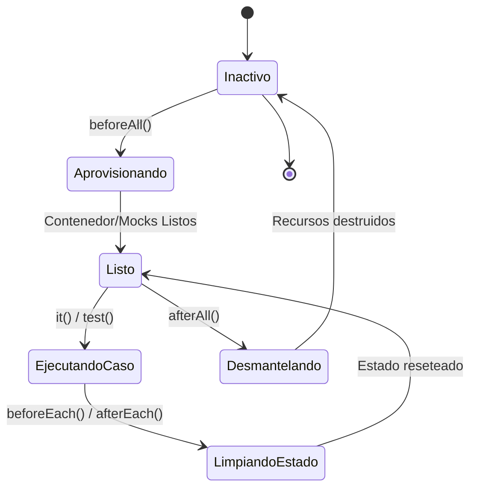

# Data Model & Conceptual Entities: Testing Profiles

**Feature**: `007-standardize-testing-profiles`  
**Date**: 2026-10-13  
**Status**: Completed  

---

## Entidades Conceptuales del Dominio de Testing

Aunque este feature se enfoca en infraestructura de calidad y configuración de pipelines, modela formalmente las siguientes entidades y estructuras de configuración en el sistema:

### 1. Perfil de Prueba (`TestingProfile`)

Representa una categoría homogénea de pruebas automatizadas con límites arquitectónicos, dependencias y metas de tiempo estrictamente delimitadas.

| Campo | Tipo | Descripción | Reglas de Validación |
|---|---|---|---|
| `id` | `string` | Identificador del perfil (`unit`, `integration`, `e2e`) | Enumeración fija: `['unit', 'integration', 'e2e']` |
| `nombre` | `string` | Nombre legible del perfil | No vacío. Ej: "Unitario", "Integración", "End-to-End" |
| `alcance` | `string` | Capas y componentes del sistema bajo prueba | Según principios I y III de la Constitución |
| `tiempoMaximo` | `number` (segundos) | Límite de tiempo esperado para la suite completa | `unit` <= 15s; `integration` <= 60s; `e2e` <= 60s |
| `requiereRed` | `boolean` | Indica si el perfil realiza operaciones I/O de red | Para `unit` **MUST** ser `false` |
| `requiereDocker` | `boolean` | Indica si requiere Testcontainers / Docker | `unit` = `false`, `integration` = `true`, `e2e` = `true` (backend) |
| `directorioCobertura`| `string` | Ruta relativa para guardar artefactos LCOV | Debe ser único para evitar sobreescritura destructiva |

#### Instancias de Perfiles

1. **Perfil Unitario (`unit`)**:
   - Backend: Evalúa entidades de dominio (`src/domain/**/*.ts`). Sin base de datos, sin red, sin dependencias externas.
   - Frontend: Evalúa lógica pura, validadores (`src/utils/`, `src/services/storage.service.ts`). Sin dependencias de servidor ni browser.
2. **Perfil de Integración (`integration`)**:
   - Backend: Evalúa `src/services/**/*.ts` y `src/data-access/**/*.ts` contra PostgreSQL levantado en Testcontainers.
   - Frontend: Evalúa componentes montados con estado (`tests/integration/**/*.test.tsx`, `tests/views/**/*.spec.tsx`) simulando interacciones de vista y providers.
3. **Perfil Extremo a Extremo (`e2e`)**:
   - Backend: Evalúa flujos HTTP completos montando `INestApplication` contra Testcontainers (`test/e2e/**/*.spec.ts` y endpoints protegidos).
   - Frontend: Evalúa flujos de usuario completos de principio a fin (navegación entre rutas, persistencia de sesión y visualización de catálogo).

---

### 2. Entorno Aislado de Prueba (`IsolatedTestEnvironment`)

Representa el ciclo de vida de aprovisionamiento, inicialización y desmantelamiento de recursos temporales para una suite.

| Campo | Tipo | Descripción |
|---|---|---|
| `tipo` | `string` | `'in-memory'` \| `'testcontainers-postgres'` \| `'jsdom-session'` |
| `estrategiaAislamiento` | `string` | Recreación por suite o truncado por caso (`cleanDatabase`) |
| `timeoutMs` | `number` | Tiempo de gracia antes de abortar por timeout |
| `limpiezaGarantizada` | `boolean` | `true` (en bloques `afterAll` / `afterEach`) |

#### Transición de Estados del Entorno

---

### 3. Flujo Crítico de Usuario (`CriticalUserJourney`)

Especifica los recorridos integrales verificados por el perfil E2E para prevenir regresiones en el valor de negocio (SC-006).

| Identificador | Nombre del Flujo | Pasos Clave | Criterio de Aceptación E2E |
|---|---|---|---|
| `CUJ-01` | Registro y Acceso a Sesión | 1. Registro de usuario con credenciales válidas 2. Verificación de hash de contraseña 3. Generación y retorno de token JWT | Código 201 en registro, token válido en respuesta |
| `CUJ-02` | Acceso a Perfil Protegido y Logout | 1. Invocación a `/auth/me` con token válido 2. Verificación de datos de usuario 3. Invocación a `/auth/logout` 4. Verificación de rechazo a petición posterior sin token | Código 200 en `/auth/me`, 200 en `/auth/logout`, 401 si se consulta sin token |
| `CUJ-03` | Consulta y Filtrado de Catálogo de Jugadores | 1. Carga inicial de catálogo 2. Consulta de filtros disponibles (ligas, equipos, posiciones) 3. Aplicación de filtros combinados 4. Consulta de ficha detallada por ID | Código 200 con lista filtrada no vacía y ficha con atributos completos |

---

### 4. Artefacto de Cobertura y Diagnóstico (`CoverageArtifact`)

Estructura de metadatos asociada a los reportes generados para consumo por SonarQube Cloud y CI.

| Propiedad | Tipo | Ejemplo Backend | Ejemplo Frontend |
|---|---|---|---|
| `perfil` | `string` | `'unit'`, `'integration'`, `'e2e'` | `'unit'`, `'integration'`, `'e2e'` |
| `rutaLcov` | `string` | `backend/coverage/unit/lcov.info` | `frontend/coverage/unit/lcov.info` |
| `rutaHtml` | `string` | `backend/coverage/unit/index.html` | `frontend/coverage/unit/index.html` |
| `projectRoot` | `string` | `'..'` (relativo a backend) | `'..'` (relativo a frontend) |
| `sonarPropertyKey` | `string` | `sonar.javascript.lcov.reportPaths` | `sonar.javascript.lcov.reportPaths` |
