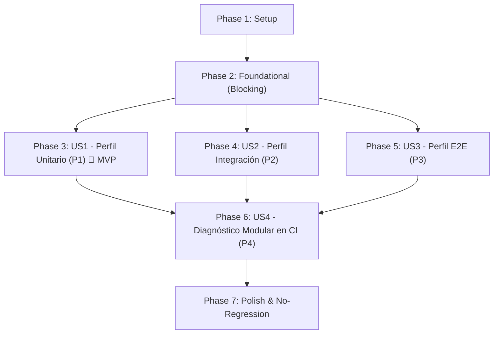

# Tasks: Estandarización de Estrategia de Testing por Perfiles (Backend y Frontend)

**Feature**: `007-standardize-testing-profiles`  
**Spec**: [spec.md](file:///home/nikkoros/dev/dapps2026GrupoQ/specs/007-standardize-testing-profiles/spec.md) | **Plan**: [plan.md](file:///home/nikkoros/dev/dapps2026GrupoQ/specs/007-standardize-testing-profiles/plan.md)  
**Status**: Ready for Implementation  

---

## Phase 1: Setup (Shared Infrastructure)

**Purpose**: Inicialización del entorno, dependencias y estructura de directorios compartida para los perfiles de prueba

- [X] T001 Create E2E test directories for backend and frontend in `backend/test/e2e` and `frontend/tests/e2e`
- [X] T002 [P] Verify backend testing dependencies (`jest`, `ts-jest`, `@nestjs/testing`, `@testcontainers/postgresql`) in `backend/package.json`
- [X] T003 [P] Verify frontend testing dependencies (`vitest`, `@vitest/coverage-v8`, `@testing-library/react`, `jsdom`) in `frontend/package.json`

---

## Phase 2: Foundational (Blocking Prerequisites)

**Purpose**: Infraestructura transversal y garantías de inmutabilidad que DEBEN completarse antes de implementar los perfiles específicos

**⚠️ CRITICAL**: Ningún trabajo de historias de usuario puede comenzar hasta que esta fase esté completada y se valide la política estricta de inmutabilidad (Principio IV de la Constitución)

- [X] T004 Validate baseline test suite execution to enforce strict test immutability (Constitution Principle IV) across `backend/test` and `frontend/tests`
- [X] T005 [P] Configure global test and coverage artifact directory structure in `.gitignore` to ignore `./coverage/` subdirectories (`./coverage/unit`, `./coverage/integration`, `./coverage/e2e`)
- [X] T006 [P] Define unified script execution conventions and error propagation contract in `backend/package.json` and `frontend/package.json` (exit code `0` on success, `!= 0` on failure)

**Checkpoint**: Foundation ready - La implementación de historias de usuario puede comenzar en orden de prioridad o en paralelo

---

## Phase 3: User Story 1 - Ejecución Aislada de Pruebas Unitarias para Feedback Rápido (Priority: P1) 🎯 MVP

**Goal**: Proveer un perfil unitario (`unit`) aislado y ultrarrápido (< 10s backend, < 5s frontend) para validación inmediata de lógica de dominio y utilidades puras sin dependencias de red, Docker ni base de datos (`requiereRed: false`, `requiereDocker: false`), generando reportes LCOV segregados en `./coverage/unit`.

**Independent Test**: Ejecutar `npm run test:unit` en `backend/` y `frontend/` en un entorno desconectado y sin contenedores activos, verificando que el 100% de las pruebas unitarias pasan en menos de 15 segundos con código de salida `0`.

### Implementation for User Story 1

- [X] T007 [P] [US1] Configure isolated Jest unit testing profile in `backend/test/jest-unit.json` matching `<rootDir>/test/unit/**/*.spec.ts` with `collectCoverageFrom: ["src/domain/**/*.ts"]`, `coverageDirectory: "./coverage/unit"`, `projectRoot: ".."`, and enforcing constraint `requiereRed: false` and `requiereDocker: false`
- [X] T008 [P] [US1] Add `test:unit` and `test:unit:cov` scripts targeting `jest-unit.json` in `backend/package.json` with execution time constraint `tiempoMaximo <= 15s`
- [X] T009 [P] [US1] Create isolated Vitest unit configuration in `frontend/vitest.unit.config.ts` matching `tests/unit/**/*.{test,spec}.{ts,tsx}` with `reportsDirectory: "./coverage/unit"`, `projectRoot: path.resolve(__dirname, '..')`, and enforcing constraint `requiereRed: false` and `requiereDocker: false`
- [X] T010 [P] [US1] Add `test:unit` and `test:unit:coverage` scripts targeting `vitest.unit.config.ts` in `frontend/package.json` with execution time constraint `tiempoMaximo <= 15s`
- [X] T011 [US1] Validate User Story 1 independent execution by running `npm run test:unit` and `npm run test:unit:cov` in `backend/` and `npm run test:unit` and `npm run test:unit:coverage` in `frontend/` verifying 100% offline pass in < 15s

**Checkpoint**: User Story 1 funcional y testeable independientemente (MVP listo para feedback instantáneo)

---

## Phase 4: User Story 2 - Verificación de Integración con Dependencias Aisladas (Priority: P2)

**Goal**: Proveer un perfil de integración (`integration`) para evaluar servicios, repositorios de acceso a datos y vistas con estado montadas, gestionando entornos aislados y reproducibles (`requiereDocker: true` con PostgreSQL dinámico vía Testcontainers en backend, `tipo: 'jsdom-session'` en frontend) con limpieza garantizada (`limpiezaGarantizada: true`) y métricas en `./coverage/integration`.

**Independent Test**: Ejecutar `npm run test:integration:cov` en `backend/` y `npm run test:integration:coverage` en `frontend/`, comprobando el aprovisionamiento de PostgreSQL en Testcontainers, la ejecución de suites de persistencia y vistas, y el desmantelamiento limpio de recursos en < 60 segundos.

### Implementation for User Story 2

- [X] T012 [P] [US2] Update Jest integration testing profile in `backend/test/jest-integration.json` matching `<rootDir>/test/integration/**/*.spec.ts` (excluding E2E flows) with `collectCoverageFrom: ["src/services/**/*.ts", "src/data-access/**/*.ts"]`, `coverageDirectory: "./coverage/integration"`, `testTimeout: 60000`, `projectRoot: ".."`, and enforcing `tipo: 'testcontainers-postgres'` with `limpiezaGarantizada: true`
- [X] T013 [P] [US2] Add or verify `test:integration` and `test:integration:cov` scripts with `--runInBand` targeting `jest-integration.json` in `backend/package.json` with constraint `tiempoMaximo <= 60s`
- [X] T014 [P] [US2] Create Vitest integration configuration in `frontend/vitest.integration.config.ts` matching `['tests/integration/**/*.{test,spec}.{ts,tsx}', 'tests/views/**/*.{test,spec}.{ts,tsx}']` with `reportsDirectory: "./coverage/integration"`, `projectRoot: path.resolve(__dirname, '..')`, and `tipo: 'jsdom-session'` with `limpiezaGarantizada: true`
- [X] T015 [P] [US2] Add `test:integration` and `test:integration:coverage` scripts targeting `vitest.integration.config.ts` in `frontend/package.json` with constraint `tiempoMaximo <= 60s`
- [X] T016 [US2] Validate User Story 2 independent execution by running `npm run test:integration:cov` in `backend/` and `npm run test:integration:coverage` in `frontend/`, verifying PostgreSQL container teardown and view integration pass

**Checkpoint**: User Stories 1 y 2 operan de manera totalmente independiente y reproducible

---

## Phase 5: User Story 3 - Validación de Flujos Críticos de Extremo a Extremo (E2E) (Priority: P3)

**Goal**: Proveer un perfil End-to-End (`e2e`) que verifique los flujos críticos de la aplicación completa (CUJ-01: Registro y Acceso a Sesión, CUJ-02: Acceso a Perfil Protegido y Logout, CUJ-03: Consulta y Filtrado de Catálogo de Jugadores) sobre endpoints HTTP montados en NestJS y navegación integral de interfaz de usuario con reportes en `./coverage/e2e`.

**Independent Test**: Ejecutar `npm run test:e2e:cov` en `backend/` y `npm run test:e2e:coverage` en `frontend/`, comprobando la validación de punta a punta de los flujos críticos de autenticación y catálogo con aserciones exactas de códigos HTTP (201 en registro, 200 en `/auth/me` y `/auth/logout`, 401 sin token, 200 en catálogo) y renderizado completo en < 60 segundos.

### Implementation for User Story 3

- [X] T017 [P] [US3] Create dedicated Jest E2E configuration in `backend/test/jest-e2e.json` with `testMatch: ["<rootDir>/test/e2e/**/*.spec.ts"]`, `collectCoverageFrom: ["src/controllers/**/*.ts"]`, `coverageDirectory: "./coverage/e2e"`, `testTimeout: 60000`, `projectRoot: ".."`, and enforcing `tipo: 'testcontainers-postgres'`
- [X] T018 [P] [US3] Implement Backend E2E tests for CUJ-01 ("código 201 en registro, token válido en respuesta") and CUJ-02 ("código 200 en /auth/me, 200 en /auth/logout, 401 si se consulta sin token") using Supertest and NestJS in `backend/test/e2e/auth-cuj.e2e-spec.ts`
- [X] T019 [P] [US3] Implement Backend E2E tests for CUJ-03 ("código 200 con lista filtrada no vacía y ficha con atributos completos") using Supertest in `backend/test/e2e/catalogo-cuj.e2e-spec.ts`
- [X] T020 [US3] Add `test:e2e`, `test:e2e:cov`, and `test:all` (`npm run test:unit && npm run test:integration && npm run test:e2e`) scripts in `backend/package.json` with constraint `tiempoMaximo <= 60s`
- [X] T021 [P] [US3] Create Vitest E2E configuration in `frontend/vitest.e2e.config.ts` matching `tests/e2e/**/*.{test,spec}.{ts,tsx}` with `reportsDirectory: "./coverage/e2e"`, `projectRoot: path.resolve(__dirname, '..')`, and `tipo: 'jsdom-session'`
- [X] T022 [P] [US3] Implement Frontend E2E tests for critical user journeys (CUJ-01, CUJ-02, CUJ-03) covering registration, login, protected routes, and catalog browsing in `frontend/tests/e2e/critical-user-journey.test.tsx`
- [X] T023 [US3] Add `test:e2e`, `test:e2e:coverage`, and `test:all` (`npm run test:unit && npm run test:integration && npm run test:e2e`) scripts in `frontend/package.json` with constraint `tiempoMaximo <= 60s`
- [X] T024 [US3] Validate User Story 3 independent execution by running `npm run test:e2e:cov` in `backend/` and `npm run test:e2e:coverage` in `frontend/`, ensuring all critical user journeys pass end-to-end

**Checkpoint**: Todos los perfiles funcionales (`unit`, `integration`, `e2e`) y sus flujos críticos validados de forma integral

---

## Phase 6: User Story 4 - Diagnóstico Modular en Integración Continua (Priority: P4)

**Goal**: Configurar el pipeline de CI en GitHub Actions y el escaneo de calidad en SonarQube Cloud para ejecutar y diagnosticar cada perfil de prueba en etapas diferenciadas, publicando reportes LCOV segregados sin sobreescritura destructiva.

**Independent Test**: Verificar la ejecución secuencial de los pasos en `.github/workflows/ci.yml` y constatar que `sonar-project.properties` incluye las 8 rutas de cobertura LCOV permitiendo identificación inmediata de fallos por perfil.

### Implementation for User Story 4

- [X] T025 [P] [US4] Update GitHub Actions workflow in `.github/workflows/ci.yml` backend job to execute separate steps: `Run unit tests with coverage` (`npm run test:unit:cov`), `Run integration tests with coverage` (`npm run test:integration:cov`), and `Run e2e tests with coverage` (`npm run test:e2e:cov`)
- [X] T026 [P] [US4] Update GitHub Actions workflow in `.github/workflows/ci.yml` frontend job to execute separate steps: `Run unit tests with coverage` (`npm run test:unit:coverage`), `Run integration tests with coverage` (`npm run test:integration:coverage`), and `Run e2e tests with coverage` (`npm run test:e2e:coverage`)
- [X] T027 [P] [US4] Configure aggregated LCOV report paths for SonarQube Cloud in `sonar-project.properties` with verbatim property `sonar.javascript.lcov.reportPaths=backend/coverage/lcov.info,backend/coverage/unit/lcov.info,backend/coverage/integration/lcov.info,backend/coverage/e2e/lcov.info,frontend/coverage/lcov.info,frontend/coverage/unit/lcov.info,frontend/coverage/integration/lcov.info,frontend/coverage/e2e/lcov.info`
- [X] T028 [US4] Validate User Story 4 by running sequential test execution `npm run test:all` in `backend/` and `frontend/` and verifying all 8 LCOV files exist with non-empty content

**Checkpoint**: Pipeline de CI y análisis de calidad operando con diagnóstico granular por perfil

---

## Phase 7: Polish & Cross-Cutting Concerns

**Purpose**: Mejoras transversales, documentación operativa y verificación completa de no-regresión

- [X] T029 [P] Update developer documentation and testing guide in `README.md` documenting commands, profiles, Docker requirements, and coverage directories
- [X] T030 Execute all validation scenarios (Scenarios 1 through 6) from `specs/007-standardize-testing-profiles/quickstart.md` and verify 100% of pre-existing tests remain intact and passing (Constitution Principle IV)
- [X] T031 Perform code cleanup, formatting, and linting checks across modified files in `backend/` and `frontend/`

---

## Dependencies & Execution Order

### Phase Dependencies

- **Setup (Phase 1)**: Sin dependencias previas - inicia de inmediato.
- **Foundational (Phase 2)**: Depende de Phase 1 - BLOQUEA la implementación de historias de usuario.
- **User Stories (Phase 3+)**: Dependen de la finalización de Foundational (Phase 2).
  - Pueden ejecutarse en orden secuencial de prioridad (P1 → P2 → P3 → P4) o en paralelo si hay capacidad de desarrollo.
- **Polish (Phase 7)**: Depende de la finalización de todas las historias de usuario deseadas.

### User Story Dependencies



- **User Story 1 (P1)**: Inicia tras Phase 2. No tiene dependencias de otras historias.
- **User Story 2 (P2)**: Inicia tras Phase 2. No depende de US1 ni US3; opera en su propio perfil (`integration`).
- **User Story 3 (P3)**: Inicia tras Phase 2. Consume endpoints y vistas completas, complementando la cobertura sin alterar US1 ni US2.
- **User Story 4 (P4)**: Inicia tras la definición de scripts de US1, US2 y US3, orquestando las etapas en CI y agregando los reportes LCOV en SonarQube.

### Within Each User Story

1. Configuraciones de runner (`jest-*.json` / `vitest.*.config.ts`) antes de scripts de ejecución.
2. Definición de scripts en `package.json`.
3. Pruebas y flujos críticos de la historia.
4. Validación independiente de la historia antes de avanzar a la siguiente prioridad.

### Parallel Opportunities

- **Phase 1**: T002 y T003 pueden ejecutarse en paralelo.
- **Phase 2**: T005 y T006 pueden ejecutarse en paralelo.
- **Phase 3 (US1)**: T007, T008, T009 y T010 pueden desarrollarse en paralelo al afectar archivos distintos en backend y frontend.
- **Phase 4 (US2)**: T012, T013, T014 y T015 pueden desarrollarse en paralelo al afectar configuraciones independientes.
- **Phase 5 (US3)**: T017, T018, T019, T021 y T022 pueden ejecutarse en paralelo entre subproyectos.
- **Phase 6 (US4)**: T025, T026 y T027 pueden ejecutarse en paralelo al modificar archivos diferentes (`ci.yml` y `sonar-project.properties`).
- **Phase 7**: T029 puede realizarse en paralelo con la preparación de T030.

---

## Parallel Execution Examples

### User Story 1 (Parallel Backend & Frontend Setup)

```bash
# Desarrollador / Agente 1 (Backend Unit Profile):
Task T007: "Configure isolated Jest unit testing profile in backend/test/jest-unit.json"
Task T008: "Add test:unit and test:unit:cov scripts targeting jest-unit.json in backend/package.json"

# Desarrollador / Agente 2 (Frontend Unit Profile):
Task T009: "Create isolated Vitest unit configuration in frontend/vitest.unit.config.ts"
Task T010: "Add test:unit and test:unit:coverage scripts targeting vitest.unit.config.ts in frontend/package.json"
```

### User Story 3 (Parallel E2E Specs Creation)

```bash
# Creación paralela de specs E2E críticos:
Task T018: "Implement Backend E2E tests for CUJ-01 and CUJ-02 in backend/test/e2e/auth-cuj.e2e-spec.ts"
Task T019: "Implement Backend E2E tests for CUJ-03 in backend/test/e2e/catalogo-cuj.e2e-spec.ts"
Task T022: "Implement Frontend E2E tests for critical user journeys in frontend/tests/e2e/critical-user-journey.test.tsx"
```

---

## Implementation Strategy

### MVP First (User Story 1 Only)

1. Completar Phase 1: Setup (directorios base).
2. Completar Phase 2: Foundational (verificación de inmutabilidad base).
3. Completar Phase 3: User Story 1 (perfil unitario aislado en backend y frontend).
4. **VALIDAR**: Ejecutar `npm run test:unit` en ambos entornos desconectados; verificar feedback en menos de 15 segundos sin Docker.
5. El equipo cuenta inmediatamente con ciclo TDD ultrarrápido (MVP operativo).

### Incremental Delivery

1. **Incremento 1 (MVP)**: Setup + Foundational + User Story 1 → Pruebas unitarias ultrarrápidas disponibles.
2. **Incremento 2**: User Story 2 → Pruebas de integración con Testcontainers y componentes montados segregadas.
3. **Incremento 3**: User Story 3 → Pruebas E2E completas cubriendo los flujos críticos (CUJ-01, CUJ-02, CUJ-03).
4. **Incremento 4**: User Story 4 → Pipeline de CI modular con etapas separadas y agregación completa en SonarQube Cloud.
5. **Incremento 5**: Polish → Documentación completa, validación de `quickstart.md` y garantía de 100% no-regresión.

---

## Notes & Quality Checklist

- **Formato Estricto**: Todas las tareas siguen rigurosamente el formato `- [ ] [TaskID] [P?] [Story?] Descripción con ruta de archivo`.
- **Inmutabilidad (Principio IV)**: 100% de los tests preexistentes permanecen intactos; ninguna aserción es eliminada ni debilitada.
- **Aislamiento**: Ninguna prueba unitaria realiza llamadas de red o interactúa con Docker.
- **Rutas de Archivo**: Cada tarea especifica explícitamente los archivos exactos a crear o modificar.
