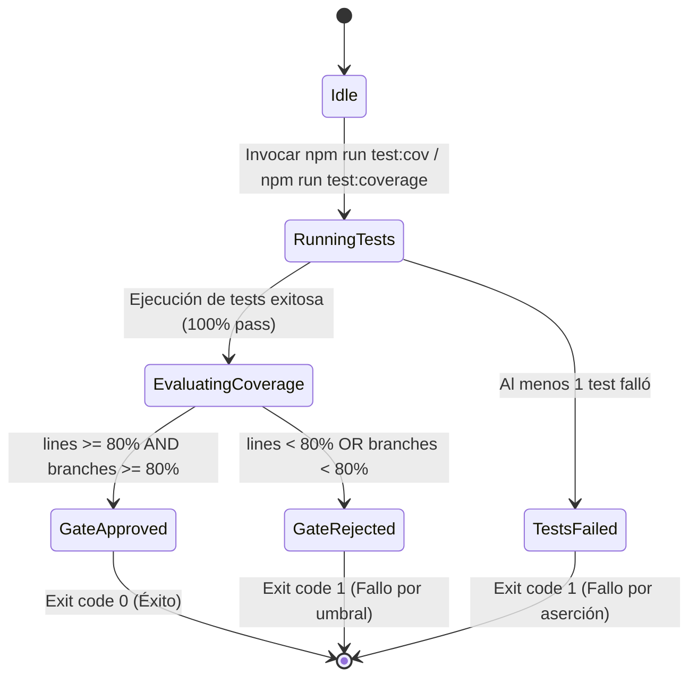

# Data Model: Mejora de Cobertura de Tests (Frontend y Backend >= 80%)

**Feature Branch**: `008-improve-test-coverage`  
**Date**: 2026-10-15  
**Spec Reference**: [spec.md](spec.md)

---

## 1. Entities & Types

### 1.1 `CoverageMetric` (Métrica de Cobertura)
Representa la medición cuantitativa de ejecución de código generada por los motores de cobertura (Jest en backend, Vitest v8 en frontend).

- **Campos**:
  - `stack`: `'backend' | 'frontend'` (Entorno de ejecución independiente)
  - `filePath`: `string` (Ruta relativa del archivo analizado)
  - `lines`: `PercentageMetric` (Porcentaje de líneas ejecutadas: `total`, `covered`, `skipped`, `pct`)
  - `branches`: `PercentageMetric` (Porcentaje de bifurcaciones condicionales evaluadas: `total`, `covered`, `skipped`, `pct`)
  - `functions`: `PercentageMetric` (Porcentaje de funciones y métodos invocados: `total`, `covered`, `skipped`, `pct`)
  - `statements`: `PercentageMetric` (Porcentaje de declaraciones ejecutadas: `total`, `covered`, `skipped`, `pct`)
- **Validation Rules**:
  - `pct` debe ser un número flotante entre 0.0 y 100.0.
  - Para pasar el Quality Gate, `lines.pct >= 80.0` y `branches.pct >= 80.0` de forma independiente por stack.

---

### 1.2 `CoverageThreshold` (Umbral de Cobertura / Quality Gate)
Configuración declarativa de límites obligatorios en las herramientas de testing.

- **Campos**:
  - `target`: `'global' | 'per-file'`
  - `minLines`: `number` (Valor mínimo: 80)
  - `minBranches`: `number` (Valor mínimo: 80)
  - `minFunctions`: `number` (Valor mínimo: 80)
  - `minStatements`: `number` (Valor mínimo: 80)
  - `enforcementAction`: `'fail-build'` (Código de salida no cero si no se cumple)
- **Validation Rules**:
  - Inmutable a la baja: ningún threshold puede ser configurado por debajo de 80 (regla trinquete / ratchet).

---

### 1.3 `CoverageGap` (Brecha de Cobertura)
Instrucción, bifurcación o bloque de lógica de negocio no ejecutado en la suite de pruebas.

- **Campos**:
  - `id`: `string`
  - `filePath`: `string`
  - `type`: `'uncovered-branch' | 'uncovered-lines' | 'missing-test-file'`
  - `startLine`: `number`
  - `endLine`: `number`
  - `description`: `string` (Causa de la brecha: ej. fallback ternario, error HTTP, validación de invariante)
  - `targetTestSuite`: `'unit' | 'integration' | 'e2e'`
  - `status`: `'identified' | 'covered'`

---

### 1.4 `TestSuite` (Suite de Pruebas)
Agrupación de casos de prueba clasificados por alcance arquitectónico según la Constitución.

- **Campos**:
  - `name`: `string`
  - `layer`: `'domain' | 'service' | 'data-access' | 'controller' | 'ui' | 'hook' | 'api-client'`
  - `testType`: `'unit' | 'integration'`
  - `isolation`: `'in-memory-isolated' | 'testcontainers-postgres' | 'jsdom'`
  - `filePath`: `string`
  - `testCount`: `number`
  - `targetEntities`: `string[]`

---

## 2. Target Modules & Testing Map

### 2.1 Backend Target Map

| Módulo / Archivo | Capa (Constitución) | Tipo de Test | Dependencias / Runner |
|---|---|---|---|
| `src/domain/liga.entity.ts` | Model (Dominio) | Unitario | Jest (Aislamiento total) |
| `src/domain/jugador.entity.ts` | Model (Dominio) | Unitario | Jest (Aislamiento total) |
| `src/domain/usuario.entity.ts` | Model (Dominio) | Unitario | Jest (Aislamiento total) |
| `src/domain/exceptions/*` | Model (Dominio) | Unitario | Jest (Aislamiento total) |
| `src/services/jugadores.service.ts` | Service (Orquestación) | Integración | Testcontainers (PostgreSQL real) + Stubs |
| `src/services/clients/football-data.client.ts` | Service (Cliente externo) | Integración / Mock HTTP | Jest + Mock Fetch |
| `src/data-access/equipo.typeorm-repository.ts` | Data Access | Integración | Testcontainers (PostgreSQL real) |
| `src/data-access/liga.typeorm-repository.ts` | Data Access | Integración | Testcontainers (PostgreSQL real) |
| `src/data-access/jugador.typeorm-repository.ts` | Data Access | Integración | Testcontainers (PostgreSQL real) |
| `src/common/filters/domain-exception.filter.ts` | Controller / Infra | Unitario / Integración | NestJS TestingModule / Supertest |
| `src/controllers/auth.controller.ts` | Controller | Integración | Testcontainers + Supertest |

### 2.2 Frontend Target Map

| Módulo / Archivo | Responsabilidad UI | Tipo de Test | Entorno |
|---|---|---|---|
| `src/components/ui/Button.tsx` | Primitiva UI (Botones, loading, disabled) | Unitario | Vitest + Testing Library |
| `src/components/ui/Card.tsx` | Primitiva UI (Contenedor con variantes) | Unitario | Vitest + Testing Library |
| `src/components/ui/PasswordInput.tsx` | Primitiva UI (Toggle password visibility) | Unitario | Vitest + Testing Library |
| `src/components/ui/Spinner.tsx` | Primitiva UI (Indicador de carga) | Unitario | Vitest + Testing Library |
| `src/components/ui/Alert.tsx` | Primitiva UI (Banners de feedback) | Unitario | Vitest + Testing Library |
| `src/components/layout/AppLayout.tsx` | Layout principal (Header, main, footer) | Unitario / Integración | Vitest + MemoryRouter |
| `src/views/HomeView.tsx` | Vista pública inicial | Integración | Vitest + Testing Library |
| `src/components/catalog/FiltersBar.tsx` | Barra de filtrado rápido y toggles | Integración | Vitest + Testing Library |
| `src/components/catalog/FilterModal.tsx` | Diálogo modal de filtros avanzados | Integración | Vitest + Testing Library |
| `src/hooks/usePlayerFilters.ts` | Hook de estado y persistencia de filtros | Unitario de Hook | Vitest + `renderHook` |
| `src/hooks/useInfinitePlayers.ts` | Hook de paginación infinita y scroll | Unitario de Hook | Vitest + `renderHook` |
| `src/context/AuthProvider.tsx` | Contexto de autenticación y sesión | Integración | Vitest + Testing Library |
| `src/api/http-client.ts` | Cliente HTTP base y manejo de errores | Unitario | Vitest + Mock `fetch` |
| `src/api/auth.api.client.ts` | Endpoints de login/registro | Unitario | Vitest + Mock `fetch` |
| `src/api/playersApi.ts` | Endpoints de catálogo de jugadores | Unitario | Vitest + Mock `fetch` |

---

## 3. State Transitions (Lifecycle of a Quality Run)

