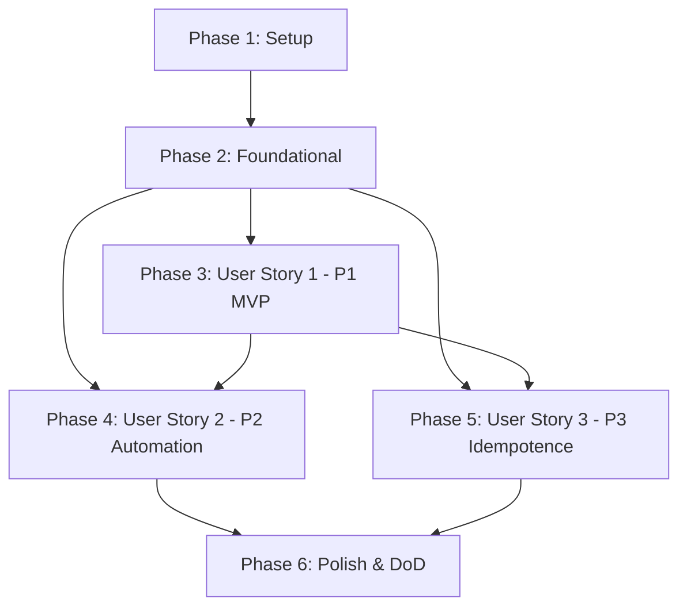

# Tasks: Módulo de Scraping de Estadísticas WhoScored

**Input**: Design documents from `/specs/009-whoscored-scraping/`
**Prerequisites**: [plan.md](./plan.md) (required), [spec.md](./spec.md) (required), [research.md](./research.md), [data-model.md](./data-model.md), [contracts/scraping-api.openapi.yml](./contracts/scraping-api.openapi.yml)

## Format: `- [ ] [TaskID] [P?] [Story?] Description with file path`

- **[P]**: Can run in parallel (different files, no dependencies)
- **[Story]**: Which user story this task belongs to (`[US1]`, `[US2]`, `[US3]`)
- Include exact file paths in all descriptions

---

## Phase 1: Setup (Shared Infrastructure)

**Purpose**: Project initialization and basic dependencies for scraping

- [X] T001 Install scraping dependencies `playwright-extra` and `puppeteer-extra-plugin-stealth` in `backend/package.json`
- [X] T002 [P] Configure Playwright browser download and install scripts (`npx playwright install chromium --with-deps`) in `backend/package.json`
- [X] T003 [P] Configure environment variables and type definitions for scraping (`WHOSCORED_LEAGUE_CONFIGS`, `WHOSCORED_DELAY_MIN_MS`, `WHOSCORED_DELAY_MAX_MS`, `WHOSCORED_SEASON_LABEL`) in `backend/.env.example` and `backend/src/config/scraping.config.ts`

---

## Phase 2: Foundational (Blocking Prerequisites)

**Purpose**: Core domain entities, database persistence, and module scaffolding that MUST be complete before ANY user story can be implemented

**⚠️ CRITICAL**: No user story work can begin until this phase is complete

- [X] T004 [P] Create domain entity `EstadisticaJugador` in `backend/src/scraping/domain/estadistica-jugador.entity.ts` with verbatim domain constraints: `uq_estadistica_jugador_temporada UNIQUE (jugador_id, temporada)`, `goles >= 0`, `asistencias >= 0`, `minutosJugados >= 0`, `partidosJugados >= 0`, `rating` en rango `[0, 10]` si no es null, `porcentajeAtajadas` en rango `[0, 100]` si no es null, `precisionPase` en rango `[0, 100]` si no es null, y los 25 campos estadísticos confirmados
- [X] T005 [P] Create domain entity unit tests for `EstadisticaJugador` validating invariants, boundary values, and constructor constraints in `backend/test/unit/scraping/estadistica-jugador.entity.spec.ts`
- [X] T006 [P] Create domain entity `EjecucionScraping` and types `EstadoEjecucion` (`'en_progreso' | 'exitoso' | 'fallido'`) and `ErrorScrapingDetalle` in `backend/src/scraping/domain/ejecucion-scraping.entity.ts` with verbatim domain constraints: `jugadoresProcesados >= 0`, `errores >= 0`, `si estado === 'exitoso' o 'fallido', entonces fin no debe ser null`, y `fin >= inicio si no es null`
- [X] T007 [P] Create domain entity unit tests for `EjecucionScraping` validating state transitions and time invariants in `backend/test/unit/scraping/ejecucion-scraping.entity.spec.ts`
- [X] T008 [P] Define domain repository interfaces `IEstadisticaJugadorRepository` in `backend/src/scraping/domain/estadistica-jugador.repository.interface.ts` and `IEjecucionScrapingRepository` in `backend/src/scraping/domain/ejecucion-scraping.repository.interface.ts`
- [X] T009 Create TypeORM database migration for `estadisticas_jugadores` and `ejecuciones_scraping` tables with foreign keys and unique constraints in `backend/src/migrations/1715000000000-create-scraping-tables.ts`
- [X] T010 [P] Create TypeORM entity `EstadisticaJugadorOrmEntity` in `backend/src/scraping/data-access/estadistica-jugador.orm-entity.ts` and domain mapper `EstadisticaJugadorMapper` in `backend/src/scraping/data-access/estadistica-jugador.mapper.ts`
- [X] T011 [P] Create TypeORM entity `EjecucionScrapingOrmEntity` in `backend/src/scraping/data-access/ejecucion-scraping.orm-entity.ts` and domain mapper `EjecucionScrapingMapper` in `backend/src/scraping/data-access/ejecucion-scraping.mapper.ts`
- [X] T012 Implement `EstadisticaJugadorTypeOrmRepository` implementing `IEstadisticaJugadorRepository` in `backend/src/scraping/data-access/estadistica-jugador.typeorm-repository.ts`
- [X] T013 [P] Implement `EjecucionScrapingTypeOrmRepository` implementing `IEjecucionScrapingRepository` in `backend/src/scraping/data-access/ejecucion-scraping.typeorm-repository.ts`
- [X] T014 [P] Create integration tests using Testcontainers/PostgreSQL for `EstadisticaJugadorTypeOrmRepository` and `EjecucionScrapingTypeOrmRepository` in `backend/test/integration/scraping/estadistica-jugador.repository.spec.ts` and `backend/test/integration/scraping/ejecucion-scraping.repository.spec.ts`
- [X] T015 Scaffold `ScrapingModule` registering repositories and services in `backend/src/scraping/scraping.module.ts` and import it into `backend/src/app.module.ts`

**Checkpoint**: Core domain entities, database schema, and persistence layer ready — user story implementation can now begin

---

## Phase 3: User Story 1 - Consultar estadísticas actualizadas de jugadores (Priority: P1) 🎯 MVP

**Goal**: Extraer estadísticas WhoScored de jugadores de las 5 grandes ligas europeas usando Playwright con evasion anti-bot y consultar datos estadísticos actualizados diferenciando por rol (jugador de campo vs. portero).

**Independent Test**: Ejecutar extracción de datos simulada o de control, persistir estadísticas de prueba y verificar mediante consulta que el sistema retorna goles, asistencias, minutos jugados, partidos jugados y rating WhoScored, retornando métricas de arquero (atajadas, goles recibidos, % atajadas) para porteros y ofensivas (goles, tiros, xG, grandes ocasiones) para jugadores de campo.

### Tests for User Story 1

> **NOTE: Write these tests FIRST, ensure they FAIL before implementation**

- [X] T016 [P] [US1] Create unit tests with mocked Playwright pages/DOM for `WhoScoredPlaywrightService` validating tab navigation and column parsing in `backend/test/unit/scraping/whoscored-playwright.service.spec.ts`
- [X] T017 [P] [US1] Create unit tests for player matching and statistics mapping logic in `ScrapingService` in `backend/test/unit/scraping/scraping.service.spec.ts`

### Implementation for User Story 1

- [X] T018 [US1] Implement `WhoScoredPlaywrightService` in `backend/src/scraping/services/whoscored-playwright.service.ts` managing browser singleton lifecycle (`OnModuleInit`/`OnModuleDestroy`), stealth plugin, resource aborting (images, stylesheets, fonts), human-like random delays (2000-5000ms), and DOM extraction from `#player-table-statistics-body tr` across tabs (Summary, Defensive, Offensive, Passing, xG, Detailed)
- [X] T019 [P] [US1] Implement player cross-referencing and name normalizer in `backend/src/scraping/services/normalizador-jugador.service.ts` matching WhoScored players to existing `Jugador` entities by normalized name, club, and league
- [X] T020 [US1] Implement `ScrapingService` orchestration in `backend/src/scraping/services/scraping.service.ts` coordinating league scraping, data extraction, validation, and querying player statistics by player ID and season
- [X] T021 [US1] Implement controller endpoint `GET /scraping/jugadores/:id/estadisticas` in `backend/src/scraping/controllers/scraping.controller.ts` returning updated player stats formatted according to player role (goalkeeper vs. field player)

**Checkpoint**: User Story 1 is fully functional and testable independently (MVP ready!)

---

## Phase 4: User Story 2 - Ejecución automática periódica del scraping (Priority: P2)

**Goal**: Automatizar la ejecución periódica cada 7 días mediante cronjob de GitHub Actions y soportar ejecución manual administrativa asíncrona registrando auditoría en `EjecucionScraping`.

**Independent Test**: Invocar `POST /scraping/ejecutar` administrativamente y verificar retorno `202 Accepted` con `ejecucionId`, consultar el detalle en `GET /scraping/ejecuciones/:id`, y ejecutar el script `backend/src/run-scraper.ts` validando finalización limpia con código de salida 0.

### Tests for User Story 2

- [X] T022 [P] [US2] Create contract & integration tests for administrative endpoints (`POST /scraping/ejecutar`, `GET /scraping/ejecuciones`, `GET /scraping/ejecuciones/:id`) in `backend/test/integration/scraping/scraping.controller.spec.ts` validating responses according to `contracts/scraping-api.openapi.yml`
- [X] T023 [P] [US2] Create unit test for CI entry point script lifecycle and exit code handling in `backend/test/unit/scraping/run-scraper.spec.ts`

### Implementation for User Story 2

- [X] T024 [US2] Implement standalone execution script `backend/src/run-scraper.ts` using `NestFactory.createApplicationContext()` to run the scraping pipeline without starting HTTP server and exit with `process.exit(0)` on success or `process.exit(1)` on error
- [X] T025 [US2] Implement controller endpoints `POST /scraping/ejecutar`, `GET /scraping/ejecuciones`, and `GET /scraping/ejecuciones/:id` in `backend/src/scraping/controllers/scraping.controller.ts` strictly complying with `contracts/scraping-api.openapi.yml`
- [X] T026 [US2] Create GitHub Actions workflow `.github/workflows/whoscored-scraper.yml` with `schedule: '0 2 * * 0'` (weekly Sundays at 02:00 UTC) and `workflow_dispatch`, setting up Node.js 20, installing Playwright Chromium with system dependencies, and executing `backend/src/run-scraper.ts`

**Checkpoint**: User Stories 1 AND 2 are both fully functional and testable independently

---

## Phase 5: User Story 3 - Actualización incremental sin duplicados (Priority: P3)

**Goal**: Garantizar idempotencia en la base de datos mediante actualización incremental (upsert) sobre `(jugador_id, temporada)` y tolerancia a fallos individuales sin interrumpir el procesamiento global.

**Independent Test**: Ejecutar dos corridas sucesivas de scraping (induciendo un fallo en un jugador para validar aislamiento de errores) y verificar que el total de registros en `estadisticas_jugadores` no se duplica, las fechas de actualización se renuevan, y la corrida termina exitosamente registrando el error puntual en el JSONB `detalle` de `EjecucionScraping`.

### Tests for User Story 3

- [X] T027 [P] [US3] Create integration test for idempotent upsert and duplicate prevention in `backend/test/integration/scraping/scraping-upsert.spec.ts`
- [X] T028 [P] [US3] Create unit/integration test for individual player error isolation (FR-008, SC-003) in `backend/test/unit/scraping/scraping-resilience.spec.ts`

### Implementation for User Story 3

- [X] T029 [US3] Implement upsert logic in `EstadisticaJugadorTypeOrmRepository` utilizing TypeORM `upsert` with `conflictPaths: ['jugadorId', 'temporada']` updating all 25 statistics and `fechaActualizacion` in `backend/src/scraping/data-access/estadistica-jugador.typeorm-repository.ts`
- [X] T030 [US3] Implement resilient loop and error aggregator in `ScrapingService` in `backend/src/scraping/services/scraping.service.ts` catching per-player exceptions, recording `ErrorScrapingDetalle` (`liga`, `jugadorNombre`, `mensaje`, `timestamp`), incrementing `errores`, and continuing with remaining players

**Checkpoint**: All user stories are independently functional, resilient, and idempotent

---

## Phase 6: Polish & Cross-Cutting Concerns

**Purpose**: Documentation, test coverage enforcement, and integration validation across all stories

- [X] T031 [P] Update Jest configuration in `backend/test/jest-unit.json` and `backend/test/jest-integration.json` to include `src/scraping/**/*.ts` in coverage collection and ensure 80% line and branch thresholds (Principio VI)
- [X] T032 [P] Update Swagger / OpenAPI configuration in `backend/src/main.ts` to document `ScrapingModule` endpoints
- [X] T033 [P] Update Postman collection `postman/collection.json` with new scraping endpoints per Constitution DoD rule 3
- [X] T034 Run quickstart scenarios validation from `specs/009-whoscored-scraping/quickstart.md` and verify test suite pass with `npm run test:all` in `backend`

---

## Dependencies & Execution Order

### Phase Dependencies

- **Setup (Phase 1)**: No dependencies - can start immediately.
- **Foundational (Phase 2)**: Depends on Setup (Phase 1) completion - BLOCKS all user stories.
- **User Stories (Phase 3+)**: All depend on Foundational (Phase 2) completion.
  - User Story 1 (P1): Delivers core scraping extraction, domain entities, and data query.
  - User Story 2 (P2): Delivers automation via GitHub Actions and administrative endpoints. Depends on US1 extraction and Foundational `EjecucionScraping`.
  - User Story 3 (P3): Enhances persistence with idempotent upsert and per-player error isolation. Depends on US1 and Foundational repositories.
- **Polish (Phase 6)**: Depends on all user stories being complete.



### User Story Dependencies

- **User Story 1 (P1)**: Can start after Foundational (Phase 2) - No dependencies on other stories. Delivers the MVP.
- **User Story 2 (P2)**: Can start after Foundational (Phase 2) - Consumes `ScrapingService` from US1 for the standalone runner and administrative triggers.
- **User Story 3 (P3)**: Can start after Foundational (Phase 2) - Consumes `ScrapingService` and `EstadisticaJugadorTypeOrmRepository` from US1 to reinforce idempotence and resilience.

### Within Each User Story

- Tests (if included) MUST be written and fail before implementation.
- Domain models and types before services.
- Services before controllers/entry points.
- Core logic before resilience/integration.
- Story complete before moving to next priority.

### Parallel Opportunities

- In **Phase 1**: T002 and T003 can run in parallel once T001 is initialized.
- In **Phase 2**:
  - T004 (`EstadisticaJugador` entity) and T006 (`EjecucionScraping` entity) can be written in parallel.
  - T005 and T007 (unit tests) can be written in parallel.
  - T010 and T011 (ORM entities and mappers) can be written in parallel.
  - T013 and T014 can be developed in parallel with T012.
- In **Phase 3 (US1)**:
  - T016 and T017 (unit tests) can run in parallel.
  - T018 and T019 can run in parallel before integrating into T020.
- In **Phase 4 (US2)**:
  - T022 and T023 (tests) can run in parallel.
  - T025 and T026 can run in parallel once T024 is ready.
- In **Phase 5 (US3)**:
  - T027 and T028 (tests) can run in parallel.
- In **Phase 6 (Polish)**:
  - T031, T032, and T033 can all run in parallel.

---

## Parallel Example: User Story 1

```bash
# Launch test tasks for User Story 1 together:
Task: "T016 [P] [US1] Create unit tests with mocked Playwright pages/DOM for WhoScoredPlaywrightService in backend/test/unit/scraping/whoscored-playwright.service.spec.ts"
Task: "T017 [P] [US1] Create unit tests for player matching and statistics mapping logic in ScrapingService in backend/test/unit/scraping/scraping.service.spec.ts"

# Launch independent implementation components together:
Task: "T018 [US1] Implement WhoScoredPlaywrightService in backend/src/scraping/services/whoscored-playwright.service.ts"
Task: "T019 [P] [US1] Implement player cross-referencing and name normalizer in backend/src/scraping/services/normalizador-jugador.service.ts"
```

---

## Implementation Strategy

### MVP First (User Story 1 Only)

1. Complete Phase 1: Setup (`playwright-extra`, `puppeteer-extra-plugin-stealth`, configs).
2. Complete Phase 2: Foundational (Entities `EstadisticaJugador` and `EjecucionScraping`, migration, repositories).
3. Complete Phase 3: User Story 1 (`WhoScoredPlaywrightService`, normalizer, `ScrapingService`, stats endpoint).
4. **STOP and VALIDATE**: Test User Story 1 independently with unit tests and mock scraping.
5. Demonstrate working data extraction and retrieval for MVP.

### Incremental Delivery

1. Setup + Foundational → Database schema and domain contracts validated.
2. User Story 1 → Core scraping and stats query functional (MVP).
3. User Story 2 → Scheduled GitHub Actions cronjob and admin REST triggers operational.
4. User Story 3 → Idempotent upsert and failure tolerance across ~2500 players verified.
5. Polish → 80% line/branch test coverage, OpenAPI docs, and Postman collection updated.

### Parallel Team Strategy

With multiple developers:
1. Team delivers Setup + Foundational together.
2. Developer A takes User Story 1 (Playwright extraction and statistics mapping).
3. Developer B takes User Story 2 (GitHub Actions workflow and admin controller endpoints).
4. Developer C takes User Story 3 (Resilient loop, JSONB error reporting, and database upsert).
5. All developers run Polish tasks and execute DoD test suite.

---

## Notes

- `[P]` tasks = different files, no shared write conflicts, independently executable.
- `[Story]` label maps each task to its user story for end-to-end traceability.
- Field constraints from `data-model.md` are quoted verbatim in task descriptions.
- Existing tests are never modified without explicit consent (Constitution Principle IV).
- Coverage threshold of 80% on lines and branches is strictly enforced (Constitution Principle VI).
