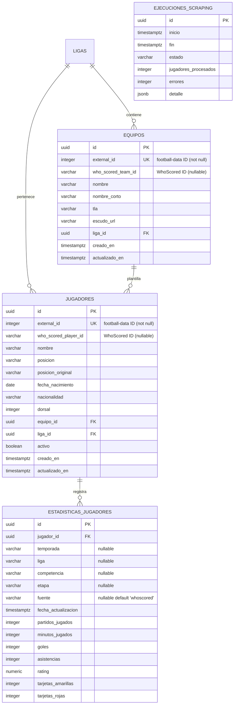

# Data Model: Ingesta Integral de Estadísticas WhoScored e Identidad Externa

**Feature**: Ingesta Integral de Estadísticas WhoScored e Identidad Externa (Top 5 Ligas)  
**Feature Branch**: `feat/scraping-whoscored`  
**Date**: 2026-10-25 (Ajustes Obligatorios de Arquitectura)  
**Status**: Completed  

---

## 1. Entidades de Dominio

### 1.1. Jugador (Modelo Rico DDD)

Alineado con `backend/src/domain/jugador.entity.ts`:

```typescript
export interface JugadorProps {
  id?: string;
  externalId: number;                  // Identificador football-data (obligatorio, entero positivo)
  whoScoredPlayerId?: string | null;   // Identificador WhoScored (opcional, string normalizado)
  nombre: string;
  posicion?: PosicionJugador;
  posicionOriginal?: string | null;
  fechaNacimiento?: string | null;
  nacionalidad?: string | null;
  dorsal?: number | null;
  equipoId: string;
  ligaId: string;
  activo?: boolean;
  creadoEn?: Date;
  actualizadoEn?: Date;
  equipo?: Equipo | null;
  liga?: Liga | null;
}
```

#### Estado Actual y Métodos Mínimos a Incorporar:
- **Estado Actual**: `Jugador` posee `crear`, `normalizarPosicion`, `validarInvariantes`, `actualizarEquipo`, `coincideConFiltros`, `desactivar` y `activar`. No posee campo ni método para WhoScored.
- **Nuevas Adiciones de Dominio**:
  - Campo privado `private _whoScoredPlayerId: string | null`.
  - Getter `get whoScoredPlayerId(): string | null`.
  - Getter `get footballDataId(): number { return this._externalId; }` (alias explícito sin alterar `externalId`).
  - Método `asociarWhoScored(whoScoredId: string): void`: Valida que la cadena no esté vacía tras `.trim()`, asigna `_whoScoredPlayerId = whoScoredId.trim()` y actualiza `_actualizadoEn = new Date()`.

---

### 1.2. Equipo (Modelo Rico DDD)

Alineado con `backend/src/domain/equipo.entity.ts`:

```typescript
export interface EquipoProps {
  id?: string;
  externalId: number;                // Identificador football-data (obligatorio, entero positivo)
  whoScoredTeamId?: string | null;   // Identificador WhoScored (opcional, string normalizado)
  nombre: string;
  nombreCorto?: string | null;
  tla?: string | null;
  escudoUrl?: string | null;
  ligaId: string;
  creadoEn?: Date;
  actualizadoEn?: Date;
}
```

#### Estado Actual y Métodos Mínimos a Incorporar:
- **Estado Actual**: `Equipo` posee `crear`, `validarInvariantes` y `perteneceALiga`. No posee campo ni método para WhoScored.
- **Nuevas Adiciones de Dominio**:
  - Campo privado `private _whoScoredTeamId: string | null`.
  - Getter `get whoScoredTeamId(): string | null`.
  - Getter `get footballDataId(): number { return this._externalId; }`.
  - Método `asociarWhoScored(whoScoredId: string): void`: Valida que la cadena no esté vacía tras `.trim()`, asigna `_whoScoredTeamId = whoScoredId.trim()` y actualiza `_actualizadoEn = new Date()`.

---

### 1.3. EstadisticaJugador (Modelo Rico DDD)

Alineado con `backend/src/scraping/domain/estadistica-jugador.entity.ts`:

```typescript
export interface EstadisticaJugadorProps {
  id?: string;
  jugadorId: string;
  temporada?: string | null;   // Ej: "2025/2026" (nullable para soportar datos legacy)
  liga?: string | null;        // Ej: "PL", "LL", "SA", "BL", "L1" (nullable)
  competencia?: string | null; // Ej: "Premier League", "LaLiga" (nullable)
  etapa?: string | null;       // Ej: "Regular Season", "22345" (nullable)
  fuente?: string | null;      // Default en nueva ingesta: "whoscored" (nullable en legacy)
  fechaActualizacion?: Date;
  partidosJugados: number;
  minutosJugados: number;
  goles: number;
  asistencias: number;
  tirosPorPartido?: number | null;
  precisionPase?: number | null;
  duelosAereosGanadosPorPartido?: number | null;
  rating?: number | null;
  tarjetasAmarillas: number;
  tarjetasRojas: number;
  regatesCompletadosPorPartido?: number | null;
  pasesClavePorPartido?: number | null;
  xgPorPartido?: number | null;
  xaPorPartido?: number | null;
  grandesOcasionesPorPartido?: number | null;
  entradasPorPartido?: number | null;
  intercepccionesPorPartido?: number | null;
  despejesPorPartido?: number | null;
  pasesPorPartido?: number | null;
  centrosPorPartido?: number | null;
  atajadas?: number | null;
  golesRecibidos?: number | null;
  porcentajeAtajadas?: number | null;
  erroresQueGeneraronGol?: number | null;
  autogoles?: number | null;
}
```

#### Estado Actual y Métodos Mínimos a Incorporar:
- **Estado Actual**: Posee `crear`, `validarInvariantes` y `actualizarEstadisticas`. Posee `temporada`, `liga` y `fuente`, pero **carece** de `competencia` y `etapa`.
- **Nuevas Adiciones de Dominio**:
  - Campos privados `_competencia: string | null` y `_etapa: string | null`.
  - Getters `get competencia(): string | null` y `get etapa(): string | null`.
  - Método `actualizarEstadisticas`: Ampliado para admitir `competencia` y `etapa` de forma retrocompatible.
  - Invariantes: `jugadorId` obligatorio; métricas de conteo >= 0; rating [0, 10]; porcentajes [0, 100].

---

## 2. Esquema Relacional de Base de Datos (PostgreSQL)



---

## 3. Plan de Migración Incremental Segura (Sin Borrado Silencioso)

Archivo: `backend/src/migrations/1729860000000-add-whoscored-external-identities-and-contextual-uniqueness.ts`

### Método `up`:
```sql
-- 1. Agregar columnas nullable en jugadores y equipos
ALTER TABLE jugadores ADD COLUMN IF NOT EXISTS who_scored_player_id VARCHAR(50) NULL;
CREATE INDEX IF NOT EXISTS idx_jugadores_whoscored_id ON jugadores (who_scored_player_id);

ALTER TABLE equipos ADD COLUMN IF NOT EXISTS who_scored_team_id VARCHAR(50) NULL;
CREATE INDEX IF NOT EXISTS idx_equipos_whoscored_id ON equipos (who_scored_team_id);

-- 2. Agregar columnas de procedencia nullable en estadisticas_jugadores
ALTER TABLE estadisticas_jugadores ADD COLUMN IF NOT EXISTS competencia VARCHAR(100) NULL;
ALTER TABLE estadisticas_jugadores ADD COLUMN IF NOT EXISTS etapa VARCHAR(50) NULL;

-- 3. Detección explícita de conflictos: ABORTAR si existen duplicados legacy sin borrar datos
DO $$
DECLARE
  conflict_count INTEGER;
BEGIN
  SELECT COUNT(*) INTO conflict_count
  FROM (
    SELECT jugador_id, COALESCE(fuente, ''), COALESCE(competencia, ''), COALESCE(liga, ''), COALESCE(temporada, ''), COALESCE(etapa, '')
    FROM estadisticas_jugadores
    GROUP BY jugador_id, COALESCE(fuente, ''), COALESCE(competencia, ''), COALESCE(liga, ''), COALESCE(temporada, ''), COALESCE(etapa, '')
    HAVING COUNT(*) > 1
  ) c;

  IF conflict_count > 0 THEN
    RAISE EXCEPTION 'Migración abortada: se detectaron % grupos de registros duplicados en estadisticas_jugadores. Se requiere saneamiento manual previo.', conflict_count;
  END IF;
END $$;

-- 4. Reemplazar restricción única antigua por índice funcional único con COALESCE
ALTER TABLE estadisticas_jugadores DROP CONSTRAINT IF EXISTS uq_estadistica_jugador_temporada;

CREATE UNIQUE INDEX IF NOT EXISTS uq_estadistica_jugador_contexto ON estadisticas_jugadores (
  jugador_id,
  COALESCE(fuente, ''),
  COALESCE(competencia, ''),
  COALESCE(liga, ''),
  COALESCE(temporada, ''),
  COALESCE(etapa, '')
);
```

### Método `down`:
```sql
-- 1. Eliminar índice funcional único
DROP INDEX IF EXISTS uq_estadistica_jugador_contexto;

-- 2. Restaurar restricción previa
ALTER TABLE estadisticas_jugadores 
  ADD CONSTRAINT uq_estadistica_jugador_temporada UNIQUE (jugador_id, temporada);

-- 3. Eliminar columnas agregadas
ALTER TABLE estadisticas_jugadores DROP COLUMN IF EXISTS etapa;
ALTER TABLE estadisticas_jugadores DROP COLUMN IF EXISTS competencia;

DROP INDEX IF EXISTS idx_equipos_whoscored_id;
ALTER TABLE equipos DROP COLUMN IF EXISTS who_scored_team_id;

DROP INDEX IF EXISTS idx_jugadores_whoscored_id;
ALTER TABLE jugadores DROP COLUMN IF EXISTS who_scored_player_id;
```

---

## 4. Estrategia de Persistencia Upsert en Repositorio

En `EstadisticaJugadorTypeOrmRepository`:
- Dado que TypeORM `conflictPaths` no admite expresiones `COALESCE`, la persistencia se realiza mediante TypeORM QueryBuilder explícito:
```typescript
async guardarMuchos(
  estadisticas: EstadisticaJugador[],
  transactionalEntityManager?: EntityManager,
): Promise<void> {
  if (!estadisticas || estadisticas.length === 0) return;
  const manager = transactionalEntityManager || this.ormRepository.manager;
  const ormEntities = estadisticas.map((e) => EstadisticaJugadorMapper.toOrm(e));

  for (const batch of chunk(ormEntities, 100)) {
    await manager
      .createQueryBuilder()
      .insert()
      .into(EstadisticaJugadorOrmEntity)
      .values(batch)
      .onConflict(`
        (
          jugador_id,
          COALESCE(fuente, ''),
          COALESCE(competencia, ''),
          COALESCE(liga, ''),
          COALESCE(temporada, ''),
          COALESCE(etapa, '')
        ) DO UPDATE SET
          partidos_jugados = EXCLUDED.partidos_jugados,
          minutos_jugados = EXCLUDED.minutos_jugados,
          goles = EXCLUDED.goles,
          asistencias = EXCLUDED.asistencias,
          rating = EXCLUDED.rating,
          tarjetas_amarillas = EXCLUDED.tarjetas_amarillas,
          tarjetas_rojas = EXCLUDED.tarjetas_rojas,
          precision_pase = EXCLUDED.precision_pase,
          tiros_por_partido = EXCLUDED.tiros_por_partido,
          fecha_actualizacion = EXCLUDED.fecha_actualizacion
      `)
      .execute();
  }
}
```
Esto garantiza total compatibilidad con el índice funcional de PostgreSQL dentro del ámbito transaccional por liga.
