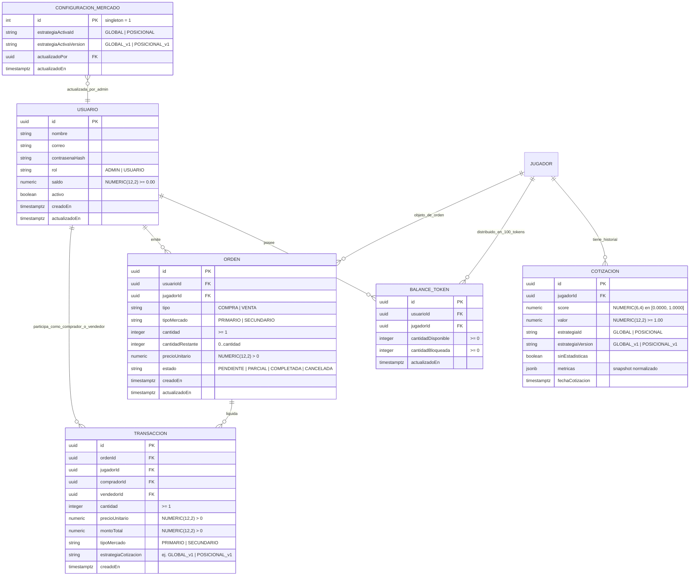

# Data Model: Marketplace de Tokens de Jugadores y Order Management System (OMS)

**Feature**: `012-token-marketplace-oms`  
**Date**: 2026-11-01  
**Status**: Completed

Este documento especifica el modelo de dominio enriquecido (Rich Domain Model), entidades, agregados, objetos de valor (Value Objects), invariantes y transiciones de estado para el marketplace y el OMS.

---

## 1. Diagrama de Entidades del Dominio



---

## 2. Objetos de Valor y Agregados del Dominio

### 2.1. Dinero (Value Object)
- **Responsabilidad**: Encapsular importes monetarios en centavos enteros para impedir errores de redondeo de punto flotante IEEE-754 en billeteras, precios y liquidaciones.
- **Representación interna**: `centavos: number` (entero seguro).
- **Operaciones e Invariantes**:
  - `Dinero.desdeMonto(monto: number | string): Dinero` (redondeo half-up a 2 decimales; rechaza `NaN`/`Infinity` o valores negativos cuando se exige no negatividad).
  - `Dinero.desdeCentavos(centavos: number): Dinero`.
  - `sumar(otro: Dinero): Dinero`, `restar(otro: Dinero): Dinero` (arroja `ReglaDeNegocioException` si resulta negativo), `multiplicarPorEntero(cantidad: number): Dinero`, `esMayorOIgualQue(otro: Dinero): boolean`, `esMayorQue(otro: Dinero): boolean`, `aNumero(): number`, `aDecimalFijo(): string`.

### 2.2. Usuario (Extensión Retrocompatible de Dominio)
- **Responsabilidad**: Agregado raíz que representa una cuenta registrada en la plataforma, enriquecida con rol de gobernanza y billetera de fondos virtuales.
- **Campos (`UsuarioProps` retrocompatible)**:
  - `id`: string (UUID)
  - `nombre`: string (2-100 caracteres)
  - `correo`: string (email normalizado)
  - `contrasenaHash`: string
  - `rol?`: `RolUsuario` (`'ADMIN'` | `'USUARIO'`), opcional en creación con valor por defecto `'USUARIO'`.
  - `saldo?`: `number | Dinero` (almacenado internamente como `Dinero` $\ge 0.00$, opcional en creación con valor por defecto `1000.00`).
  - `activo`: boolean
  - `creadoEn`: Date
  - `actualizadoEn`: Date
- **Invariantes y Métodos de Negocio**:
  - `debitarSaldo(monto: number | Dinero): void`: Valida cuenta activa, `monto > 0` y saldo suficiente; si no alcanza, arroja `ReglaDeNegocioException('Saldo monetario insuficiente para realizar la operación.')`.
  - `acreditarSaldo(monto: number | Dinero): void`: Valida `monto > 0` e incrementa el saldo.
  - `promoverAAdmin(): void`: Transiciona `rol` a `'ADMIN'` para el bootstrap idempotente.
  - `esAdmin(): boolean`: Retorna `this._rol === 'ADMIN'`.

### 2.3. ConfiguracionMercado
- **Responsabilidad**: Agregado singleton (`id = 1`) que persiste la política de cotización activa del marketplace administrada por el superusuario.
- **Campos**:
  - `id`: number (`1`)
  - `estrategiaActivaId`: `'GLOBAL' | 'POSICIONAL'` (por defecto `'GLOBAL'`)
  - `estrategiaActivaVersion`: `'GLOBAL_v1' | 'POSICIONAL_v1'` (por defecto `'GLOBAL_v1'`)
  - `actualizadoPor`: string | null (UUID del `ADMIN`)
  - `actualizadoEn`: Date
- **Invariantes y Métodos de Negocio**:
  - `cambiarEstrategia(estrategiaId: EstrategiaId, version: string, adminId: string): void`: Valida que la estrategia esté entre las aprobadas y actualiza versión, autor y fecha.

### 2.4. BalanceToken
- **Responsabilidad**: Mantiene la tenencia de tokens indivisibles de un jugador particular por parte de un usuario. La emisión inicial del activo de un jugador asigna exactamente 100 tokens disponibles a la cuenta `ADMIN` (`UNIQUE (usuario_id, jugador_id)`).
- **Campos**:
  - `id`: string (UUID)
  - `usuarioId`: string (UUID)
  - `jugadorId`: string (UUID)
  - `cantidadDisponible`: number (entero $\ge 0$)
  - `cantidadBloqueada`: number (entero $\ge 0$, tokens retenidos en custodia por órdenes de venta activas)
  - `actualizadoEn`: Date
- **Invariantes y Métodos de Negocio**:
  - `cantidadTotal`: getter que retorna `cantidadDisponible + cantidadBloqueada`.
  - `debitarDisponibles(cantidad: number): void`: Deduce directamente de `cantidadDisponible` (usado al transferir desde el inventario primario del `ADMIN`). Valida entero $\ge 1$ y `cantidadDisponible >= cantidad`.
  - `bloquearTokens(cantidad: number): void`: Pasa `cantidad` de `cantidadDisponible` a `cantidadBloqueada` al publicar una orden de venta secundaria.
  - `liberarTokens(cantidad: number): void`: Devuelve `cantidad` de `cantidadBloqueada` a `cantidadDisponible` al cancelar una orden de venta.
  - `debitarBloqueados(cantidad: number): void`: Deduce de `cantidadBloqueada` al liquidarse total o parcialmente una orden de venta secundaria.
  - `acreditarTokens(cantidad: number): void`: Incrementa `cantidadDisponible` tras una compra.

### 2.5. Cotizacion y Estrategias (`EstrategiaCotizacion`, `MetricasJugadorParaCotizacion`)
- **Cotizacion (Entidad Inmutable)**:
  - `id`: string (UUID)
  - `jugadorId`: string (UUID)
  - `score`: number (decimal en $[0.0000, 1.0000]$)
  - `valor`: number (`Dinero` $\ge 1.00$, calculado como $\text{round}_2(1.00 + \text{score} \times 1.00)$)
  - `estrategiaId`: `'GLOBAL' | 'POSICIONAL'`
  - `estrategiaVersion`: `'GLOBAL_v1' | 'POSICIONAL_v1'`
  - `sinEstadisticas`: boolean (`true` en la emisión inicial o cuando el jugador carece de métricas deportivas jugadas)
  - `metricas`: `SnapshotMetricasNormalizadas | null` (desglose JSON de métricas normalizadas en $[0, 1]$ empleadas en el cálculo)
  - `fechaCotizacion`: Date
  - **Invariantes**: Registro *append-only* (prohibido actualizar o eliminar tanto en repositorio como mediante trigger en BD); `0 <= score <= 1`; `valor >= 1.00`.
- **Interfaz `EstrategiaCotizacion`**:
  ```typescript
  export interface ResultadoCalculoCotizacion {
    score: number;
    valor: number;
    sinEstadisticas: boolean;
    metricasNormalizadas: SnapshotMetricasNormalizadas | null;
  }

  export interface EstrategiaCotizacion {
    readonly id: 'GLOBAL' | 'POSICIONAL';
    readonly version: 'GLOBAL_v1' | 'POSICIONAL_v1';
    calcular(
      metricas: MetricasJugadorParaCotizacion,
      posicion: PosicionJugador,
    ): ResultadoCalculoCotizacion;
  }
  ```

### 2.6. Orden (OMS)
- **Responsabilidad**: Agregado que gobierna las órdenes de compraventa del marketplace.
- **Campos**:
  - `id`: string (UUID)
  - `usuarioId`: string (UUID)
  - `jugadorId`: string (UUID)
  - `tipo`: `'COMPRA'` | `'VENTA'`
  - `tipoMercado`: `'PRIMARIO'` | `'SECUNDARIO'`
  - `cantidad`: number (entero $\ge 1$)
  - `cantidadRestante`: number (entero en $[0, \text{cantidad}]$)
  - `precioUnitario`: number (`Dinero` $> 0.00$)
  - `estado`: `'PENDIENTE'` | `'PARCIAL'` | `'COMPLETADA'` | `'CANCELADA'`
  - `creadoEn`: Date
  - `actualizadoEn`: Date
- **Política y Máquina de Estados**:
  - Las órdenes `COMPRA` son de ejecución inmediata (*Immediate-Or-Cancel*): se crean directamente en estado `COMPLETADA` (`cantidadRestante = 0`) dentro de la transacción de liquidación y nunca permanecen en `PENDIENTE`.
  - Las órdenes `VENTA` (`SECUNDARIO`) siguen la máquina de estados:
  ```mermaid
  stateDiagram-v2
      [*] --> PENDIENTE : Publicar Orden de Venta (custodia)
      PENDIENTE --> PARCIAL : Compra Parcial Puntual
      PARCIAL --> PARCIAL : Compra Parcial Sucesiva
      PENDIENTE --> COMPLETADA : Compra Total Puntual
      PARCIAL --> COMPLETADA : Compra del Remanente
      PENDIENTE --> CANCELADA : Cancelación por Propietario
      PARCIAL --> CANCELADA : Cancelación del Remanente
  ```

### 2.7. Transaccion
- **Responsabilidad**: Asiento contable definitivo e inmutable de la liquidación de una compra/venta en mercado primario o secundario.
- **Campos**:
  - `id`: string (UUID)
  - `ordenId`: string (UUID de la orden de compra primaria o de la orden de venta secundaria ejecutada)
  - `jugadorId`: string (UUID)
  - `compradorId`: string (UUID)
  - `vendedorId`: string (UUID; en mercado primario corresponde al `ADMIN`)
  - `cantidad`: number (entero $\ge 1$)
  - `precioUnitario`: number (`Dinero` $> 0.00$)
  - `montoTotal`: number (`cantidad * precioUnitario` exacto en `Dinero`)
  - `tipoMercado`: `'PRIMARIO'` | `'SECUNDARIO'`
  - `estrategiaCotizacion`: string (requerido, ej. `'GLOBAL_v1'` o `'POSICIONAL_v1'`; registra la estrategia/versión utilizada en la cotización oficial vigente del token al momento de dicha compra)
  - `creadoEn`: Date
- **Invariantes**:
  - Registro *append-only* inmutable (sin update/delete en repositorio y protegido por trigger en PostgreSQL).
  - `compradorId !== vendedorId` (prohibición de autocontratación / *wash trading*).
  - `estrategiaCotizacion` no vacío y `montoTotal === cantidad * precioUnitario`.

---

## 3. Invariantes Globales del Sistema

1. **Invariante de Suministro Estricto**:
   $$\forall j \in \text{JugadoresEmitidos}: \sum_{u \in \text{Usuarios}} \left( \text{BalanceToken}_{u,j}.\text{cantidadDisponible} + \text{BalanceToken}_{u,j}.\text{cantidadBloqueada} \right) = 100$$
2. **Invariante de Custodia Activa**:
   $$\forall u, j: \text{BalanceToken}_{u,j}.\text{cantidadBloqueada} = \sum_{o \in \text{OrdenesVentaActivas}(u,j)} o.\text{cantidadRestante}$$
3. **Invariante de Conservación Monetaria**:
   En toda `Transaccion`:
   $$\Delta \text{Saldo}_{\text{comprador}} = -\text{montoTotal}, \quad \Delta \text{Saldo}_{\text{vendedor}} = +\text{montoTotal}$$
4. **Invariante de No Autocontratación**:
   $$\text{compradorId} \neq \text{vendedorId}$$
