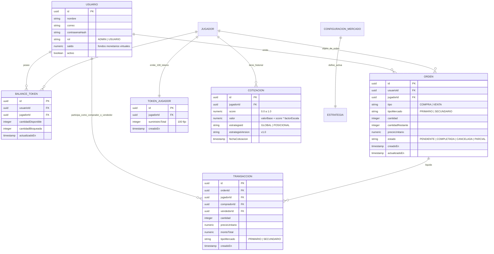

# Data Model: Marketplace de Tokens de Jugadores y Order Management System (OMS)

**Feature**: `012-token-marketplace-oms`  
**Date**: 2026-10-31  
**Status**: Draft

Este documento especifica el modelo de dominio enriquecido (Rich Domain Model), entidades, agregados, objetos de valor (Value Objects), invariantes y transiciones de estado para el marketplace y el OMS.

---

## 1. Diagrama de Entidades del Dominio



---

## 2. Entidades y Agregados del Dominio

### 2.1. Usuario (Actualización de Dominio)
- **Responsabilidad**: Agregado raíz que representa una cuenta en el sistema. Incorpora rol de permisos y billetera de fondos monetarios virtuales.
- **Campos**:
  - `id`: string (UUID)
  - `nombre`: string (2-100 caracteres)
  - `correo`: string (email normalizado)
  - `contrasenaHash`: string
  - `rol`: `RolUsuario` (`'ADMIN'` | `'USUARIO'`), por defecto `'USUARIO'`.
  - `saldo`: number (saldo monetario en créditos virtuales, decimal positivo $\ge 0.00$, por defecto 1,000.00 al registrarse).
  - `activo`: boolean
  - `creadoEn`: Date
  - `actualizadoEn`: Date
- **Invariantes y Métodos de Negocio**:
  - `debitarSaldo(monto: number): void`: Valida que `monto > 0` y `this._saldo >= monto`. Si es insuficiente, arroja `ReglaDeNegocioException('Saldo monetario insuficiente para realizar la operación.')`.
  - `acreditarSaldo(monto: number): void`: Valida `monto > 0` y suma a `this._saldo`.
  - `esAdmin(): boolean`: Retorna `this._rol === 'ADMIN'`.

### 2.2. TokenJugador
- **Responsabilidad**: Representa la emisión original del activo financiero correspondiente a un futbolista.
- **Campos**:
  - `id`: string (UUID)
  - `jugadorId`: string (UUID, relación 1 a 1 con Jugador)
  - `suministroTotal`: number (siempre exactamente 100)
  - `creadoEn`: Date
- **Invariantes**:
  - `suministroTotal` es inmutable y debe ser exactamente 100.
  - Al crearse, se inicializa el balance del superusuario (`admin`) con 100 tokens disponibles de este jugador.

### 2.3. BalanceToken (o PosicionToken)
- **Responsabilidad**: Mantiene la tenencia de tokens de un jugador particular por parte de un usuario.
- **Campos**:
  - `id`: string (UUID)
  - `usuarioId`: string (UUID)
  - `jugadorId`: string (UUID)
  - `cantidadDisponible`: number (entero $\ge 0$)
  - `cantidadBloqueada`: number (entero $\ge 0$, tokens retenidos en órdenes de venta activas)
  - `actualizadoEn`: Date
- **Invariantes y Métodos de Negocio**:
  - `cantidadTotal()`: Retorna `cantidadDisponible + cantidadBloqueada`.
  - `bloquearTokens(cantidad: number): void`: Pasa `cantidad` de disponible a bloqueada al crear una orden de venta. Valida `cantidadDisponible >= cantidad`.
  - `liberarTokens(cantidad: number): void`: Pasa `cantidad` de bloqueada a disponible (al cancelar una orden de venta).
  - `debitarBloqueados(cantidad: number): void`: Deduce tokens bloqueados al liquidar una venta.
  - `acreditarTokens(cantidad: number): void`: Incrementa `cantidadDisponible` tras una compra.
  - Invariante: Ningún balance puede ser negativo.

### 2.4. Cotizacion (o CotizacionJugador)
- **Responsabilidad**: Registro inmutable de la valoración de un token en un punto temporal.
- **Campos**:
  - `id`: string (UUID)
  - `jugadorId`: string (UUID)
  - `score`: number (decimal acotado en $[0.00, 1.00]$)
  - `valor`: number (decimal positivo calculado como $\text{valorBase} + (\text{score} \times \text{factorEscala})$)
  - `estrategiaId`: string (ej. `'GLOBAL'`, `'POSICIONAL'`)
  - `estrategiaVersion`: string (ej. `'v1.0'`)
  - `fechaCotizacion`: Date
- **Invariantes**:
  - Registro de solo inserción (inmutable). No admite actualización ni borrado.
  - `score` no puede ser menor a 0 ni mayor a 1.
  - `valor` no puede ser inferior a 1.00 (`valorBase`).

### 2.5. Estrategias de Cotización (EstrategiaCotizacion)
- **Interfaz**:
  ```typescript
  export interface EstrategiaCotizacion {
    readonly id: string;
    readonly version: string;
    calcularScore(estadisticas: EstadisticaJugador, posicion: PosicionJugador): number;
    convertirAPrecio(score: number): number;
  }
  ```
- **Implementaciones**:
  1. `EstrategiaGlobal`: Ponderación uniforme fija.
  2. `EstrategiaPosicional`: Ponderación dependiente de `posicion` (`Delantero`, `Mediocampista`, `Defensa`, `Portero`).

### 2.6. Orden (OMS)
- **Responsabilidad**: Agregado que gobierna el ciclo de vida de una intención de compra o venta en el marketplace.
- **Campos**:
  - `id`: string (UUID)
  - `usuarioId`: string (UUID)
  - `jugadorId`: string (UUID)
  - `tipo`: `'COMPRA'` | `'VENTA'`
  - `tipoMercado`: `'PRIMARIO'` | `'SECUNDARIO'`
  - `cantidad`: number (entero $\ge 1$)
  - `cantidadRestante`: number (entero $\ge 0$)
  - `precioUnitario`: number (decimal $> 0.00$)
  - `estado`: `'PENDIENTE'` | `'PARCIAL'` | `'COMPLETADA'` | `'CANCELADA'`
  - `creadoEn`: Date
  - `actualizadoEn`: Date
- **Máquina de Estados de la Orden**:
  ```mermaid
  stateDiagram-v2
      [*] --> PENDIENTE : Crear Orden
      PENDIENTE --> PARCIAL : Ejecución Parcial
      PARCIAL --> PARCIAL : Ejecución Parcial Sucesiva
      PENDIENTE --> COMPLETADA : Ejecución Total
      PARCIAL --> COMPLETADA : Ejecución Remanente
      PENDIENTE --> CANCELADA : Cancelación por Usuario
      PARCIAL --> CANCELADA : Cancelación Remanente
  ```

### 2.7. Transaccion
- **Responsabilidad**: Asiento contable definitivo e inmutable de la liquidación de una operación entre dos partes (o entre usuario y mercado primario).
- **Campos**:
  - `id`: string (UUID)
  - `ordenId`: string (UUID)
  - `jugadorId`: string (UUID)
  - `compradorId`: string (UUID)
  - `vendedorId`: string (UUID)
  - `cantidad`: number (entero $\ge 1$)
  - `precioUnitario`: number (decimal)
  - `montoTotal`: number (`cantidad * precioUnitario`)
  - `tipoMercado`: `'PRIMARIO'` | `'SECUNDARIO'`
  - `creadoEn`: Date

---

## 3. Invariantes Globales del Sistema

1. **Invariante de Suministro Estricto**:
   $$\forall j \in \text{Jugadores}: \sum_{u \in \text{Usuarios}} \left( \text{BalanceToken}_{u,j}.\text{cantidadDisponible} + \text{BalanceToken}_{u,j}.\text{cantidadBloqueada} \right) = 100$$
2. **Invariante de Conservación Monetaria**:
   En toda transacción:
   $$\Delta \text{Saldo}_{\text{comprador}} = -\text{montoTotal}, \quad \Delta \text{Saldo}_{\text{vendedor}} = +\text{montoTotal}$$
   No hay generación ni destrucción no registrada de saldo.
3. **Invariante de No Auto-contratación**:
   $$\text{compradorId} \neq \text{vendedorId}$$

