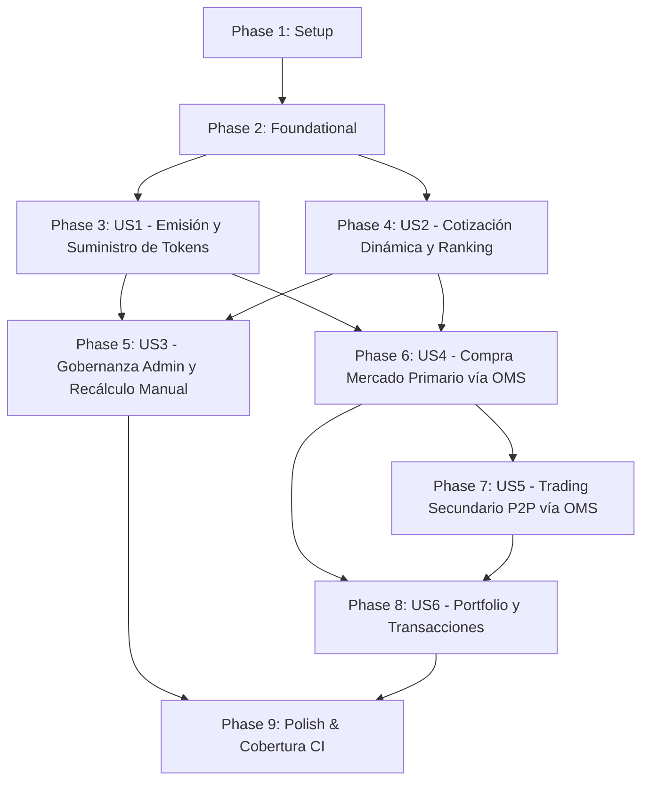

# Tasks: Marketplace de Tokens de Jugadores y Order Management System (OMS)

**Input**: Design documents from `specs/012-token-marketplace-oms/` (`spec.md`, `plan.md`, `research.md`, `data-model.md`, `contracts/`, `quickstart.md`).  
**Prerequisites**: `plan.md` (required), `spec.md` (required for user stories), `research.md`, `data-model.md`, `contracts/`.  
**Tests**: Se incluyen tareas de pruebas unitarias de dominio y de integración con Testcontainers en cumplimiento del Principio III y VI de la Constitución (cobertura mínima del 80%).  
**Organization**: Tareas agrupadas por historia de usuario para permitir desarrollo, pruebas y entregas independientes.

## Format: `[ID] [P?] [Story] Description with file path`

- **[P]**: Ejecutable en paralelo (archivos independientes, sin dependencias pendientes).
- **[Story]**: Historia de usuario asociada ([US1], [US2], [US3], [US4], [US5], [US6]).
- Todas las tareas incluyen la ruta exacta del archivo afectado.

---

## Phase 1: Setup (Infraestructura Compartida)

**Purpose**: Inicialización del módulo de marketplace, dependencias y esquema de base de datos.

- [ ] T001 Verificar e instalar dependencia de tareas programadas `@nestjs/schedule` en `backend/package.json`.
- [ ] T002 [P] Crear migración TypeORM en `backend/src/migrations/1730000000000-create-marketplace-and-oms-tables.ts` para crear las tablas `balances_tokens`, `cotizaciones`, `ordenes`, `transacciones`, `configuraciones_mercado` y añadir las columnas `rol` (`VARCHAR(20) DEFAULT 'USUARIO'`) y `saldo` (`NUMERIC(12,2) DEFAULT 1000.00`) en la tabla `usuarios`.
- [ ] T003 [P] Configurar el módulo de tareas programadas `ScheduleModule.forRoot()` en `backend/src/app.module.ts`.

---

## Phase 2: Foundational (Prerrequisitos Bloqueantes)

**Purpose**: Infraestructura y modelos de base requeridos antes de implementar las historias de usuario.

**⚠️ CRITICAL**: Completar esta fase antes de iniciar el trabajo en las historias de usuario.

- [ ] T004 Actualizar la entidad de dominio `Usuario` en `backend/src/domain/usuario.entity.ts` incorporando el atributo `rol` ('ADMIN' | 'USUARIO', requerido), `saldo` (número decimal $\ge 0.00$, requerido, valor por defecto 1000.00), y los métodos de negocio `debitarSaldo(monto: number): void`, `acreditarSaldo(monto: number): void` y `esAdmin(): boolean`.
- [ ] T005 [P] Actualizar la entidad ORM `UsuarioOrmEntity` en `backend/src/data-access/usuario.orm-entity.ts` y el mapeador `UsuarioMapper` en `backend/src/data-access/usuario.mapper.ts` mapeando las columnas `rol` y `saldo`.
- [ ] T006 [P] Implementar el decorador `@Roles()` en `backend/src/common/decorators/roles.decorator.ts` y el guardia de autorización `RolesGuard` en `backend/src/common/guards/roles.guard.ts` validando el rol del usuario autenticado vía JWT.
- [ ] T007 [P] Crear suite de pruebas unitarias para validación de billetera, débito/crédito e invariantes de rol de usuario en `backend/test/unit/domain/usuario-wallet.spec.ts`.

**Checkpoint**: Base lista: modelo de usuario enriquecido con saldo y roles funcionales.

---

## Phase 3: User Story 1 - Emisión Inicial y Consulta del Mercado de Tokens (Priority: P1) 🎯 MVP

**Goal**: Permitir la emisión de 100 tokens indivisibles por cada jugador en posesión inicial del superusuario (`admin`) y garantizar la invariante de suministro inmutable de 100 tokens totales.

**Independent Test**: Verificar que al registrarse o inicializarse un jugador, se emite exactamente un lote de 100 tokens en poder del admin con valor base 1.00, y que ninguna operación permite alterar dicho suministro total.

### Tests para User Story 1
- [ ] T008 [P] [US1] Crear pruebas unitarias para la entidad `BalanceToken` verificando invariantes de saldo no negativo y cálculo de cantidad total en `backend/test/unit/domain/balance-token.entity.spec.ts`.

### Implementación para User Story 1
- [ ] T009 [P] [US1] Crear la entidad de dominio `BalanceToken` en `backend/src/domain/balance-token.entity.ts` con propiedades `usuarioId` (UUID), `jugadorId` (UUID), `cantidadDisponible` (entero $\ge 0$), `cantidadBloqueada` (entero $\ge 0$) y métodos `bloquearTokens(cant: number)`, `liberarTokens(cant: number)`, `debitarBloqueados(cant: number)` y `acreditarTokens(cant: number)`.
- [ ] T010 [P] [US1] Definir la interfaz de repositorio `IBalanceTokenRepository` en `backend/src/domain/balance-token.repository.interface.ts` con métodos `buscarPorUsuarioYJugador`, `obtenerBalancesPorJugador`, `obtenerBalancesPorUsuario` y `guardar`.
- [ ] T011 [P] [US1] Implementar la entidad ORM `BalanceTokenOrmEntity` en `backend/src/data-access/balance-token.orm-entity.ts`, su mapeador `BalanceTokenMapper` en `backend/src/data-access/balance-token.mapper.ts` y el repositorio `BalanceTokenRepository` en `backend/src/data-access/balance-token.typeorm-repository.ts`.
- [ ] T012 [US1] Implementar servicio de emisión `TokensService` en `backend/src/services/tokens.service.ts` que asegure la emisión de exactamente 100 tokens para cada jugador asignados al superusuario (`admin`).

**Checkpoint**: Suministro de tokens modelado y persistido con invariante estricta de 100 tokens por jugador.

---

## Phase 4: User Story 2 - Cotización Dinámica por Estrategias y Recálculo Semanal (Priority: P1)

**Goal**: Calcular el valor de mercado del token de cada jugador a partir de métricas de rendimiento deportivo mediante 2 estrategias distintas (`GLOBAL_v1` y `POSICIONAL_v1`), registrar el histórico de cotizaciones con fecha y versión, y exponer endpoints de cotización y ranking.

**Independent Test**: Ejecutar el cálculo sobre un jugador con estadísticas conocidas; comprobar que la fórmula matemática produce el score exacto, genera `valor = 1.0 + (score * 1.0)`, registra la cotización con versión, y responde en `GET /players/:id/quotes` y `GET /players/ranking`.

### Tests para User Story 2
- [ ] T013 [P] [US2] Crear pruebas unitarias para `EstrategiaGlobal` y `EstrategiaPosicional` validando scores normalizados en $[0, 1]$ y precios en `backend/test/unit/domain/estrategia-cotizacion.spec.ts`.
- [ ] T014 [P] [US2] Crear pruebas unitarias para la entidad de dominio `Cotizacion` en `backend/test/unit/domain/cotizacion.entity.spec.ts`.
- [ ] T015 [P] [US2] Crear pruebas de integración con Testcontainers para el servicio de cotizaciones y ranking en `backend/test/integration/quotes.service.spec.ts`.

### Implementación para User Story 2
- [ ] T016 [P] [US2] Crear la interfaz `EstrategiaCotizacion` en `backend/src/domain/strategies/estrategia-cotizacion.interface.ts`.
- [ ] T017 [P] [US2] Implementar `EstrategiaGlobal` (`GLOBAL_v1`) en `backend/src/domain/strategies/estrategia-global.strategy.ts` con normalización en $[0, 1]$ de `goals`, `assists`, `shots`, `keyPasses`, `dribbles`, `tackles`, `rating`, ponderación estándar y conversión a precio `valorBase (1.0) + score * factorEscala (1.0)`.
- [ ] T018 [P] [US2] Implementar `EstrategiaPosicional` (`POSICIONAL_v1`) en `backend/src/domain/strategies/estrategia-posicional.strategy.ts` con ponderaciones específicas para Delantero (prioriza goals/shots), Mediocampista (prioriza assists/keyPasses/dribbles), Defensa (prioriza tackles/intercepciones) y Portero (prioriza rating/atajadas).
- [ ] T019 [P] [US2] Crear la entidad inmutable de dominio `Cotizacion` en `backend/src/domain/cotizacion.entity.ts` con campos `id`, `jugadorId`, `score` ($0.0 \le \text{score} \le 1.0$), `valor` ($\ge 1.00$), `estrategiaId`, `estrategiaVersion` y `fechaCotizacion`.
- [ ] T020 [P] [US2] Definir la interfaz de repositorio `ICotizacionRepository` en `backend/src/domain/cotizacion.repository.interface.ts`.
- [ ] T021 [P] [US2] Implementar `CotizacionOrmEntity` en `backend/src/data-access/cotizacion.orm-entity.ts`, `CotizacionMapper` en `backend/src/data-access/cotizacion.mapper.ts` y `CotizacionRepository` en `backend/src/data-access/cotizacion.typeorm-repository.ts`.
- [ ] T022 [US2] Implementar `QuotesService` en `backend/src/services/quotes.service.ts` con métodos `obtenerHistorialCotizaciones(jugadorId: string, limite?: number)` y `obtenerRanking(limite?: number, posicion?: string)`.
- [ ] T023 [US2] Implementar el scheduler semanal `QuotesSchedulerService` en `backend/src/services/scheduler/quotes-scheduler.service.ts` con `@Cron('0 0 * * 0')` para recalcular periódicamente las cotizaciones de todos los jugadores activos.
- [ ] T024 [US2] Crear los DTOs `CotizacionRespuestaDto` en `backend/src/controllers/dto/cotizacion.dto.ts` y `JugadorRankingDto` en `backend/src/controllers/dto/ranking-jugadores.dto.ts`.
- [ ] T025 [US2] Exponer los endpoints `GET /players/ranking` y `GET /players/:id/quotes` en `backend/src/controllers/players.controller.ts` documentados con Swagger OpenAPI (colocando `/ranking` antes de `/:id` para evitar colisión de rutas).

**Checkpoint**: Cotizaciones dinámicas calculadas, persistidas y consultables mediante historial y ranking.

---

## Phase 5: User Story 3 - Configuración y Administración de Estrategias por Superusuario (Priority: P2)

**Goal**: Permitir al superusuario (`admin`) cambiar la estrategia activa de cotización y ejecutar el recálculo manual masivo bajo demanda (`POST /quotes/recalculate`), bloqueando a usuarios convencionales.

**Independent Test**: Invocar `POST /quotes/recalculate` con token de usuario común (debe fallar con `403 Forbidden`) y con token de `admin` (debe retornar `200 OK` con resumen de jugadores procesados y estrategia aplicada).

### Tests para User Story 3
- [ ] T026 [P] [US3] Crear pruebas de integración en `backend/test/integration/quotes-admin.spec.ts` validando la autorización RBAC (`admin` exitoso vs `usuario` rechazado con 403) para `POST /quotes/recalculate`.

### Implementación para User Story 3
- [ ] T027 [P] [US3] Crear entidad de dominio `ConfiguracionMercado` en `backend/src/domain/configuracion-mercado.entity.ts`, su entidad ORM `ConfiguracionMercadoOrmEntity` en `backend/src/data-access/configuracion-mercado.orm-entity.ts` y repositorio `ConfiguracionMercadoRepository` en `backend/src/data-access/configuracion-mercado.typeorm-repository.ts` para persistir la estrategia activa.
- [ ] T028 [US3] Añadir método `recalcularCotizacionesManual(estrategiaId?: string)` en `QuotesService` (`backend/src/services/quotes.service.ts`) para procesar en lote a todos los jugadores activos bajo una transacción segura.
- [ ] T029 [US3] Crear el DTO `ResumenRecalculoDto` en `backend/src/controllers/dto/recalculo-cotizaciones.dto.ts`.
- [ ] T030 [US3] Crear el controlador `QuotesController` en `backend/src/controllers/quotes.controller.ts` exponiendo `POST /quotes/recalculate` protegido por `JwtAuthGuard` y `@Roles('ADMIN')`.

**Checkpoint**: Gobernanza administrativa de estrategias y recálculo bajo demanda operativo con RBAC.

---

## Phase 6: User Story 4 - Compra de Tokens en Mercado Primario vía OMS (Priority: P1)

**Goal**: Permitir a los usuarios inversores adquirir tokens de un jugador directamente desde el inventario del superusuario (`admin`) a la cotización oficial vigente mediante el OMS con garantías transaccionales A.C.I.D.

**Independent Test**: Emitir una orden de compra `POST /orders/buy` con fondos suficientes; comprobar el débito de saldo monetario, la acreditación de tokens en el comprador, la deducción del inventario del superusuario y el registro inmutable en `Transaccion`.

### Tests para User Story 4
- [ ] T031 [P] [US4] Crear pruebas unitarias para la entidad de dominio `Transaccion` en `backend/test/unit/domain/transaccion.entity.spec.ts`.
- [ ] T032 [P] [US4] Crear pruebas de integración en `backend/test/integration/oms-primario.service.spec.ts` validando compra primaria, rechazo por saldo insuficiente, rechazo por exceso de suministro y conservación de la invariante total de 100 tokens.

### Implementación para User Story 4
- [ ] T033 [P] [US4] Crear la entidad de dominio `Transaccion` en `backend/src/domain/transaccion.entity.ts` con campos `id`, `ordenId`, `jugadorId`, `compradorId`, `vendedorId`, `cantidad` ($\ge 1$), `precioUnitario`, `montoTotal` (`cantidad * precioUnitario`), `tipoMercado` ('PRIMARIO' | 'SECUNDARIO') y `creadoEn`.
- [ ] T034 [P] [US4] Definir la interfaz de repositorio `ITransaccionRepository` en `backend/src/domain/transaccion.repository.interface.ts`.
- [ ] T035 [P] [US4] Implementar `TransaccionOrmEntity` en `backend/src/data-access/transaccion.orm-entity.ts`, `TransaccionMapper` en `backend/src/data-access/transaccion.mapper.ts` y `TransaccionRepository` en `backend/src/data-access/transaccion.typeorm-repository.ts`.
- [ ] T036 [US4] Implementar el servicio `OmsService` en `backend/src/services/oms.service.ts` con el método `comprarTokens(compradorId: string, dto: CrearOrdenCompraDto)` resolviendo la compra en mercado primario contra el balance del superusuario con bloqueo transaccional (`SELECT FOR UPDATE`).
- [ ] T037 [US4] Crear los DTOs `CrearOrdenCompraDto` y `ResultadoCompraDto` en `backend/src/controllers/dto/orden-compra.dto.ts`.
- [ ] T038 [US4] Crear el controlador `OrdersController` en `backend/src/controllers/orders.controller.ts` exponiendo el endpoint `POST /orders/buy` protegido por `JwtAuthGuard`.

**Checkpoint**: Compras en mercado primario funcionando de forma atómica y auditada.

---

## Phase 7: User Story 5 - Trading de Tokens entre Usuarios en Mercado Secundario vía OMS (Priority: P2)

**Goal**: Permitir el intercambio P2P de tokens entre usuarios: publicación de órdenes de venta con bloqueo de custodia preventiva (`POST /orders/sell`), cancelación de órdenes y liquidación transaccional contra órdenes de compra.

**Independent Test**: Publicar una orden de venta de 2 tokens a precio 2.50 con el Usuario A (los tokens pasan a custodia bloqueada) y ejecutar la compra con el Usuario B; verificar la transferencia atómica de tokens y fondos entre ambos usuarios.

### Tests para User Story 5
- [ ] T039 [P] [US5] Crear pruebas unitarias para la máquina de estados de la entidad `Orden` (`PENDIENTE`, `PARCIAL`, `COMPLETADA`, `CANCELADA`) en `backend/test/unit/domain/orden.entity.spec.ts`.
- [ ] T040 [P] [US5] Crear pruebas de integración en `backend/test/integration/oms-secundario.service.spec.ts` validando creación de orden de venta con custodia, compra de orden secundaria, prevención de autocontratación (*wash trading*) y cancelación de órdenes.

### Implementación para User Story 5
- [ ] T041 [P] [US5] Crear la entidad de dominio `Orden` en `backend/src/domain/orden.entity.ts` con campos `id`, `usuarioId`, `jugadorId`, `tipo` ('COMPRA' | 'VENTA'), `tipoMercado` ('PRIMARIO' | 'SECUNDARIO'), `cantidad` ($\ge 1$), `cantidadRestante`, `precioUnitario`, `estado` ('PENDIENTE' | 'PARCIAL' | 'COMPLETADA' | 'CANCELADA') y métodos de transición de estados.
- [ ] T042 [P] [US5] Definir la interfaz de repositorio `IOrdenRepository` en `backend/src/domain/orden.repository.interface.ts`.
- [ ] T043 [P] [US5] Implementar `OrdenOrmEntity` en `backend/src/data-access/orden.orm-entity.ts`, `OrdenMapper` en `backend/src/data-access/orden.mapper.ts` y `OrdenRepository` en `backend/src/data-access/orden.typeorm-repository.ts`.
- [ ] T044 [US5] Implementar los métodos `crearOrdenVenta(vendedorId: string, dto: CrearOrdenVentaDto)` y `cancelarOrden(usuarioId: string, ordenId: string)` en `OmsService` (`backend/src/services/oms.service.ts`) gestionando la custodia de tokens en `BalanceToken`.
- [ ] T045 [US5] Extender `comprarTokens` en `OmsService` (`backend/src/services/oms.service.ts`) para cruzar y liquidar órdenes de venta activas en mercado secundario antes o en preferencia al mercado primario si el comprador lo especifica.
- [ ] T046 [US5] Crear los DTOs `CrearOrdenVentaDto` y `OrdenVentaRespuestaDto` en `backend/src/controllers/dto/orden-venta.dto.ts`.
- [ ] T047 [US5] Exponer el endpoint `POST /orders/sell` en `backend/src/controllers/orders.controller.ts` protegido por `JwtAuthGuard`.

**Checkpoint**: Trading secundario P2P con custodia preventiva y prevención de venta en descubierto plenamente operativo.

---

## Phase 8: User Story 6 - Consulta de Histórico de Cotizaciones y Transacciones del Usuario (Priority: P2)

**Goal**: Exponer la consulta integral del portfolio valorizado del usuario (`GET /users/:id/portfolio`) y el historial cronológico de todas sus transacciones concluidas (`GET /users/:id/transactions`).

**Independent Test**: Realizar operaciones de compra y venta con un usuario, consultar `GET /users/:id/portfolio` y `GET /users/:id/transactions`, verificando que se listan con precisión las posiciones activas, la cotización vigente, la valorización total y los movimientos históricos.

### Tests para User Story 6
- [ ] T048 [P] [US6] Crear pruebas de integración en `backend/test/integration/users-portfolio.spec.ts` validando la agregación de portfolio (posiciones, valorizaciones, saldos) y el filtrado cronológico de transacciones.

### Implementación para User Story 6
- [ ] T049 [US6] Implementar método `obtenerPortfolioUsuario(usuarioId: string)` en `OmsService` (`backend/src/services/oms.service.ts`) agregando balances de tokens, datos del jugador, cotizaciones actuales de mercado y saldo en billetera.
- [ ] T050 [US6] Implementar método `obtenerHistorialTransacciones(usuarioId: string, tipo?: string)` en `OmsService` (`backend/src/services/oms.service.ts`) consultando `TransaccionRepository`.
- [ ] T051 [US6] Crear los DTOs `PortfolioUsuarioDto`, `PosicionPortafolioDto` en `backend/src/controllers/dto/portfolio-usuario.dto.ts` y `TransaccionUsuarioDto` en `backend/src/controllers/dto/transaccion-usuario.dto.ts`.
- [ ] T052 [US6] Crear el controlador `UsersController` en `backend/src/controllers/users.controller.ts` exponiendo `GET /users/:id/portfolio` y `GET /users/:id/transactions` protegidos por `JwtAuthGuard` con validación de identidad.

**Checkpoint**: Los 7 endpoints del marketplace y OMS expuestos, documentados y testeados.

---

## Phase 9: Polish & Cross-Cutting Concerns

**Purpose**: Integración modular final, documentación Swagger, colección Postman y verificación de umbral de cobertura.

- [ ] T053 [P] Crear el módulo `MarketplaceModule` en `backend/src/marketplace/marketplace.module.ts` agrupando controladores, servicios, repositorios y entidades TypeORM, e importarlo en `backend/src/app.module.ts`.
- [ ] T054 [P] Actualizar la colección de Postman en `postman/` incorporando solicitudes de ejemplo y validaciones para los 7 endpoints del marketplace y OMS.
- [ ] T055 Ejecutar la suite completa de pruebas unitarias y de integración del backend (`npm run test:unit` y `npm run test:integration`), y verificar que la cobertura global de líneas y branches sea $\ge 80\%$ cumpliendo el Principio VI de la Constitución.
- [ ] T056 Ejecutar los escenarios de prueba E2E documentados en `specs/012-token-marketplace-oms/quickstart.md` validando el flujo punta a punta.

---

## Dependencies & Execution Order

### Phase Dependencies



### User Story Dependencies

- **US1 (Emisión de Tokens)**: Depende de Phase 2. Bloquea las compras en el OMS (US4).
- **US2 (Cotización y Ranking)**: Depende de Phase 2. Provee precios oficiales para US3, US4, US5 y US6.
- **US3 (Recálculo Manual Admin)**: Depende de US2.
- **US4 (Compra Mercado Primario)**: Depende de US1 y US2.
- **US5 (Trading Secundario P2P)**: Depende de US4.
- **US6 (Portfolio y Transacciones)**: Depende de US4 y US5.

---

## Parallel Opportunities

```bash
# Ejecución en paralelo dentro de Phase 2 (Foundational):
Task T005: "Actualizar UsuarioOrmEntity y UsuarioMapper en backend/src/data-access/"
Task T006: "Implementar RolesGuard y decorador @Roles en backend/src/common/"
Task T007: "Tests unitarios de billetera de usuario en backend/test/unit/domain/"

# Ejecución en paralelo dentro de Phase 4 (Cotizaciones):
Task T013: "Tests unitarios de estrategias en backend/test/unit/domain/"
Task T017: "Implementar EstrategiaGlobal en backend/src/domain/strategies/"
Task T018: "Implementar EstrategiaPosicional en backend/src/domain/strategies/"
Task T021: "Implementar CotizacionRepository en backend/src/data-access/"
```

---

## Implementation Strategy

### MVP First (User Story 1 + User Story 2 + User Story 4)
1. Completar Setup (Phase 1) y Foundational (Phase 2).
2. Implementar US1 (Emisión de 100 tokens iniciales por jugador) y US2 (Estrategias de cotización y ranking).
3. Implementar US4 (Compra de tokens en mercado primario vía OMS).
4. **Validar MVP**: El usuario puede ver tokens valuados objetivamente por estadísticas y comprarlos de forma atómica al emisor.

### Entrega Incremental
1. Añadir US3: Permite al superusuario admin recalcular cotizaciones a demanda y alternar estrategias.
2. Añadir US5: Habilita el mercado secundario P2P con órdenes de venta y custodia preventiva.
3. Añadir US6: Expone el portfolio valorizado y el historial exhaustivo de transacciones.
4. Polish: Módulo limpio, documentación Swagger completa, colección Postman y verificación de cobertura $\ge 80\%$.

