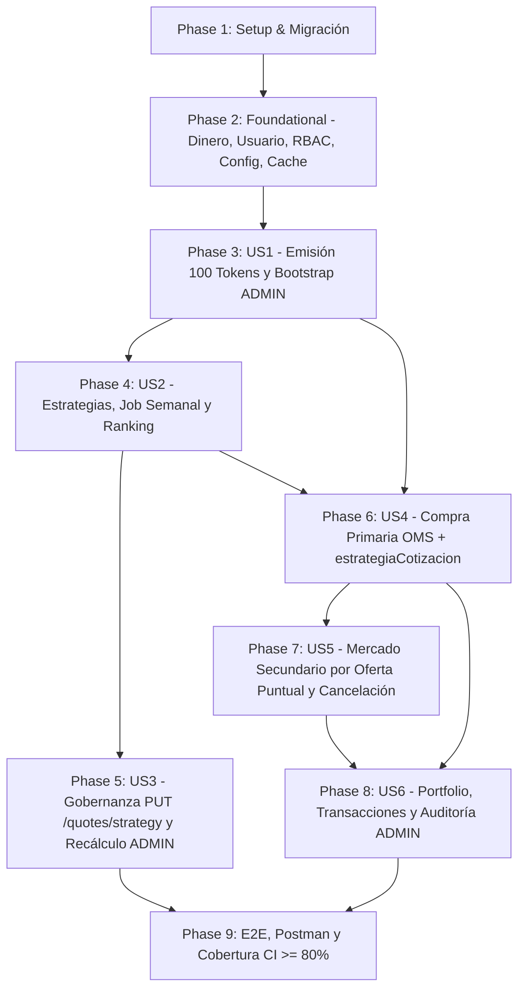

# Tasks: Marketplace de Tokens de Jugadores y Order Management System (OMS)

**Input**: Design documents from `specs/012-token-marketplace-oms/` (`spec.md`, `plan.md`, `research.md`, `data-model.md`, `contracts/openapi-marketplace-oms.yaml`, `quickstart.md`).  
**Prerequisites**: `plan.md` (required), `spec.md` (required for user stories), `research.md`, `data-model.md`, `contracts/openapi-marketplace-oms.yaml`.  
**Tests**: Se incluyen tareas obligatorias de pruebas unitarias de dominio, integración con Testcontainers y E2E de controladores en cumplimiento de los Principios III, IV y VI de la Constitución (cobertura mínima del 80% en líneas y branches sin alterar ningún test preexistente).  
**Organization**: Tareas agrupadas por historia de usuario con orden de dependencias verificado para permitir desarrollo, pruebas y entregas incrementales sin bloqueos circulares.

## Format: `[ID] [P?] [Story] Description with file path`

- **[P]**: Ejecutable en paralelo (archivos independientes, sin dependencias pendientes dentro de la misma fase).
- **[Story]**: Historia de usuario asociada (`[US1]`, `[US2]`, `[US3]`, `[US4]`, `[US5]`, `[US6]`).
- Todas las tareas especifican las rutas exactas de los archivos afectados.

---

## Phase 1: Setup (Infraestructura Compartida y Esquema Base)

**Purpose**: Dependencias, migración idempotente de base de datos, esqueleto modular del marketplace y helper aislado de pruebas con Testcontainers.

- [X] T001 Instalar la dependencia `@nestjs/schedule` compatible con NestJS 11 en `backend/package.json` y actualizar `backend/package-lock.json` sin modificar versiones mayores del stack existente.
- [X] T002 [P] Crear la migración idempotente `CreateMarketplaceAndOmsTables1730000000000` en `backend/src/migrations/1730000000000-create-marketplace-and-oms-tables.ts` usando `CREATE TABLE IF NOT EXISTS` y `ADD COLUMN IF NOT EXISTS`: añadir `rol` (`VARCHAR(20) NOT NULL DEFAULT 'USUARIO'`, `CHECK`) y `saldo` (`NUMERIC(12,2) NOT NULL DEFAULT 1000.00`, `CHECK >= 0`) a `usuarios`; crear `configuraciones_mercado` (con semilla inicial `'GLOBAL'` / `'GLOBAL_v1'`), `balances_tokens` (`UNIQUE (usuario_id, jugador_id)`, `CHECK >= 0`), `cotizaciones` (`score`, `valor >= 1.00`, `estrategia_id`, `estrategia_version`, `sin_estadisticas`, `metricas JSONB`), `ordenes` (`tipo`, `tipo_mercado`, `cantidad >= 1`, `cantidad_restante`, `precio_unitario > 0`, `estado`) y `transacciones` (`orden_id`, `comprador_id <> vendedor_id`, `estrategia_cotizacion VARCHAR(50) NOT NULL`), más índices y triggers `BEFORE UPDATE OR DELETE` de inmutabilidad sobre `cotizaciones` y `transacciones`.
- [X] T003 Registrar `CreateMarketplaceAndOmsTables1730000000000` en `backend/src/config/database.config.ts` y configurar `ScheduleModule.forRoot()` en `backend/src/app.module.ts`.
- [X] T004 Crear el esqueleto inicial de `MarketplaceModule` en `backend/src/marketplace/marketplace.module.ts` (importando `AuthModule`, `PlayersModule` y `ScrapingModule`), registrarlo en `backend/src/app.module.ts` y crear el helper aislado `MarketplaceTestDatabaseHelper` en `backend/test/integration/marketplace/marketplace-test-database.helper.ts` ejecutando las migraciones reales sobre PostgreSQL 16 con Testcontainers (sin modificar `TestDatabaseHelper` ni `ScrapingTestDatabaseHelper`).

---

## Phase 2: Foundational (Prerrequisitos Bloqueantes)

**Purpose**: Aritmética monetaria exacta, modelo de usuario retrocompatible, RBAC sin tocar `JwtStrategy`, configuración de estrategia, consulta de jugadores activos y caché L1 en Redis.

**⚠️ CRITICAL**: Completar esta fase antes de iniciar el trabajo en las historias de usuario.

- [X] T005 [P] Crear el Value Object `Dinero` basado en centavos enteros (redondeo half-up a 2 decimales, suma, resta no negativa, multiplicación por entero y comparadores) en `backend/src/domain/dinero.value-object.ts`.
- [X] T006 Actualizar de forma retrocompatible la entidad `Usuario` en `backend/src/domain/usuario.entity.ts` incorporando `rol` (`'ADMIN' | 'USUARIO'`, opcional en `UsuarioProps` con default `'USUARIO'`), `saldo` (almacenado con `Dinero`, opcional en `UsuarioProps` con default `1000.00`), y los métodos `debitarSaldo`, `acreditarSaldo`, `promoverAAdmin` y `esAdmin` sin romper ninguna llamada existente a `Usuario.crear(...)`.
- [X] T007 Actualizar `UsuarioOrmEntity` en `backend/src/data-access/usuario.orm-entity.ts`, `UsuarioMapper` en `backend/src/data-access/usuario.mapper.ts`, la interfaz `UsuarioRepository` en `backend/src/domain/usuario.repository.interface.ts` y `UsuarioTypeOrmRepository` en `backend/src/data-access/usuario.typeorm-repository.ts` añadiendo el mapeo de `rol`/`saldo` y `buscarAdmin()`, y exportar `USUARIO_REPOSITORY` en `backend/src/auth/auth.module.ts` (sin modificar `backend/src/auth/jwt.strategy.ts` ni `backend/src/services/auth.service.ts`).
- [X] T008 [P] Implementar el decorador `@Roles()` en `backend/src/common/decorators/roles.decorator.ts` y el guardia `RolesGuard` en `backend/src/common/guards/roles.guard.ts` consultando el usuario vigente desde `USUARIO_REPOSITORY` por `request.user.id` (rechazando con `401` cuentas inexistentes/inactivas y con `403` roles no autorizados, sin confiar en roles del cliente y reflejando cambios de rol inmediatos en BD).
- [X] T009 [P] Crear la entidad `ConfiguracionMercado` en `backend/src/domain/configuracion-mercado.entity.ts`, su interfaz `IConfiguracionMercadoRepository` en `backend/src/domain/configuracion-mercado.repository.interface.ts`, `ConfiguracionMercadoOrmEntity` en `backend/src/data-access/configuracion-mercado.orm-entity.ts`, `ConfiguracionMercadoMapper` en `backend/src/data-access/configuracion-mercado.mapper.ts` y `ConfiguracionMercadoTypeOrmRepository` en `backend/src/data-access/configuracion-mercado.typeorm-repository.ts`, registrándolos en `backend/src/marketplace/marketplace.module.ts`.
- [X] T010 [P] Extender `IJugadorRepository` en `backend/src/domain/jugador.repository.interface.ts` y `JugadorTypeOrmRepository` en `backend/src/data-access/jugador.typeorm-repository.ts` con `listarActivos(): Promise<Jugador[]>`, y extender `IEstadisticaJugadorRepository` en `backend/src/scraping/domain/estadistica-jugador.repository.interface.ts` y `EstadisticaJugadorTypeOrmRepository` en `backend/src/scraping/data-access/estadistica-jugador.typeorm-repository.ts` con `buscarPorJugadores(jugadorIds: string[]): Promise<EstadisticaJugador[]>` para precarga en lote sin consultas `N+1`.
- [X] T011 [P] Implementar el servicio de caché L1 `MarketplaceCacheService` con `ioredis` y degradación controlada (lectura/escritura e invalidación de ranking) en `backend/src/services/marketplace-cache.service.ts` y registrarlo en `backend/src/marketplace/marketplace.module.ts`.
- [X] T012 [P] Crear pruebas unitarias de dominio para `Dinero`, billetera de `Usuario` (`debitarSaldo`, `acreditarSaldo`, invariantes de rol) en `backend/test/unit/domain/usuario-wallet.spec.ts` y para `ConfiguracionMercado` en `backend/test/unit/domain/configuracion-mercado.entity.spec.ts`.
- [X] T013 Crear pruebas de integración en `backend/test/integration/marketplace/marketplace-rbac-migration.spec.ts` verificando `up`/`down` de la migración, inmutabilidad de triggers `BEFORE UPDATE OR DELETE` en `cotizaciones`/`transacciones`, y autorización de `RolesGuard` (`USUARIO` -> `403`, `ADMIN` -> permitido, cambio de rol en BD efectivo de inmediato).

**Checkpoint**: Base lista: `Dinero`, `Usuario` con billetera y rol, `RolesGuard`, `ConfiguracionMercado`, `listarActivos` y caché L1 operativos sin regresiones.

---

## Phase 3: User Story 1 - Emisión Inicial y Consulta del Mercado de Tokens (Priority: P1) 🎯 MVP

**Goal**: Garantizar la emisión transaccional e idempotente de exactamente 100 tokens indivisibles por jugador activo asignados inicialmente al único superusuario `ADMIN`, junto con su cotización base inicial de `1.00`, y aprovisionar al `ADMIN` de forma segura al arranque.

**Independent Test**: Inicializar el sistema con credenciales de `ADMIN` y catálogo de jugadores; comprobar que existe un único `ADMIN`, cada jugador activo posee exactamente 100 tokens disponibles en `balances_tokens` a nombre del `ADMIN` y una `Cotizacion` inicial de `1.00`, y que ejecuciones repetidas no duplican suministro.

### Tests para User Story 1
- [X] T014 [P] [US1] Crear pruebas unitarias para `BalanceToken` (`debitarDisponibles`, `bloquearTokens`, `liberarTokens`, `debitarBloqueados`, `acreditarTokens`, `cantidadTotal`, prohibición de negativos/decimales) en `backend/test/unit/domain/balance-token.entity.spec.ts`.
- [X] T015 [P] [US1] Crear pruebas unitarias para la entidad inmutable `Cotizacion` (`crearInicial`, `crearDesdeCalculo`, invariantes `0 <= score <= 1`, `valor >= 1.00`, `sinEstadisticas` y snapshot `metricas`) en `backend/test/unit/domain/cotizacion.entity.spec.ts`.

### Implementación para User Story 1
- [X] T016 [P] [US1] Crear la entidad `BalanceToken` en `backend/src/domain/balance-token.entity.ts` y la interfaz `IBalanceTokenRepository` en `backend/src/domain/balance-token.repository.interface.ts`.
- [X] T017 [P] [US1] Crear la entidad inmutable `Cotizacion` en `backend/src/domain/cotizacion.entity.ts` y la interfaz *insert-only* `ICotizacionRepository` (incluyendo `guardar` y `guardarMuchos` por bloques) en `backend/src/domain/cotizacion.repository.interface.ts`.
- [X] T018 [US1] Implementar `BalanceTokenOrmEntity` en `backend/src/data-access/balance-token.orm-entity.ts`, `BalanceTokenMapper` en `backend/src/data-access/balance-token.mapper.ts` y `BalanceTokenTypeOrmRepository` en `backend/src/data-access/balance-token.typeorm-repository.ts`.
- [X] T019 [P] [US1] Implementar `CotizacionOrmEntity` en `backend/src/data-access/cotizacion.orm-entity.ts`, `CotizacionMapper` en `backend/src/data-access/cotizacion.mapper.ts` y `CotizacionTypeOrmRepository` (solo inserción individual/por bloques `guardarMuchos` y lectura histórica/última cotización/variación) en `backend/src/data-access/cotizacion.typeorm-repository.ts`.
- [X] T020 [US1] Implementar `TokensService` en `backend/src/services/tokens.service.ts` con `emitirFaltantes()` y `asegurarEmisionJugador(jugadorId)` para emitir de forma transaccional e idempotente (`ON CONFLICT DO NOTHING`) los 100 tokens iniciales de cada jugador activo a favor del `ADMIN` junto con su `Cotizacion` base inicial (`valor = 1.00`, `score = 0.00`, `sinEstadisticas = true`, estrategia activa vigente), omitiendo con log de advertencia si no existe `ADMIN` o si el jugador está inactivo.
- [X] T021 [US1] Implementar `AdminBootstrapService` (`OnApplicationBootstrap`) en `backend/src/services/admin-bootstrap.service.ts` leyendo `ADMIN_CORREO`, `ADMIN_CONTRASENA` y `ADMIN_NOMBRE` (si faltan, registrar warning y omitir sin fallar; si existen, crear o promover de forma idempotente al único `ADMIN` e invocar `TokensService.emitirFaltantes()`), y registrar entidades, repositorios y servicios de US1 en `backend/src/marketplace/marketplace.module.ts`.
- [X] T022 [US1] Crear pruebas de integración en `backend/test/integration/marketplace/tokens-emission.spec.ts` validando bootstrap idempotente del único `ADMIN`, omisión limpia sin variables de entorno, emisión repetida sin duplicados, exclusión de jugadores inactivos y verificación SQL de invariante `SUM(cantidad_disponible + cantidad_bloqueada) = 100`.

**Checkpoint**: Suministro fijo de 100 tokens por jugador, cotización inicial de `1.00` y bootstrap de `ADMIN` verificados.

---

## Phase 4: User Story 2 - Cotización Dinámica por Estrategias y Recálculo Semanal (Priority: P1)

**Goal**: Calcular las cotizaciones dinámicas de los jugadores mediante `EstrategiaGlobal` (`GLOBAL_v1`) y `EstrategiaPosicional` (`POSICIONAL_v1`) con normalización determinista en $[0, 1]$, ejecutar el job semanal automatizado y exponer el historial de cotizaciones y el ranking de jugadores.

**Independent Test**: Ejecutar el cálculo sobre jugadores con estadísticas reales de distintas posiciones y sin estadísticas; verificar fórmulas exactas, snapshot `metricas`, `valor = round2(1.00 + score)`, persistencia histórica inmutable, scheduler semanal y respuestas en `GET /players/:id/quotes` y `GET /players/ranking`.

### Tests para User Story 2
- [X] T023 [P] [US2] Crear pruebas unitarias para `EstrategiaGlobal` (`GLOBAL_v1`) y `EstrategiaPosicional` (`POSICIONAL_v1` en `Delantero`, `Mediocampista`, `Defensa`, `Portero` y fallback `No Clasificado`, verificando suma de pesos $= 1.00$) en `backend/test/unit/domain/estrategia-cotizacion.spec.ts`.
- [X] T024 [P] [US2] Crear pruebas unitarias para `MetricasJugadorParaCotizacion` y normalización con límites de referencia fijos (`clamp` en $[0, 1]$, valores `null`, cero partidos, agregación ponderada de múltiples filas por temporada y métricas extremas) en `backend/test/unit/domain/estrategia-normalizacion.spec.ts`.

### Implementación para User Story 2
- [X] T025 [P] [US2] Crear la interfaz `EstrategiaCotizacion` en `backend/src/domain/strategies/estrategia-cotizacion.interface.ts` y el Value Object `MetricasJugadorParaCotizacion` en `backend/src/domain/strategies/metricas-jugador-cotizacion.value-object.ts` exponiendo las claves canónicas (`goals`, `assists`, `shots`, `keyPasses`, `dribbles`, `tackles`, `interceptions`, `saves`, `savePercentage`, `rating`) desde `EstadisticaJugador[]` (proyectando el getter preexistente `intercepccionesPorPartido` hacia `interceptions` sin renombrar `EstadisticaJugador`).
- [X] T026 [P] [US2] Implementar `EstrategiaGlobal` (`id: 'GLOBAL'`, `version: 'GLOBAL_v1'`) en `backend/src/domain/strategies/estrategia-global.strategy.ts` aplicando los máximos de referencia fijos (`FR-008`), clamp en $[0, 1]$, ponderaciones estándar (`FR-009`) y `valor = round2(1.00 + score * 1.00)`.
- [X] T027 [P] [US2] Implementar `EstrategiaPosicional` (`id: 'POSICIONAL'`, `version: 'POSICIONAL_v1'`) en `backend/src/domain/strategies/estrategia-posicional.strategy.ts` con los coeficientes exactos de `FR-009` (suma $= 1.00$): `Delantero` (`0.35*goals + 0.20*shots + 0.15*assists + 0.15*rating + 0.10*dribbles + 0.05*keyPasses + 0.00*tackles`), `Mediocampista` (`0.25*assists + 0.20*keyPasses + 0.15*dribbles + 0.15*rating + 0.10*goals + 0.10*tackles + 0.05*shots`), `Defensa` (`0.30*tackles + 0.25*interceptions + 0.25*rating + 0.05*keyPasses + 0.05*assists + 0.05*dribbles + 0.05*goals`), `Portero` (`0.55*rating + 0.30*savePercentage + 0.15*saves`) y fallback a `GLOBAL_v1` para `No Clasificado`.
- [X] T028 [US2] Implementar `QuotesService` en `backend/src/services/quotes.service.ts` con `obtenerHistorialCotizaciones(jugadorId, limite)`, `obtenerRanking(limite, posicion)` (incluyendo `variacionPorcentual`, `tokensDisponibles` y caché L1 vía `MarketplaceCacheService`) y `recalcularCotizacionesActivas()` (precargando estadísticas en lote con `buscarPorJugadores`, ignorando jugadores inactivos, persistiendo nuevas `Cotizacion` en bloques con fallback individual ante fallo parcial para no abortar el lote ni sobrescribir el histórico e invalidando la caché de ranking).
- [X] T029 [US2] Implementar `QuotesSchedulerService` en `backend/src/services/scheduler/quotes-scheduler.service.ts` con `@Cron('0 0 * * 0')` y protección contra ejecuciones solapadas mediante `pg_try_advisory_lock`.
- [X] T030 [P] [US2] Crear los DTOs `CotizacionRespuestaDto` (con `sinEstadisticas` y `metricas` usando las claves canónicas de `FR-008`) en `backend/src/controllers/dto/cotizacion.dto.ts` y `JugadorRankingDto` (con `variacionPorcentual`, `estrategiaId`, `estrategiaVersion`, `tokensDisponibles` y query DTO) en `backend/src/controllers/dto/ranking-jugadores.dto.ts`.
- [X] T031 [US2] Exponer `GET /players/ranking` y `GET /players/:id/quotes` en `backend/src/controllers/players.controller.ts` exhaustivamente documentados con decoradores `@nestjs/swagger` (`@ApiOperation`, `@ApiParam`, `@ApiQuery`, `@ApiResponse` alineados con `contracts/openapi-marketplace-oms.yaml`), ubicando `@Get('ranking')` antes de `@Get(':id')` e inyectando `@Optional() private readonly quotesService?: QuotesService` para preservar intacto `players.controller.spec.ts`, y actualizar `backend/src/players/players.module.ts` (`forwardRef(() => MarketplaceModule)`) y `backend/src/marketplace/marketplace.module.ts`.
- [X] T032 [P] [US2] Crear pruebas de integración para historial de cotizaciones, ranking con variación/suministro, caché L1 y benchmark de latencia $< 200\text{ ms}$ en `backend/test/integration/marketplace/quotes.service.spec.ts`.
- [X] T033 [US2] Crear pruebas de integración para `QuotesSchedulerService` en `backend/test/integration/marketplace/quotes-scheduler.spec.ts` cubriendo ejecución del handler, jugador sin estadísticas (`valor = 1.00`, `sinEstadisticas = true`), prevención de solapamiento, tolerancia a fallo parcial sin sobrescribir el histórico y benchmark reproducible a escala completa sembrando la totalidad del catálogo objetivo (`2.500` jugadores activos) y verificando `duracionMs / totalJugadoresProcesados < 50` ms/jugador (`SC-002`).

**Checkpoint**: Motor de cotizaciones dinámicas, job semanal, historial con desglose y ranking funcionando de extremo a extremo.

---

## Phase 5: User Story 3 - Configuración y Administración de Estrategias por Superusuario (Priority: P2)

**Goal**: Permitir exclusivamente al rol `ADMIN` conmutar la estrategia activa del marketplace (`PUT /quotes/strategy`), consultar versiones vigentes (`GET /quotes/strategy`) y disparar el recálculo manual masivo (`POST /quotes/recalculate`).

**Independent Test**: Invocar `PUT /quotes/strategy` y `POST /quotes/recalculate` con token de `USUARIO` (rechazado con `403`) y con token de `ADMIN` (`200 OK`, persiste `POSICIONAL` / `POSICIONAL_v1` y recalcula todos los jugadores activos bajo la nueva estrategia).

### Implementación y Tests para User Story 3
- [X] T034 [P] [US3] Crear los DTOs `CambiarEstrategiaDto`, `ConfiguracionEstrategiaRespuestaDto` en `backend/src/controllers/dto/configuracion-estrategia.dto.ts` y `ResumenRecalculoDto` en `backend/src/controllers/dto/recalculo-cotizaciones.dto.ts`.
- [X] T035 [US3] Extender `QuotesService` en `backend/src/services/quotes.service.ts` con `obtenerConfiguracionEstrategia()`, `cambiarEstrategiaActiva(estrategiaId, adminId)` y `recalcularCotizacionesManual()`.
- [X] T036 [US3] Crear `QuotesController` en `backend/src/controllers/quotes.controller.ts` exponiendo `GET /quotes/strategy`, `PUT /quotes/strategy` (`JwtAuthGuard`, `RolesGuard`, `@Roles('ADMIN')`) y `POST /quotes/recalculate` (`JwtAuthGuard`, `RolesGuard`, `@Roles('ADMIN')`), documentados con Swagger y registrados en `backend/src/marketplace/marketplace.module.ts`.
- [X] T037 [US3] Crear pruebas de integración en `backend/test/integration/marketplace/quotes-admin.spec.ts` validando consulta de versiones vigentes, cambio de estrategia por `ADMIN`, rechazo `403` para `USUARIO`, `401` sin token, `400` ante estrategia inexistente y recálculo manual reflejando `POSICIONAL_v1`.

**Checkpoint**: Gobernanza administrativa de estrategias y recálculo bajo demanda protegidos con RBAC.

---

## Phase 6: User Story 4 - Compra de Tokens en Mercado Primario vía OMS (Priority: P1)

**Goal**: Permitir a los usuarios inversores comprar tokens directamente del inventario disponible del `ADMIN` al precio oficial vigente mediante el OMS con bloqueo transaccional A.C.I.D., guardando en la transacción el campo `estrategiaCotizacion` de la cotización vigente del token.

**Independent Test**: Ejecutar `POST /orders/buy` (sin `ordenVentaId`) con un usuario con saldo suficiente; comprobar débito exacto en `Dinero`, transferencia de tokens desde `ADMIN`, orden `COMPLETADA`, registro inmutable en `Transaccion` con `estrategiaCotizacion` y conservación estricta de 100 tokens totales.

### Tests para User Story 4
- [X] T038 [P] [US4] Crear pruebas unitarias para la entidad `Orden` (órdenes `COMPRA` inmediatas en `COMPLETADA` y máquina de estados `PENDIENTE -> PARCIAL -> COMPLETADA / CANCELADA` para órdenes `VENTA`) en `backend/test/unit/domain/orden.entity.spec.ts`.
- [X] T039 [P] [US4] Crear pruebas unitarias para la entidad inmutable `Transaccion` (cálculo exacto de `montoTotal` con `Dinero`, obligatoriedad de `estrategiaCotizacion`, prohibición `compradorId === vendedorId`) en `backend/test/unit/domain/transaccion.entity.spec.ts`.

### Implementación para User Story 4
- [X] T040 [P] [US4] Crear la entidad `Orden` en `backend/src/domain/orden.entity.ts` y la interfaz `IOrdenRepository` en `backend/src/domain/orden.repository.interface.ts` (definiendo la política de ejecución inmediata para `COMPRA` sin órdenes `PENDIENTE`).
- [X] T041 [P] [US4] Crear la entidad inmutable `Transaccion` en `backend/src/domain/transaccion.entity.ts` (incluyendo `estrategiaCotizacion: string`) y la interfaz *insert-only* `ITransaccionRepository` en `backend/src/domain/transaccion.repository.interface.ts`.
- [X] T042 [US4] Implementar `OrdenOrmEntity` en `backend/src/data-access/orden.orm-entity.ts`, `OrdenMapper` en `backend/src/data-access/orden.mapper.ts` y `OrdenTypeOrmRepository` en `backend/src/data-access/orden.typeorm-repository.ts`.
- [X] T043 [P] [US4] Implementar `TransaccionOrmEntity` (con columna `estrategia_cotizacion`) en `backend/src/data-access/transaccion.orm-entity.ts`, `TransaccionMapper` en `backend/src/data-access/transaccion.mapper.ts` y `TransaccionTypeOrmRepository` en `backend/src/data-access/transaccion.typeorm-repository.ts`.
- [X] T044 [US4] Implementar `OmsService` en `backend/src/services/oms.service.ts` con `comprarTokens(compradorId, dto)` para el mercado primario (`ordenVentaId` omitido) bajo `DataSource.transaction`, adquiriendo locks `SELECT ... FOR UPDATE` en orden determinista de UUID sobre comprador, `ADMIN` y `balances_tokens`, validando jugador activo, no autocompra del `ADMIN`, `precioMaximoUnitario`, saldo y stock suficientes, persistiendo `Orden` (`COMPLETADA`) y `Transaccion` con `estrategiaCotizacion` tomada de la `Cotizacion` vigente del jugador e invalidando caché de ranking.
- [X] T045 [P] [US4] Crear los DTOs `CrearOrdenCompraDto` (`jugadorId`, `cantidad`, `ordenVentaId?`, `precioMaximoUnitario?`) y `ResultadoCompraDto` (incluyendo `estrategiaCotizacion`) en `backend/src/controllers/dto/orden-compra.dto.ts`.
- [X] T046 [US4] Crear `OrdersController` en `backend/src/controllers/orders.controller.ts` exponiendo `POST /orders/buy` protegido por `JwtAuthGuard`, documentado con decoradores `@nestjs/swagger` (`@ApiBearerAuth`, `@ApiOperation`, `@ApiResponse` alineados con `contracts/openapi-marketplace-oms.yaml`), y registrar entidades, repositorios, `OmsService` y controlador en `backend/src/marketplace/marketplace.module.ts`.
- [X] T047 [US4] Crear pruebas de integración en `backend/test/integration/marketplace/oms-primario.service.spec.ts` validando compra primaria exitosa en $< 500\text{ ms}$ (`SC-004`), registro de `estrategiaCotizacion` (tanto con `GLOBAL_v1` como tras cambiar a `POSICIONAL_v1`), rechazo por fondos insuficientes, exceso de suministro, jugador inactivo, `precioMaximoUnitario`, autocompra del `ADMIN` y ráfaga concurrente sobre el último lote primario comprobando `0` sobreventas/sobregiros (`SC-005`) y `SUM(cantidad_disponible + cantidad_bloqueada) = 100` (`SC-001`).

**Checkpoint**: Compras en mercado primario atómicas, libres de carreras y con trazabilidad de `estrategiaCotizacion`.

---

## Phase 7: User Story 5 - Trading de Tokens entre Usuarios en Mercado Secundario vía OMS (Priority: P2)

**Goal**: Habilitar el mercado secundario P2P: publicación de órdenes de venta con custodia preventiva (`POST /orders/sell`), consulta del libro de ofertas (`GET /orders`), compra total o parcial eligiendo una oferta puntual (`POST /orders/buy` con `ordenVentaId`) guardando `estrategiaCotizacion`, y cancelación por el propietario (`DELETE /orders/:id`).

**Independent Test**: Publicar una oferta con el Usuario A (`POST /orders/sell`), consultarla en `GET /orders`, comprarla parcial y totalmente con el Usuario B enviando `ordenVentaId` en `POST /orders/buy` (verificando `estrategiaCotizacion` y concurrencia), y cancelar otra oferta pendiente con `DELETE /orders/:id` comprobando la liberación de custodia.

### Implementación y Tests para User Story 5
- [X] T048 [P] [US5] Crear los DTOs `CrearOrdenVentaDto`, `FiltroOrdenesVentaDto` y `OrdenVentaRespuestaDto` en `backend/src/controllers/dto/orden-venta.dto.ts`.
- [X] T049 [US5] Extender `OmsService` en `backend/src/services/oms.service.ts` con `crearOrdenVenta(vendedorId, dto)` (custodia `bloquearTokens`), `listarOrdenesVenta(filtros)` (`precioUnitario ASC, creadoEn ASC`), `cancelarOrdenVenta(usuarioId, ordenId)` (`403` ajena, `409` ya completada/cancelada, liberación `liberarTokens`) y la rama secundaria de `comprarTokens(compradorId, dto)` cuando se envía `ordenVentaId` (bloqueo `FOR UPDATE` determinista sobre `Orden`, usuarios y balances; soporte de compra parcial/total; `409` si ya no está activa; rechazo de autocontratación y jugador inactivo; registro de `Transaccion` `SECUNDARIO` con `estrategiaCotizacion` de la cotización oficial vigente del jugador).
- [X] T050 [US5] Extender `OrdersController` en `backend/src/controllers/orders.controller.ts` exponiendo `GET /orders` (público), `POST /orders/sell` (`JwtAuthGuard`) y `DELETE /orders/:id` (`JwtAuthGuard`) documentados con Swagger (`200/201/400/401/403/404/409`).
- [X] T051 [US5] Crear pruebas de integración en `backend/test/integration/marketplace/oms-secundario.service.spec.ts` validando custodia preventiva, listado del libro secundario, compra parcial y total de oferta puntual (`ordenVentaId`) liquidada en $< 500\text{ ms}$ (`SC-004`), persistencia de `estrategiaCotizacion`, rechazo de *wash trading*, ráfaga concurrente sobre el último lote secundario (`409`/`400` con `0` sobreventas `SC-005` y suma contable exacta de `100` tokens `SC-001`) y cancelación autorizada vs no autorizada (`403`) o repetida (`409`).

**Checkpoint**: Trading secundario P2P por selección de oferta puntual con custodia y cancelación plenamente operativo.

---

## Phase 8: User Story 6 - Consulta de Portfolio, Histórico de Transacciones y Auditoría Global (Priority: P2)

**Goal**: Exponer el portafolio consolidado y valorizado del usuario (`GET /users/:id/portfolio`), su historial filtrable de transacciones incluyendo `estrategiaCotizacion` (`GET /users/:id/transactions`) y el reporte global de auditoría para `ADMIN` (`GET /admin/transactions`).

**Independent Test**: Ejecutar compras primarias y secundarias bajo distintas estrategias, consultar `GET /users/:id/portfolio`, `GET /users/:id/transactions` (con filtros y `403` ante identidad ajena) y `GET /admin/transactions` (exclusivo `ADMIN`), comprobando saldos, `precioPromedioAdquisicion`, valorizaciones y `estrategiaCotizacion`.

### Implementación y Tests para User Story 6
- [X] T052 [P] [US6] Crear los DTOs `PortfolioUsuarioDto`, `PosicionPortafolioDto` (incluyendo `precioPromedioAdquisicion`) en `backend/src/controllers/dto/portfolio-usuario.dto.ts` y `TransaccionUsuarioDto`, `TransaccionAuditoriaDto`, `FiltroTransaccionesUsuarioDto`, `FiltroTransaccionesAdminDto` (incluyendo `estrategiaCotizacion`) en `backend/src/controllers/dto/transaccion-usuario.dto.ts`.
- [X] T053 [US6] Extender `OmsService` en `backend/src/services/oms.service.ts` con `obtenerPortfolioUsuario(solicitanteId, usuarioId)` (cálculo de `precioPromedioAdquisicion`, `valoracionTotalPosicion`, `patrimonioNetoTotal` y validación propio o `ADMIN` con `403`), `obtenerHistorialTransaccionesUsuario(solicitanteId, usuarioId, filtros)` (filtros `jugadorId`, `tipo`, `desde`, `hasta`, `limite`, orden cronológico estable y `estrategiaCotizacion`) y `obtenerAuditoriaGlobalTransacciones(filtros)` (filtros `jugadorId`, `usuarioId`, `tipoMercado`, `desde`, `hasta`, `limite`).
- [X] T054 [US6] Crear `UsersController` en `backend/src/controllers/users.controller.ts` (`GET /users/:id/portfolio` y `GET /users/:id/transactions` protegidos con `JwtAuthGuard`) y `AdminTransactionsController` en `backend/src/controllers/admin-transactions.controller.ts` (`GET /admin/transactions` protegido con `JwtAuthGuard`, `RolesGuard` y `@Roles('ADMIN')`), exhaustivamente documentados con decoradores `@nestjs/swagger` (`@ApiBearerAuth`, `@ApiOperation`, `@ApiParam`, `@ApiQuery`, `@ApiResponse` alineados con `contracts/openapi-marketplace-oms.yaml`) y registrados en `backend/src/marketplace/marketplace.module.ts`.
- [X] T055 [US6] Crear pruebas de integración en `backend/test/integration/marketplace/users-portfolio.spec.ts` validando agregación de portfolio (`precioPromedioAdquisicion`, tenencias disponibles y en custodia, patrimonio neto), benchmark explícito de latencia $< 200\text{ ms}$ para la consulta de portfolio (`GET /users/:id/portfolio` / `obtenerPortfolioUsuario`), filtros combinados de transacciones con `estrategiaCotizacion`, bloqueo `403` a terceros sin rol `ADMIN` y auditoría global `GET /admin/transactions`.

**Checkpoint**: Los 12 endpoints del marketplace y OMS expuestos, documentados con Swagger y verificados en integración.

---

## Phase 9: Polish & Cross-Cutting Concerns

**Purpose**: Suite E2E integral para cobertura de controladores, colección Postman actualizada, enforcement de cobertura en CI y validación de despliegue local con Docker conforme al DoD de la Constitución.

- [X] T056 Crear la suite E2E `backend/test/e2e/marketplace-oms.e2e-spec.ts` cubriendo de extremo a extremo los 12 endpoints, la validación del documento Swagger (`/api/docs`), las aserciones de latencia HTTP $< 200\text{ ms}$ en `GET /players/ranking` y `GET /users/:id/portfolio`, y los escenarios de `specs/012-token-marketplace-oms/quickstart.md` (bootstrap `ADMIN`, cambio de estrategia `PUT /quotes/strategy` y `403`, recálculo manual, historial/ranking, compra primaria con `estrategiaCotizacion`, orden de venta + `GET /orders` + compra puntual `ordenVentaId` + carrera concurrente + `DELETE /orders/:id`, portfolio, filtros históricos y auditoría `GET /admin/transactions`).
- [X] T057 [P] Actualizar la colección de Postman en `postman/collection.json` incorporando carpetas, ejemplos de request/response y validaciones para los 12 endpoints del marketplace y OMS.
- [X] T058 [P] Configurar el reporte completo y enforcement automático de cobertura en CI actualizando `backend/test/jest-integration.json` (añadiendo `"src/common/**/*.ts"` a `collectCoverageFrom` para reportar `RolesGuard` y `@Roles` a SonarCloud) y `.github/workflows/ci.yml` (incorporando en el job `backend` la ejecución de `npm run test:cov -- --runInBand --testTimeout=60000` y verificando el ratchet contra los umbrales fuente preexistentes `lines/branches/functions/statements: 80` en `backend/jest.config.js` y `backend/test/jest-unit.json`, prohibiendo cualquier reducción respecto a `80%`).
- [X] T059 Ejecutar en `backend/` `npm run build`, `npm run test:unit:cov`, `npm run test:integration:cov`, `npm run test:e2e:cov` y `npm run test:cov -- --runInBand --testTimeout=60000` verificando cobertura de líneas y branches $\ge 80\%$ y no regresión del ratchet en `backend/jest.config.js` y `backend/test/jest-unit.json`, comprobar con `git diff -- 'backend/test/**/*.spec.ts' 'backend/test/**/*.e2e-spec.ts'` que ningún test preexistente haya sido modificado ni eliminado (Principio IV), y validar el levantamiento local con Docker (`docker compose up -d postgres` + arranque del backend y smoke HTTP `200` en `/api/docs` y `/quotes/strategy` conforme al DoD de la Constitución).

---

## Dependencies & Execution Order

### Phase Dependencies



### User Story & Task Dependencies

- **Phase 1 -> Phase 2**: `T001`–`T004` habilitan migración, `ScheduleModule`, `MarketplaceModule` y `MarketplaceTestDatabaseHelper` antes de cualquier prueba de integración.
- **US1 (Emisión y Bootstrap ADMIN)**: Depende de Phase 2. Inicializa los 100 tokens y la cotización base `1.00` requeridos por ranking y OMS.
- **US2 (Cotización Dinámica y Ranking)**: Depende de US1 (`Cotizacion` y `TokensService`). `T025` (interfaz y `MetricasJugadorParaCotizacion`) precede a `T026`/`T027` (estrategias), que a su vez preceden a `T028`/`T029`.
- **US3 (Gobernanza ADMIN)**: Depende de US2 (`QuotesService`) y de `RolesGuard`/`ConfiguracionMercado` (Phase 2).
- **US4 (Compra Mercado Primario)**: Depende de US1 y US2. Introduce `Orden` y `Transaccion` (con `estrategiaCotizacion`) en la misma fase para satisfacer la clave foránea `transacciones.orden_id`.
- **US5 (Mercado Secundario por Oferta Puntual)**: Depende de US4 (`Orden`, `Transaccion`, `OmsService`).
- **US6 (Portfolio, Historial y Auditoría ADMIN)**: Depende de US4 y US5.

---

## Parallel Opportunities

```bash
# Ejecución en paralelo dentro de Phase 2 (Foundational):
Task T005: "Value Object Dinero en backend/src/domain/dinero.value-object.ts"
Task T008: "Decorador @Roles y RolesGuard en backend/src/common/"
Task T009: "ConfiguracionMercado dominio + ORM + repo"
Task T010: "IJugadorRepository.listarActivos()"
Task T011: "MarketplaceCacheService en backend/src/services/marketplace-cache.service.ts"

# Ejecución en paralelo dentro de Phase 4 (US2 - Estrategias):
Task T023: "Tests unitarios de EstrategiaGlobal y EstrategiaPosicional"
Task T024: "Tests unitarios de normalización y agregación contextual"
Task T026: "Implementar EstrategiaGlobal (GLOBAL_v1)"   # tras T025
Task T027: "Implementar EstrategiaPosicional (POSICIONAL_v1)" # tras T025

# Ejecución en paralelo dentro de Phase 6 (US4 - Dominio OMS):
Task T038: "Tests unitarios de Orden"
Task T039: "Tests unitarios de Transaccion (con estrategiaCotizacion)"
Task T040: "Entidad e interfaz de Orden"
Task T041: "Entidad e interfaz de Transaccion"
```

---

## Implementation Strategy

### MVP First (Phase 1 + Phase 2 + US1 + US2 + US4)
1. Completar Setup (Phase 1) y Foundational (Phase 2).
2. Implementar US1 (Bootstrap `ADMIN` + emisión idempotente de 100 tokens y cotización inicial `1.00`) y US2 (Estrategias `GLOBAL_v1`/`POSICIONAL_v1`, job semanal, historial y ranking).
3. Implementar US4 (Compra atómica en mercado primario registrando `estrategiaCotizacion`).
4. **Validar MVP**: Los jugadores están emitidos con 100 tokens, valuados por rendimiento real y pueden comprarse atómicamente en el mercado primario.

### Entrega Incremental Completa
1. Añadir US3: Gobernanza administrativa (`GET/PUT /quotes/strategy` y `POST /quotes/recalculate`).
2. Añadir US5: Mercado secundario P2P con libro `GET /orders`, custodia en `POST /orders/sell`, compra de oferta puntual `ordenVentaId` y cancelación `DELETE /orders/:id`.
3. Añadir US6: Portfolio valorizado con `precioPromedioAdquisicion`, historial filtrable de usuario con `estrategiaCotizacion` y auditoría global `GET /admin/transactions`.
4. Polish (Phase 9): Suite E2E completa de los 12 endpoints, colección Postman actualizada y cobertura $\ge 80\%$ verificada en todas las capas.
