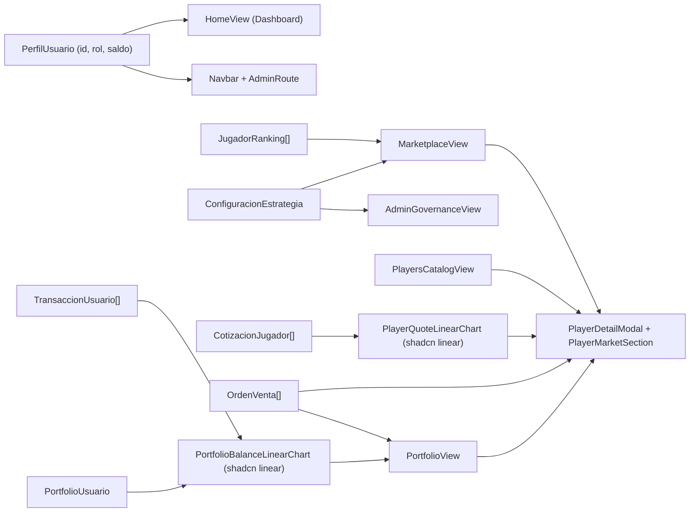
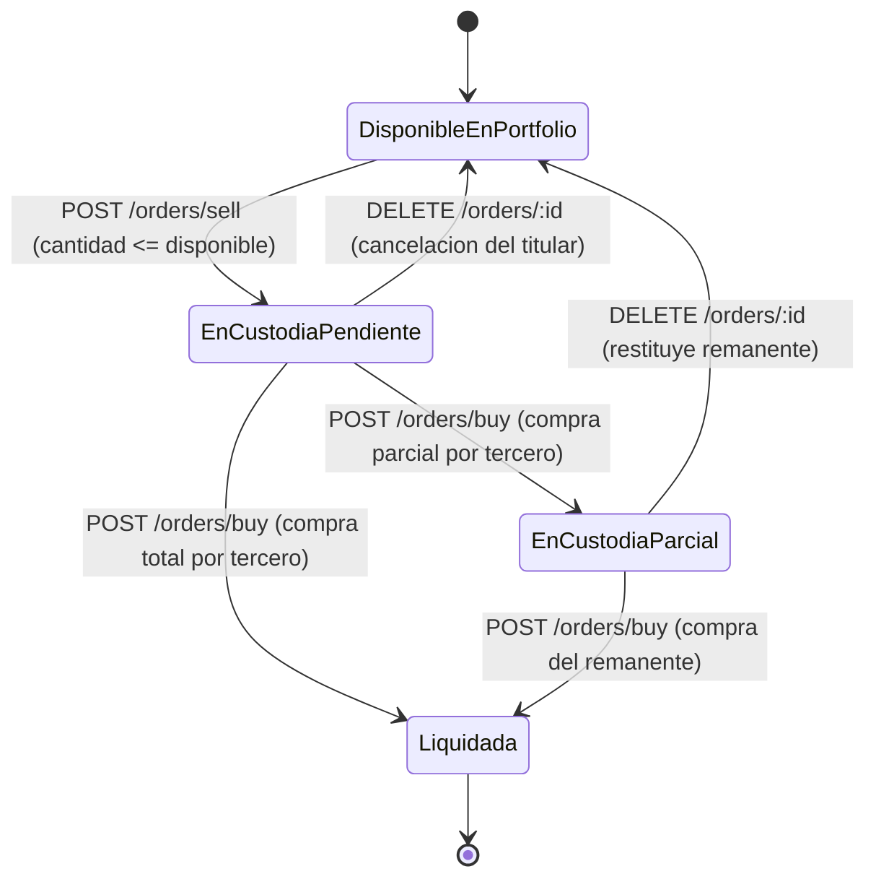

# Data Model: Experiencia Integral de Marketplace de Tokens, Trading, Portfolio Personal y Gobernanza

**Feature**: `013-marketplace-frontend` | **Phase**: 1 — Design & Contracts | **Date**: 2026-11-02

---

## 1. Extensión Aditiva Retrocompatible de Sesión y Rol (`PerfilUsuarioDto` / `PerfilUsuario`)

### 1.1 Backend (`backend/src/controllers/dto/respuesta-autenticacion.dto.ts` y `AuthService.mapearPerfil`)

Único ajuste en `backend/`: exposición aditiva de `rol` y `saldo` sobre las propiedades ya existentes de `Usuario` (`backend/src/domain/usuario.entity.ts`), decoradas con `@ApiProperty` para sincronización automática en Swagger (`/api/docs-json`), sin alterar base de datos, migraciones, `AuthController` ni `JwtStrategy`.

```typescript
import { ApiProperty } from '@nestjs/swagger';
import { RolUsuario } from '../../domain/usuario.entity';

export class PerfilUsuarioDto {
  @ApiProperty({ example: '123e4567-e89b-12d3-a456-426614174000' })
  id: string;        // UUID v4

  @ApiProperty({ example: 'Juan Perez' })
  nombre: string;

  @ApiProperty({ example: 'juan.perez@ejemplo.com' })
  correo: string;

  @ApiProperty({ example: true })
  activo: boolean;

  @ApiProperty({ example: '2026-09-16T22:30:00.000Z' })
  creadoEn: Date;

  @ApiProperty({ enum: ['USUARIO', 'ADMIN'], example: 'USUARIO' })
  rol: RolUsuario;   // 'USUARIO' | 'ADMIN' (NUEVO - aditivo)

  @ApiProperty({ example: 1000 })
  saldo: number;     // usuario.saldo.aNumero() en créditos con 2 dec (NUEVO - aditivo)
}
```

### 1.2 Frontend (`frontend/src/types/auth.types.ts` y `frontend/src/services/storage.service.ts`)

`rol` y `saldo` se declaran **opcionales (`?`)** en TypeScript y `.optional()` en `PerfilUsuarioSchema` (Zod v4 `.strict()`) para mantener 100% de compatibilidad con `tests/unit/storage.service.test.ts` y los mocks preexistentes en `frontend/tests/**`.

```typescript
export type RolUsuario = 'USUARIO' | 'ADMIN';

export interface PerfilUsuario {
  id: string;
  nombre: string;
  correo: string;
  activo: boolean;
  creadoEn: string;
  rol?: RolUsuario;
  saldo?: number;
}

export interface ContextoAutenticacion extends EstadoAutenticacion {
  login: (credenciales: CredencialesLogin) => Promise<void>;
  logout: () => void;
  limpiarError: () => void;
  refrescarPerfil?: () => Promise<void>; // Opcional para no romper proveedores mockeados existentes
}
```

---

## 2. Entidades y Contratos Tipados del Marketplace en Frontend (`frontend/src/types/marketplace.types.ts`)

Siguiendo el **Principio V de la Constitución**, los identificadores de dominio se escriben en español sin acentos ni `ñ` y los sufijos técnicos en inglés (`Payload`, `Filter`, `Summary`, `Point`, `Props`).

### 2.1 Tipos Canónicos y Enumeraciones de Dominio

```typescript
import type { PosicionJugador } from './player.types';

export type EstrategiaId = 'GLOBAL' | 'POSICIONAL';
export type EstrategiaVersion = 'GLOBAL_v1' | 'POSICIONAL_v1' | string;
export type PosicionFiltroRanking = Exclude<PosicionJugador, 'No Clasificado'>;
export type TipoMercado = 'PRIMARIO' | 'SECUNDARIO';
export type TipoOperacionUsuario = 'COMPRA' | 'VENTA';
export type EstadoOrdenVenta = 'PENDIENTE' | 'PARCIAL' | 'COMPLETADA' | 'CANCELADA';
export type EstadoFiltroOrdenes = 'ACTIVA' | EstadoOrdenVenta;
export type VarianteTendencia = 'positiva' | 'negativa' | 'neutra';
```

### 2.2 Estrategia de Mercado, Ranking e Historial de Cotizaciones

```typescript
export interface EstrategiaDisponible {
  id: EstrategiaId;
  version: EstrategiaVersion;
  descripcion: string;
}

export interface ConfiguracionEstrategia {
  estrategiaActivaId: EstrategiaId;
  estrategiaActivaVersion: EstrategiaVersion;
  actualizadoEn: string; // ISO-8601
  estrategiasDisponibles: EstrategiaDisponible[];
}

export interface JugadorRanking {
  posicionRanking: number;
  jugadorId: string;
  nombre: string;
  posicion: PosicionJugador;
  equipoNombre: string;
  score: number;               // [0, 1]
  cotizacionActual: number;    // créditos >= 1.00
  variacionPorcentual: number; // ej. 5.59, -3.12, 0
  estrategiaId: EstrategiaId;
  estrategiaVersion: EstrategiaVersion;
  tokensDisponibles: number;   // stock primario ADMIN + órdenes secundarias activas (sobre 100 fijos)
}

export interface SnapshotMetricasNormalizadas {
  goals?: number;
  assists?: number;
  shots?: number;
  keyPasses?: number;
  dribbles?: number;
  tackles?: number;
  interceptions?: number;
  saves?: number;
  savePercentage?: number;
  rating?: number;
}

export interface CotizacionJugador {
  id: string;
  jugadorId: string;
  score: number;
  valor: number;
  estrategiaId: EstrategiaId;
  estrategiaVersion: EstrategiaVersion;
  sinEstadisticas: boolean;
  metricas: SnapshotMetricasNormalizadas | null;
  fechaCotizacion: string; // ISO-8601
}
```

### 2.3 Órdenes de Compra/Venta (OMS Primario y Secundario)

```typescript
export interface CrearOrdenCompraPayload {
  jugadorId: string;             // Obligatorio tanto en PRIMARIO como en SECUNDARIO
  cantidad: number;              // Entero >= 1
  ordenVentaId?: string;         // Si se define -> compra SECUNDARIA sobre oferta puntual
  precioMaximoUnitario?: number; // Opcional (> 0)
}

export interface ResultadoCompra {
  transaccionId: string;
  ordenId: string;
  jugadorId: string;
  cantidadTokensComprados: number;
  precioUnitarioPagado: number;
  montoTotalDebitado: number;
  saldoRestanteUsuario: number;
  tipoMercado: TipoMercado;
  estrategiaCotizacion: string;
  fecha: string; // ISO-8601
}

export interface CrearOrdenVentaPayload {
  jugadorId: string;
  cantidad: number;       // Entero >= 1 <= cantidadTokensDisponibles
  precioUnitario: number; // > 0
}

export interface OrdenVenta {
  ordenId: string;
  jugadorId: string;
  vendedorId: string;
  cantidad: number;
  cantidadRestante: number;
  precioUnitario: number;
  estado: EstadoOrdenVenta;
  creadoEn: string;
  actualizadoEn: string;
}

export interface FiltroOrdenesVenta {
  jugadorId?: string;
  vendedorId?: string;
  estado?: EstadoFiltroOrdenes;
  limite?: number; // 1..100
}
```

### 2.4 Portfolio Personal, Historial del Usuario y Gobernanza / Auditoría

```typescript
export interface PosicionPortafolio {
  jugadorId: string;
  nombreJugador: string;
  posicion: string;
  equipoNombre: string;
  cantidadTokensDisponibles: number;
  cantidadTokensEnVenta: number; // En custodia preventiva por órdenes activas
  precioPromedioAdquisicion: number;
  cotizacionActual: number;
  valoracionTotalPosicion: number;
}

export interface PortfolioUsuario {
  usuarioId: string;
  saldoBilletera: number;
  valoracionTotalTokens: number;
  patrimonioNetoTotal: number;
  posiciones: PosicionPortafolio[];
}

export interface TransaccionUsuario {
  transaccionId: string;
  ordenId: string;
  tipoOperacion: TipoOperacionUsuario;
  tipoMercado: TipoMercado;
  jugadorId: string;
  nombreJugador: string;
  cantidadTokens: number;
  precioUnitario: number;
  montoTotal: number;
  estrategiaCotizacion: string;
  contraparte: string; // 'MERCADO_PRIMARIO' o UUID de contraparte
  fecha: string;
}

export interface FiltroTransaccionesUsuario {
  jugadorId?: string;
  tipo?: TipoOperacionUsuario;
  desde?: string;  // ISO-8601 normalizado
  hasta?: string;  // ISO-8601 normalizado
  limite?: number; // 1..100 (máximo estricto en backend)
}

export interface ResumenRecalculo {
  mensaje: string;
  totalJugadoresProcesados: number;
  exitosos: number;
  fallidos: number;
  sinEstadisticas: number;
  estrategiaAplicada: EstrategiaId;
  versionEstrategia: EstrategiaVersion;
  duracionMs: number;
}

export interface TransaccionAuditoria {
  transaccionId: string;
  ordenId: string;
  tipoMercado: TipoMercado;
  jugadorId: string;
  nombreJugador: string;
  compradorId: string;
  vendedorId: string;
  cantidadTokens: number;
  precioUnitario: number;
  montoTotal: number;
  estrategiaCotizacion: string;
  fecha: string;
}

export interface FiltroTransaccionesAdmin {
  jugadorId?: string;
  usuarioId?: string;
  tipoMercado?: TipoMercado;
  desde?: string;  // ISO-8601 normalizado
  hasta?: string;  // ISO-8601 normalizado
  limite?: number; // 1..200 (máximo estricto en backend)
}
```

---

## 3. Modelos Derivados de Dominio UI y Series Lineales (`src/utils/`)

### 3.1 Serie Lineal de Cotizaciones (`src/utils/quotes-chart.ts`)

```typescript
export interface PuntoGraficoCotizacion {
  id: string;
  fechaIso: string;
  etiquetaEjeX: string;      // Formato corto cronológico ("02 nov" o "02/11 14:30" si colisiona día)
  fechaFormateada: string;   // Formato completo para ChartTooltipContent
  valor: number;             // Eje Y: créditos
  score: number;             // 4 decimales en tooltip
  estrategiaId: EstrategiaId;
  estrategiaVersion: string;
  sinEstadisticas: boolean;
}

export interface ResultadoSerieCotizaciones {
  puntos: PuntoGraficoCotizacion[]; // Ordenado ascendentemente por fechaCotizacion
  cotizacionVigente: CotizacionJugador | null;
  dominioY: [number, number];       // Con margen +-0.10 si min === max
  esHistorialUnico: boolean;        // puntos.length === 1
}
```

### 3.2 Serie Lineal de Balance/Patrimonio y Rendimiento (`src/utils/portfolio-chart.ts`)

```typescript
export interface PuntoGraficoPatrimonio {
  indice: number;
  etiquetaEjeX: string;      // "Inicio", fecha corta de operación, "Actual"
  fechaFormateada: string;   // Marca temporal legible
  hitoOperativo: string;     // Ej: "Saldo inicial", "Compra 5x Saka (Primario)", "Valoración actual"
  saldoBilletera: number;    // Serie lineal 1 (--color-saldo -> ámbar #f59e0b)
  valoracionTokens: number;  // Metadato en tooltip
  patrimonioNeto: number;    // Serie lineal 2 (--color-patrimonio -> esmeralda #10b981)
}

export interface PosicionEnriquecida extends PosicionPortafolio {
  cantidadTotalTenencia: number;       // disponibles + enVenta
  costoTotalAdquisicion: number;       // round2(cantidadTotalTenencia * precioPromedioAdquisicion)
  gananciaLatenteCreditos: number;     // round2(valoracionTotalPosicion - costoTotalAdquisicion)
  gananciaLatentePorcentaje: number;   // 0 si costoTotalAdquisicion === 0
  tendencia: VarianteTendencia;
}

export interface ResumenPatrimonialConsolidado {
  saldoBilletera: number;
  valoracionTotalTokens: number;
  patrimonioNetoTotal: number;
  costoTotalAdquisicion: number;
  gananciaLatenteConsolidada: number;
  gananciaLatentePorcentaje: number;   // 0 si costoTotalAdquisicion === 0 (sin NaN/Infinity)
  tendenciaConsolidada: VarianteTendencia;
  posiciones: PosicionEnriquecida[];
  serieTemporal: PuntoGraficoPatrimonio[];
  sinOperaciones: boolean;             // transacciones.length === 0
}
```

#### Algoritmo Determinista de Reconstrucción en Centavos (`reconstruirSeriePatrimonial`)

1. **Ordenamiento**: clonar `transacciones` y ordenar ascendentemente por `Date.parse(t.fecha) ASC`, desempatando por `t.transaccionId.localeCompare(...)`: $t_1, \dots, t_n$.
2. **Caso sin operaciones ($n = 0$)**: retornar `sinOperaciones = true` y un punto ancla `{ etiquetaEjeX: 'Actual', hitoOperativo: 'Saldo inicial disponible', saldoBilletera: portfolio.saldoBilletera, valoracionTokens: portfolio.valoracionTotalTokens, patrimonioNeto: portfolio.patrimonioNetoTotal }`.
3. **Reconstrucción hacia atrás de efectivo y tenencias ($k = n \dots 0$)**:
   - Sea $S_n = \text{round}(100 \cdot \text{portfolio.saldoBilletera})$ (en centavos) y $Q_j(n) = \text{disponibles}_j + \text{enVenta}_j$ para cada posición activa $j$.
   - Para $k = n$ hasta $1$:
     - $\Delta S_k = -\text{round}(100 \cdot t_k.\text{montoTotal})$ si $t_k.\text{tipoOperacion} = \text{'COMPRA'}$, o $+\text{round}(100 \cdot t_k.\text{montoTotal})$ si $\text{'VENTA'}$.
     - $S_{k-1} = S_k - \Delta S_k$.
     - Para el jugador $j = t_k.\text{jugadorId}$: si es `'COMPRA'`, $Q_j(k-1) = \max(0, Q_j(k) - t_k.\text{cantidadTokens})$; si es `'VENTA'`, $Q_j(k-1) = Q_j(k) + t_k.\text{cantidadTokens}$.
4. **Proyección hacia adelante ($k = 0 \dots n$) y culminación exacta**:
   - En cada paso $k \in \{0, \dots, n\}$, el precio unitario de referencia en centavos $u_j(k)$ de cada jugador con $Q_j(k) > 0$ toma el último `precioUnitario` observado en $\{t_1, \dots, t_k\}$ para $j$ (o, si ya poseía tenencia previa en $k=0$, el primer precio observado o `precioPromedioAdquisicion` del portfolio).
   - $V_k = \sum_j Q_j(k) \cdot u_j(k)$ y $P_k = S_k + V_k$ (convertidos a créditos `/ 100`).
   - Se cierra la serie añadiendo el punto vigente **`Valoración actual`** con `saldoBilletera = portfolio.saldoBilletera`, `valoracionTokens = portfolio.valoracionTotalTokens` y `patrimonioNeto = portfolio.patrimonioNetoTotal`, garantizando coincidencia matemática del 100% con las tarjetas superiores del Portfolio (`SC-004`).

---

## 4. Relaciones de Vista y Ciclo de Estado de Órdenes





---

## 5. Reglas de Validación Preventiva en Cliente (`src/utils/validaciones-mercado.ts`)

| Operación | Regla Preventiva en Cliente | Mensaje / Comportamiento en Español |
|-----------|-----------------------------|-------------------------------------|
| **Compra Primaria** | `rol === 'ADMIN'` | Deshabilita envío y muestra aviso: `"La cuenta Administradora es la emisora oficial y no puede autocomprar inventario primario."` |
| **Compra Primaria** | Stock primario conocido `=== 0` | Muestra estado agotado y orienta al libro de órdenes del mercado secundario en el mismo modal. |
| **Compra Primaria / Secundaria / Venta** | `cantidad` vacía, decimal, `NaN` o `< 1` (`!Number.isInteger(n) \|\| n < 1`) | `"Ingresa una cantidad entera de al menos 1 token."` |
| **Compra Primaria** | `stockPrimarioConocido !== null && cantidad > stockPrimarioConocido` | `"La cantidad supera los tokens disponibles en emisión primaria (${stock})."` |
| **Compra Primaria** | `precioMaximoUnitario` informado y `<= 0` o `< cotizacionActual` | `"El precio máximo debe ser mayor a 0 y al menos igual a la cotización vigente (${cotizacion}) para ejecutarse ahora."` |
| **Compra Primaria / Secundaria** | `saldoDisponible !== undefined && costoEstimado > saldoDisponible` | Advertencia preventiva visible en el resumen previo y bloqueo de confirmación: `"Saldo insuficiente en billetera para cubrir el costo estimado."` |
| **Compra Secundaria** | `orden.vendedorId === usuario.id` | Bloquea botón de compra sobre la propia oferta y muestra en su lugar la acción `"Cancelar orden"` (`FR-025`). |
| **Compra Secundaria** | `cantidad > orden.cantidadRestante` | `"La cantidad solicitada supera el remanente disponible en esta oferta (${orden.cantidadRestante})."` |
| **Publicar Orden de Venta** | `cantidad > cantidadTokensDisponibles` (sin contar custodia) | `"Solo puedes ofertar hasta ${cantidadTokensDisponibles} tokens libres de custodia."` |
| **Publicar Orden de Venta** | `precioUnitario <= 0` o más de 2 decimales inválidos | `"Ingresa un precio unitario válido mayor a 0,00 créditos."` |
| **Filtros de Historial / Auditoría** | `desde` y `hasta` ambos presentes con `desde > hasta` | `"La fecha inicial 'Desde' no puede ser posterior a la fecha 'Hasta'."` |

