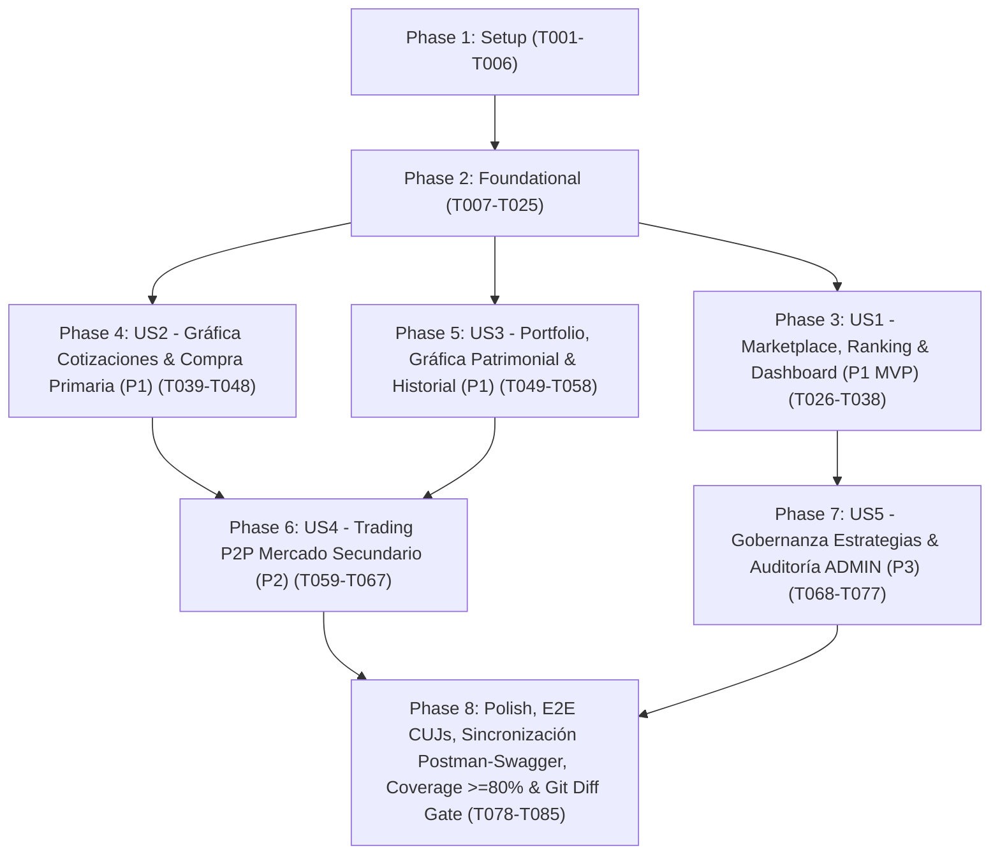

---

description: "Listado ejecutable y ordenado por dependencias de tareas para la implementación del Marketplace Frontend, Trading, Portfolio Personal y Gobernanza"
---

# Tasks: Experiencia Integral de Marketplace de Tokens, Trading, Portfolio Personal y Gobernanza

**Input**: Documentos de diseño en `/specs/013-marketplace-frontend/` (`plan.md`, `spec.md`, `research.md`, `data-model.md`, `contracts/rest-api-consumption.contract.md`, `contracts/ui-components-and-charts.contract.md`, `contracts/postman-swagger-sync.contract.md`, `contracts/openapi-auth-perfil-v1.1.yaml`, `quickstart.md`) y Constitución v1.3.0 (`.specify/memory/constitution.md`).

**Prerequisites**: `plan.md` (requerido), `spec.md` (5 historias de usuario `P1 -> P2 -> P3`), `research.md`, `data-model.md`, `contracts/`

**Tests**: **OBLIGATORIOS** en cada fase e historia de usuario para garantizar **>= 80% de cobertura en `lines`, `branches`, `functions` y `statements`** de forma independiente en `frontend/` (alineados con los 3 perfiles `vitest.unit.config.ts`, `vitest.integration.config.ts`, `vitest.e2e.config.ts` y el gate consolidado de `vite.config.ts`) y en `backend/` (Jest + Testcontainers PostgreSQL 16 real), respetando de forma absoluta el **Principio IV de Inmutabilidad de Tests** (**0 archivos de test preexistentes modificados o eliminados**).

**Organization**: Las tareas están organizadas estrictamente por fases e Historias de Usuario (`P1 -> P2 -> P3`) para permitir entrega incremental, pruebas independientes y máxima ejecución paralela segura.

## Format: `[ID] [P?] [Story?] Description`

- **[P]**: Tarea paralelizable (opera sobre archivos independientes sin depender de tareas incompletas de la misma ola).
- **[Story]**: Historia de usuario asociada (`[US1]`, `[US2]`, `[US3]`, `[US4]`, `[US5]`); presente únicamente en las fases de User Stories (Phases 3 a 7).
- Todas las tareas especifican rutas exactas de archivo, campos exactos de DTOs y restricciones de validación.

## Path Conventions

- **Frontend SPA**: `frontend/src/`, `frontend/tests/unit/`, `frontend/tests/integration/marketplace/`, `frontend/tests/e2e/`
- **Backend API (extensión de `PerfilUsuarioDto` y paridad Postman/Swagger)**: `backend/src/`, `backend/test/integration/marketplace/auth-perfil-rol.spec.ts`, `backend/test/integration/marketplace/postman-swagger-parity.spec.ts`
- **Colección API y Evidencia (DoD #3, FR-033..FR-035, SC-008)**: `postman/collection.json`, `postman/football_tokens.postman_environment.json`, `postman/README.md`

---

## Phase 1: Setup (Shared Infrastructure)

**Purpose**: Inicializar la nueva dependencia gráfica (`recharts`), crear las hojas de estilo Vanilla CSS modulares vinculadas a `tokens.css` (sin preflight de Tailwind CSS) y verificar en verde la línea base inmutable de tests preexistentes.

- [X] T001 Instalar la dependencia `recharts` (`^2.15.1`) en `frontend/package.json` y `frontend/package-lock.json` sin instalar ni activar Tailwind CSS preflight para preservar intactos los estilos y selectores existentes
- [X] T002 [P] Crear la hoja de estilos `frontend/src/styles/chart.css` para `ChartContainer` y `ChartTooltipContent` consumiendo exclusivamente variables de `frontend/src/styles/tokens.css` (`--bg-card`, `--glass-blur`, `--border-default`, `--text-primary`, `--text-secondary`, `--color-emerald-500`, `--color-amber-500`, `--radius-lg`, `--shadow-md`) sin reset CSS global
- [X] T003 [P] Crear la hoja de estilos responsiva `frontend/src/styles/marketplace.css` (escritorio `>= 1024px` y móvil `360px`–`768px`) para banner de estrategia, filtros, tabla/tarjetas de ranking, paneles de compra primaria, libro secundario y formulario de venta sobre `frontend/src/styles/tokens.css`
- [X] T004 [P] Crear la hoja de estilos responsiva `frontend/src/styles/portfolio.css` (escritorio `>= 1024px` y móvil `360px`–`768px`) para los 4 KPIs consolidados, gráfica patrimonial, tabla de posiciones con custodia, órdenes abiertas e historial filtrable sobre `frontend/src/styles/tokens.css`
- [X] T005 [P] Crear la hoja de estilos responsiva `frontend/src/styles/admin.css` (escritorio `>= 1024px` y móvil `360px`–`768px`) para las tarjetas de gobernanza de estrategia, recálculo manual y tabla de auditoría global sobre `frontend/src/styles/tokens.css`
- [X] T006 Ejecutar la verificación automatizada de línea base (`npm run test:all` desde `frontend/package.json` y `npm run test:unit` desde `backend/package.json`) comprobando que el 100% de la suite preexistente parte en verde con 0 cambios en `frontend/tests/` y `backend/test/`

---

## Phase 2: Foundational (Blocking Prerequisites)

**Purpose**: Exponer de forma aditiva y retrocompatible `rol` (`'USUARIO' | 'ADMIN'`) y `saldo` (`number`) en `PerfilUsuarioDto`, declarar contratos TypeScript del dominio, corregir preservación de cabeceras en `http-client.ts`, implementar los 4 clientes HTTP/REST stateless, formateadores financieros puros y las primitivas `shadcn/ui` en `chart.tsx` con soporte determinista en `jsdom`.

**⚠️ CRITICAL**: Ninguna historia de usuario puede comenzar hasta completar esta fase y tener sus tests automatizados en verde.

### Tests Automatizados para Phase 2 (Escribir PRIMERO — TDD) ⚠️

- [X] T007 [P] Crear test de integración con PostgreSQL 16 real (Testcontainers) en `backend/test/integration/marketplace/auth-perfil-rol.spec.ts` verificando que `POST /auth/register` (`201`), `POST /auth/login` (`200`) y `GET /auth/me` (`200`) retornen en `PerfilUsuarioDto` los campos exactos `{ id, nombre, correo, activo, creadoEn, rol, saldo }` con `rol: 'USUARIO' | 'ADMIN'` y `saldo: number` (`>= 0` con hasta 2 decimales), cubriendo además errores HTTP `401` (token inválido/ausente y credenciales inválidas) y `409` (correo ya registrado) sin tocar tests existentes
- [X] T008 [P] Crear tests unitarios en `frontend/tests/unit/storage.service.rol.test.ts` (perfil `vitest.unit.config.ts`) validando que `StorageService` (`PerfilUsuarioSchema` con `.strict()`) acepte tanto sesiones legadas sin `rol`/`saldo` como sesiones con `rol?: 'USUARIO' | 'ADMIN'` y `saldo?: number` (`>= 0`), rechazando valores de `rol` fuera del enum, `saldo < 0` o campos desconocidos
- [X] T009 [P] Crear tests unitarios en `frontend/tests/unit/api/marketplace-api-clients.test.ts` validando preservación de `'Content-Type': 'application/json'` junto a `Authorization: Bearer <token>` en `httpRequest`, contratos de `marketplaceApi`, `ordersApi`, `portfolioApi` y `adminApi`, acotamiento de `limite` (`1..100` y `1..200`), envío obligatorio de `jugadorId` en `POST /orders/buy`, omisión de body en `POST /quotes/recalculate`, propagación de `AbortError` y mapeo a `HttpError` en español para códigos `400`, `401`, `403`, `404`, `409` y error de red (`0`)
- [X] T010 [P] Crear tests unitarios en `frontend/tests/unit/utils/formato-mercado.test.ts` (perfil `vitest.unit.config.ts`) cubriendo formateo de créditos con 2 decimales exactos, variación porcentual con signo (`+`, `-`, `0,00%`), clasificación `VarianteTendencia` (`'positiva' | 'negativa' | 'neutra'`), normalización de rangos `desde` (`YYYY-MM-DDT00:00:00.000Z`) y `hasta` (`YYYY-MM-DDT23:59:59.999Z`), y formateo de contraparte (`MERCADO_PRIMARIO` vs UUID abreviado)
- [X] T011 [P] Crear tests de integración en `frontend/tests/integration/marketplace/chart-primitives.test.tsx` (perfil `vitest.integration.config.ts`) verificando `ChartContainer`, `ChartStyle`, `ChartTooltip` y `ChartTooltipContent` de `frontend/src/components/ui/chart.tsx`, inyección de variables CSS `[data-chart]` y renderizado SVG de `<LineChart>` tanto cuando `ResizeObserver` es `undefined` en `jsdom` como usando un mock seguro de `ResizeObserver` local al test sin modificar `frontend/tests/setup.ts`

### Implementación para Phase 2

- [X] T012 [P] Extender `PerfilUsuarioDto` en `backend/src/controllers/dto/respuesta-autenticacion.dto.ts` añadiendo `@ApiProperty({ enum: ['USUARIO', 'ADMIN'] }) rol: RolUsuario` y `@ApiProperty({ example: 1000 }) saldo: number` junto a `{ id, nombre, correo, activo, creadoEn }` sin alterar los DTOs de entrada ni códigos HTTP
- [X] T013 Actualizar `AuthService.mapearPerfil(usuario)` en `backend/src/services/auth.service.ts` para incluir `rol: usuario.rol` y `saldo: usuario.saldo.aNumero()` en el objeto `PerfilUsuarioDto` retornado por `registrar`, `login` y `obtenerPerfil`, manteniendo intacto `JwtStrategy.validate` (depende de T012)
- [X] T014 [P] Extender `frontend/src/types/auth.types.ts` declarando `export type RolUsuario = 'USUARIO' | 'ADMIN'`, las propiedades opcionales `rol?: RolUsuario` y `saldo?: number` en `PerfilUsuario` (`id: string`, `nombre: string`, `correo: string`, `activo: boolean`, `creadoEn: string`, `rol?: RolUsuario`, `saldo?: number`) y `refrescarPerfil?: () => Promise<void>` en `ContextoAutenticacion`
- [X] T015 [P] Crear `frontend/src/types/marketplace.types.ts` con todos los tipos e interfaces exactas de los contratos REST: `EstrategiaId` (`'GLOBAL' | 'POSICIONAL'`), `EstrategiaVersion`, `PosicionFiltroRanking` (`'Portero' | 'Defensa' | 'Mediocampista' | 'Delantero'`), `TipoMercado` (`'PRIMARIO' | 'SECUNDARIO'`), `TipoOperacionUsuario` (`'COMPRA' | 'VENTA'`), `EstadoOrdenVenta` (`'PENDIENTE' | 'PARCIAL' | 'COMPLETADA' | 'CANCELADA'`), `EstadoFiltroOrdenes` (`'ACTIVA' | EstadoOrdenVenta`), `VarianteTendencia` (`'positiva' | 'negativa' | 'neutra'`), `EstrategiaDisponible`, `ConfiguracionEstrategia`, `JugadorRanking` (`posicionRanking`, `jugadorId`, `nombre`, `posicion`, `equipoNombre`, `score`, `cotizacionActual`, `variacionPorcentual`, `estrategiaId`, `estrategiaVersion`, `tokensDisponibles`), `SnapshotMetricasNormalizadas`, `CotizacionJugador` (`id`, `jugadorId`, `score`, `valor`, `estrategiaId`, `estrategiaVersion`, `sinEstadisticas`, `metricas`, `fechaCotizacion`), `CrearOrdenCompraPayload` (`jugadorId: string`, `cantidad: number` entero `>= 1`, `ordenVentaId?: string`, `precioMaximoUnitario?: number` `> 0`), `ResultadoCompra`, `CrearOrdenVentaPayload` (`jugadorId: string`, `cantidad: number` entero `>= 1`, `precioUnitario: number` `> 0`), `OrdenVenta`, `FiltroOrdenesVenta` (`limite?: 1..100`), `PosicionPortafolio`, `PortfolioUsuario`, `TransaccionUsuario`, `FiltroTransaccionesUsuario` (`limite?: 1..100`), `ResumenRecalculo`, `TransaccionAuditoria` y `FiltroTransaccionesAdmin` (`limite?: 1..200`)
- [X] T016 [P] Corregir la fusión de cabeceras en `frontend/src/api/http-client.ts` desestructurando `const { headers: extraHeaders, ...restOptions } = options` para preservar siempre `'Content-Type': 'application/json'` al adjuntar `headers: { Authorization: 'Bearer ...' }`, manteniendo la propagación de `AbortError` y el parseo de `{ codigoEstado, mensaje, marcaDeTiempo }` en `HttpError`
- [X] T017 [P] Implementar utilidades puras de presentación financiera en `frontend/src/utils/formato-mercado.ts`: `formatearCreditos(valor: number)` (2 decimales), `formatearPorcentajeVariacion(valor: number)` (`+X,XX%`, `-X,XX%`, `0,00%`), `obtenerVarianteTendencia(valor: number): VarianteTendencia`, `normalizarFechaDesdeIso(fechaYmd: string)` (`T00:00:00.000Z`), `normalizarFechaHastaIso(fechaYmd: string)` (`T23:59:59.999Z`), `formatearFechaHoraCorta(iso: string)` y `formatearContraparte(contraparte: string)`
- [X] T018 [P] Implementar las primitivas `shadcn/ui` en `frontend/src/components/ui/chart.tsx` exportando `ChartConfig`, `ChartContainer`, `ChartStyle`, `ChartTooltip` y `ChartTooltipContent` sobre `recharts` y `frontend/src/styles/chart.css`, inyectando `[data-chart="<id>"] { --color-<key>: ... }` e incorporando fallback determinista `React.cloneElement(children, { width: 640, height: altura })` cuando `typeof globalThis.ResizeObserver === 'undefined'` en `jsdom` sin modificar `frontend/tests/setup.ts`
- [X] T019 Actualizar `PerfilUsuarioSchema` en `frontend/src/services/storage.service.ts` preservando `.strict()` y añadiendo `rol: z.enum(['USUARIO', 'ADMIN']).optional()` y `saldo: z.number().nonnegative().optional()` (depende de T014)
- [X] T020 Extender `frontend/src/context/AuthProvider.tsx` implementando `refrescarPerfil: () => Promise<void>` que invoca `obtenerPerfilAutenticado(tokenDeAcceso)` (`GET /auth/me`), actualiza `StorageService.guardarSesion` y sincroniza `usuario.saldo` y `usuario.rol` en el estado global sin romper `AuthProvider.test.tsx` (depende de T014, T019)
- [X] T021 [P] Implementar el cliente HTTP stateless `frontend/src/api/marketplaceApi.ts` con `obtenerRankingJugadores(params?: { limite?: number; posicion?: PosicionFiltroRanking | 'Todas' }, signal?: AbortSignal): Promise<JugadorRanking[]>` (`GET /players/ranking`, omitiendo `posicion` cuando es `'Todas'` y acotando `limite` a `1..100` con default `20`), `obtenerHistorialCotizaciones(jugadorId: string, limite?: number, signal?: AbortSignal): Promise<CotizacionJugador[]>` (`GET /players/:id/quotes`, `limite` `1..100` default `50`) y `obtenerEstrategiaActiva(signal?: AbortSignal): Promise<ConfiguracionEstrategia>` (`GET /quotes/strategy`) (depende de T015, T016)
- [X] T022 [P] Implementar el cliente HTTP stateless `frontend/src/api/ordersApi.ts` con `listarOrdenesVenta(filtros?: FiltroOrdenesVenta, signal?: AbortSignal): Promise<OrdenVenta[]>` (`GET /orders`, acotando `limite` `1..100`), `comprarTokens(token: string, payload: CrearOrdenCompraPayload): Promise<ResultadoCompra>` (`POST /orders/buy`, enviando siempre `jugadorId`, `cantidad` entera `>= 1`, `ordenVentaId` opcional y `precioMaximoUnitario` únicamente cuando es numérico `> 0` y `!== undefined` para cumplir `forbidNonWhitelisted: true`), `publicarOrdenVenta(token: string, payload: CrearOrdenVentaPayload): Promise<OrdenVenta>` (`POST /orders/sell` con `{ jugadorId, cantidad, precioUnitario }`) y `cancelarOrdenVenta(token: string, ordenId: string): Promise<OrdenVenta>` (`DELETE /orders/:id`) (depende de T015, T016)
- [X] T023 [P] Implementar el cliente HTTP stateless `frontend/src/api/portfolioApi.ts` con `obtenerPortfolioUsuario(token: string, usuarioId: string, signal?: AbortSignal): Promise<PortfolioUsuario>` (`GET /users/:id/portfolio`) y `obtenerTransaccionesUsuario(token: string, usuarioId: string, filtros?: FiltroTransaccionesUsuario, signal?: AbortSignal): Promise<TransaccionUsuario[]>` (`GET /users/:id/transactions`, acotando `limite = Math.min(Math.max(1, filtros?.limite ?? 100), 100)` y normalizando `desde`/`hasta` en ISO-8601) (depende de T015, T016)
- [X] T024 [P] Implementar el cliente HTTP stateless `frontend/src/api/adminApi.ts` con `cambiarEstrategiaMercado(token: string, estrategiaId: EstrategiaId): Promise<ConfiguracionEstrategia>` (`PUT /quotes/strategy` con `{ estrategiaId }`), `ejecutarRecalculoManual(token: string): Promise<ResumenRecalculo>` (`POST /quotes/recalculate` sin body para cumplir `forbidNonWhitelisted: true`) y `obtenerTransaccionesAuditoria(token: string, filtros?: FiltroTransaccionesAdmin, signal?: AbortSignal): Promise<TransaccionAuditoria[]>` (`GET /admin/transactions`, acotando `limite = Math.min(Math.max(1, filtros?.limite ?? 100), 200)` y omitiendo `jugadorId`/`usuarioId` vacíos) (depende de T015, T016)
- [X] T025 Ejecutar las suites fundacionales (`backend/test/integration/marketplace/auth-perfil-rol.spec.ts`, `frontend/tests/unit/storage.service.rol.test.ts`, `frontend/tests/unit/api/marketplace-api-clients.test.ts`, `frontend/tests/unit/utils/formato-mercado.test.ts` y `frontend/tests/integration/marketplace/chart-primitives.test.tsx`) comprobando 100% en verde antes de iniciar las User Stories (depende de T007..T024)

**Checkpoint**: Base fundacional lista y verificada — las historias de usuario pueden comenzar.

---

## Phase 3: User Story 1 - Cartelera del Marketplace, Ranking de Cotizaciones y Resumen Ejecutivo en Inicio (Priority: P1) 🎯 MVP

**Goal**: Habilitar navegación global consciente del rol (`USUARIO` vs `ADMIN`), enriquecer `HomeView` (Dashboard) con resumen financiero y de mercado real sin romper selectores existentes, y entregar la vista `/marketplace` con la estrategia activa y el ranking filtrable por demarcación táctica sobre el suministro fijo de 100 tokens por jugador.

**Independent Test**: Iniciar sesión con un inversor autenticado, verificar en `/` el saldo líquido real, patrimonio neto, rendimiento latente consolidado, estrategia vigente y top del ranking, navegar desde `Navbar` a `/marketplace`, filtrar por `Portero`/`Defensa`/`Mediocampista`/`Delantero`/`Todas`, verificar el orden descendente por cotización y seleccionar un jugador para abrir su modal de detalle.

### Tests Automatizados para User Story 1 (Escribir PRIMERO — TDD) ⚠️

- [X] T026 [P] [US1] Crear tests unitarios en `frontend/tests/unit/utils/navegacion.test.ts` (perfil `vitest.unit.config.ts`) verificando `construirItemsNavegacion(rol?: RolUsuario)` (enlaces permanentes `Inicio` `/`, `Marketplace` `/marketplace`, `Catálogo de Jugadores` `/players` con `id="nav-players-catalog"` y `Portfolio` `/portfolio`; enlace `Gobernanza` `/admin` con `id="nav-admin"` visible única y exclusivamente cuando `rol === 'ADMIN'` y oculto para `'USUARIO'` o `undefined`) y `esRutaActiva(pathname, itemTo)`
- [X] T027 [P] [US1] Crear tests de integración en `frontend/tests/integration/marketplace/home-and-marketplace-ranking.test.tsx` (perfil `vitest.integration.config.ts`) validando `Navbar` (`aria-current="page"` y segregación de enlace `ADMIN`), `HomeView` + `useDashboardSummary` (KPIs reales de `saldoBilletera`, `patrimonioNetoTotal`, ganancia/pérdida latente, estrategia activa, top del ranking, aviso `avisoSeguridad` de redirección RBAC y preservación de selectores síncronos), y `MarketplaceView` (`StrategyBanner`, `RankingFiltersBar` por demarcación, control `"Actualizar"`, `RankingTable` con signos `+`/`-`/`0,00%` y stock `/ 100`, estados de carga/vacío, errores HTTP `400`/`401`/`404` con reintento y apertura de `PlayerDetailModal`)

### Implementación para User Story 1

- [X] T028 [P] [US1] Implementar `frontend/src/utils/navegacion.ts` exportando `construirItemsNavegacion(rol?: RolUsuario): NavItem[]` (`id="nav-dashboard"` -> `/`, `id="nav-marketplace"` -> `/marketplace`, `id="nav-players-catalog"` -> `/players`, `id="nav-portfolio"` -> `/portfolio`, e ítem exclusivo `id="nav-admin"` -> `/admin` únicamente cuando `rol === 'ADMIN'`) y `esRutaActiva(pathname: string, itemTo: string): boolean`
- [X] T029 [P] [US1] Implementar el hook `frontend/src/hooks/useDashboardSummary.ts` con `AbortController` en cleanup para consultar `obtenerPortfolioUsuario`, `obtenerTransaccionesUsuario` (`limite: 100`), `obtenerEstrategiaActiva` y `obtenerRankingJugadores({ limite: 5 })`, calculando ganancia/pérdida latente consolidada sin `NaN` cuando el costo es `0` y degradando limpiamente cuando `fetch` falla en tests síncronos aislados
- [X] T030 [P] [US1] Implementar el hook `frontend/src/hooks/useMarketplaceRanking.ts` con `AbortController` orquestando `obtenerEstrategiaActiva` y `obtenerRankingJugadores({ limite: 50, posicion })`, estado de filtro `posicionFiltro: PosicionFiltroRanking | 'Todas'`, `cambiarPosicion` y `recargar()` bajo demanda sin polling continuo
- [X] T031 [P] [US1] Crear el componente `frontend/src/components/marketplace/StrategyBanner.tsx` exhibiendo de forma destacada la estrategia de valuación vigente: nombre legible (`Ponderación Global` para `'GLOBAL'`, `Ponderación Posicional` para `'POSICIONAL'`), `estrategiaActivaVersion`, `descripcion` funcional extraída de `estrategiasDisponibles` y fecha `actualizadoEn` en español
- [X] T032 [P] [US1] Crear el componente `frontend/src/components/marketplace/RankingFiltersBar.tsx` con selector accesible de demarcación táctica (`Todas`, `Portero`, `Defensa`, `Mediocampista`, `Delantero`) y botón explícito `"Actualizar"` con estado `cargando`
- [X] T033 [P] [US1] Crear el componente `frontend/src/components/marketplace/RankingTable.tsx` renderizando el ranking descendente con `posicionRanking`, `nombre`, `equipoNombre`, `posicion`, `score` deportivo (`[0, 1]`), `cotizacionActual` en créditos, `variacionPorcentual` diferenciada visual y textualmente (`positiva`, `negativa`, `neutra` `0,00%`), `tokensDisponibles` sobre el suministro fijo de `100` unidades, estados vacío/carga/error con reintento y selección de jugador
- [X] T034 [US1] Extender `frontend/src/components/layout/Navbar.tsx` usando `useLocation()` y `esRutaActiva` para marcar la sección activa con `aria-current="page"` y clase `.app-navbar-link-active`, preservando intactos `<nav className="app-navbar home-navbar" aria-label="Navegación principal">`, soporte de `items` por prop y botón `id="logout-button"` con `aria-label="Cerrar sesión"` y texto `"Cerrar Sesión"` (depende de T028)
- [X] T035 [US1] Crear la vista `frontend/src/views/MarketplaceView.tsx` integrando `AppLayout` y `Navbar` con `construirItemsNavegacion(usuario?.rol)`, `StrategyBanner`, `RankingFiltersBar`, `RankingTable` y apertura de `PlayerDetailModal` recargando el ranking tras mutaciones de mercado (depende de T030..T034)
- [X] T036 [US1] Extender `frontend/src/views/HomeView.tsx` manteniendo en el primer render síncrono todos los nodos validados por `LayoutAndViews.test.tsx` (avatar con inicial, `¡Bienvenido de vuelta, {usuario.nombre}!`, texto `'Activo'`, `Sesión activa — {usuario.correo}`, `#nav-players-catalog`, `#logout-button`), conectando `construirItemsNavegacion(usuario.rol)`, mostrando `location.state?.avisoSeguridad` si proviene de bloqueo RBAC e integrando debajo el resumen ejecutivo real de `useDashboardSummary`, top del ranking clicable hacia `PlayerDetailModal` y accesos rápidos a `/marketplace`, `/players` y `/portfolio` (depende de T028, T029, T034)
- [X] T037 [US1] Actualizar `frontend/src/views/PlayersCatalogView.tsx` reemplazando la lista estática `navItems` por `construirItemsNavegacion(usuario?.rol)` desde `useAuth()`, preservando intactos `h1` `Catálogo de Jugadores de las 5 Grandes Ligas`, `data-testid="catalog-count-badge"`, `data-testid="btn-open-filters"`, `data-testid="catalog-error"`, `data-testid="catalog-initial-loading"`, `data-testid="loading-more-spinner"`, `data-testid="infinite-scroll-sentinel"` y `PlayerDetailModal` (depende de T028, T034)
- [X] T038 [US1] Registrar la ruta protegida `/marketplace` envuelta en `<ProtectedRoute><MarketplaceView /></ProtectedRoute>` dentro de `frontend/src/routes/AppRoutes.tsx` preservando `/login`, `/register`, `/`, `/players` y `*` (depende de T035)

**Checkpoint**: User Story 1 completamente funcional, probada de forma independiente y entregable como incremento MVP.

---

## Phase 4: User Story 2 - Evolución Gráfica de Cotizaciones y Compra en Mercado Primario (Priority: P1)

**Goal**: Integrar en el detalle unificado del jugador (`PlayerDetailModal`) la gráfica lineal punto a punto `PlayerQuoteLinearChart` (*shadcn/ui Line Chart - Linear* con `recharts`) sobre `GET /players/:id/quotes` y el formulario de compra en mercado primario `PrimaryBuyForm` (`POST /orders/buy`) con cálculo previo de costo frente al saldo, protección opcional de precio máximo, bloqueo preventivo de autocompra para `ADMIN` y revalidación inmediata.

**Independent Test**: Abrir el modal de cualquier jugador desde `/marketplace` o `/players`, inspeccionar los puntos del gráfico lineal histórico de cotizaciones (incluyendo casos de `0`, `1` y `N` puntos y tooltip con `score`, `estrategiaVersion` y `sinEstadisticas`), ingresar una cantidad entera `>= 1` de tokens en compra primaria y confirmar, verificando confirmación en español y actualización inmediata (< 2 s) de saldo, tenencia y disponibilidad.

### Tests Automatizados para User Story 2 (Escribir PRIMERO — TDD) ⚠️

- [X] T039 [P] [US2] Crear tests unitarios en `frontend/tests/unit/utils/quotes-chart.test.ts` (perfil `vitest.unit.config.ts`) validando `prepararSerieCotizaciones` y `calcularDominioCotizacion`: inversión inmutable de `fechaCotizacion DESC` a orden cronológico `ASC`, desempate de etiquetas cuando hay múltiples cotizaciones en la misma fecha, manejo de `0`, `1` (`esHistorialUnico: true`) y `N` registros, y cálculo de `dominioY` seguro con margen `+-0.10` cuando todos los puntos tienen igual `valor`
- [X] T040 [P] [US2] Crear tests unitarios en `frontend/tests/unit/utils/validaciones-mercado.test.ts` (perfil `vitest.unit.config.ts`) validando `esEnteroPositivo`, `tieneMaximoDosDecimales` y `validarOrdenCompraPrimaria`: exigencia de `cantidad` entera `>= 1` (rechazo de decimales, `0`, negativos, vacíos o `NaN`), tope contra `stockPrimarioConocido` (`/ 100`), estado de stock primario agotado (`=== 0`), `precioMaximoUnitario` opcional (`> 0`, hasta 2 decimales y `>= cotizacionActual`), bloqueo por `costoEstimado > saldoDisponible` y bloqueo preventivo de autocompra primaria cuando `rol === 'ADMIN'`
- [X] T041 [P] [US2] Crear tests de integración en `frontend/tests/integration/marketplace/player-detail-primary-trading.test.tsx` (perfil `vitest.integration.config.ts`, con mock seguro de `ResizeObserver` en `jsdom` para Recharts) cubriendo `PlayerDetailModal` + `PlayerMarketSection` + `PlayerQuoteLinearChart` (`type="linear"`, `<CartesianGrid vertical={false} />`, tooltip con `fechaFormateada`, `valor`, `score`, `estrategiaVersion` y leyenda `sinEstadisticas`, `data-testid="quote-chart-empty"` para `0` puntos y `data-testid="quote-chart-single-notice"` para `1` punto) + `PrimaryBuyForm` y `usePlayerMarketPanel` (cálculo en tiempo real `cantidad * cotizacion`, éxito `200 OK` en `POST /orders/buy` con revalidación de saldo/tenencia/stock, stock `0/100`, bloqueo `ADMIN` y errores HTTP `400`, `401`, `404`, `409` en español)

### Implementación para User Story 2

- [X] T042 [P] [US2] Implementar `frontend/src/utils/quotes-chart.ts` exportando `PuntoGraficoCotizacion`, `ResultadoSerieCotizaciones`, `calcularDominioCotizacion(valores: number[]): [number, number]` y `prepararSerieCotizaciones(cotizaciones: CotizacionJugador[]): ResultadoSerieCotizaciones` clonando e invirtiendo `fechaCotizacion DESC` hacia `ASC` sin mutar el arreglo original
- [X] T043 [P] [US2] Implementar `frontend/src/utils/validaciones-mercado.ts` con `esEnteroPositivo(valor: number)` (`Number.isInteger(valor) && valor >= 1`), `tieneMaximoDosDecimales(valor: number)` (validando `> 0` y precisión `<= 2` decimales) y `validarOrdenCompraPrimaria(params)` aplicando en español: bloqueo de autocompra si `rol === 'ADMIN'`, aviso de agotamiento si `stockPrimario === 0`, `cantidad` entera `>= 1` y `<= stockPrimario`, `precioMaximoUnitario` opcional `> 0` con hasta 2 decimales y `>= cotizacionActual`, y bloqueo cuando `costoEstimado > saldoDisponible`
- [X] T044 [P] [US2] Implementar el hook `frontend/src/hooks/usePlayerMarketPanel.ts` leyendo la sesión vía `useContext(AuthContext)` (sin lanzar excepción cuando se monta fuera de `<AuthProvider>` en `PlayerDetailModal.test.tsx`), consultando con `AbortController` `obtenerHistorialCotizaciones(jugadorId)`, `listarOrdenesVenta({ jugadorId, estado: 'ACTIVA' })` y `obtenerPortfolioUsuario`, y exponiendo `comprarPrimario` (`POST /orders/buy` con `{ jugadorId, cantidad, precioMaximoUnitario? }`), `comprarSecundario`, `publicarVenta`, `cancelarOrden` y `recargar()`, revalidando automáticamente cotizaciones, órdenes activas, portfolio, `refrescarPerfil?.()` y `onMarketMutation?.()` tras cada mutación
- [X] T045 [P] [US2] Crear `frontend/src/components/player-detail/PlayerQuoteLinearChart.tsx` implementando la variante exacta `shadcn/ui` *Line Chart - Linear* con `ChartContainer` (`config={{ valor: { label: 'Cotización (cr.)', color: 'var(--color-emerald-500)' } }}`), `<LineChart accessibilityLayer>`, `<CartesianGrid vertical={false} />`, `<XAxis dataKey="etiquetaEjeX" tickLine={false} axisLine={false} tickMargin={8} />`, `<YAxis hide domain={dominioY} />`, `<Line dataKey="valor" type="linear" stroke="var(--color-valor)" strokeWidth={2} dot={false} activeDot={{ r: 5 }} />`, `<ReferenceDot>` + `data-testid="quote-chart-single-notice"` cuando hay 1 punto, `data-testid="quote-chart-empty"` cuando hay 0 puntos, control de reintento sin `role="alert"` pasivo y `ChartTooltipContent` exponiendo `fechaFormateada`, `valor`, `score` (4 dec), `estrategiaVersion` y aviso `"Sin estadísticas deportivas (valor base)"` si `sinEstadisticas === true` (depende de T042)
- [X] T046 [P] [US2] Crear `frontend/src/components/player-detail/PrimaryBuyForm.tsx` con entradas controladas de `cantidad` entera (`>= 1`, `step="1"`) y `precioMaximoUnitario` opcional (`> 0`, hasta 2 decimales), resumen previo en tiempo real (`cantidad * cotizacionVigente` frente a `saldoDisponible`), estado orientativo hacia el libro secundario cuando el suministro primario está en `0`, bloqueo informativo para `rol === 'ADMIN'`, resumen de éxito con `{ cantidadTokensComprados, precioUnitarioPagado, montoTotalDebitado, saldoRestanteUsuario }` y errores de negocio en español (depende de T043)
- [X] T047 [US2] Crear `frontend/src/components/player-detail/PlayerMarketSection.tsx` integrando indicadores de cotización oficial vigente, stock disponible sobre `100` y tenencia del usuario, botón `"Actualizar"`, `PlayerQuoteLinearChart` y `PrimaryBuyForm` conectados a `usePlayerMarketPanel` (depende de T044, T045, T046)
- [X] T048 [US2] Extender `frontend/src/components/player-detail/PlayerDetailModal.tsx` aceptando la prop opcional `onMarketMutation?: () => void` y renderizando `<PlayerMarketSection jugadorId={jugador.id} nombreJugador={jugador.nombre} onMarketMutation={onMarketMutation} />` exclusivamente dentro de `{!loading && !error && jugador && (...)}`, conservando intactos `data-testid="player-detail-overlay"`, `role="dialog"`, `aria-labelledby="player-detail-title"`, `#player-detail-close`, `data-testid="modal-loading-spinner"`, `data-testid="stats-grid"`, `data-testid="stats-empty-notice"` y el único `role="alert"` cuando falla `usePlayerDetail` (depende de T047)

**Checkpoint**: User Stories 1 y 2 operativas e independientemente verificables (descubrimiento + evolución lineal + compra en mercado primario).

---

## Phase 5: User Story 3 - Portfolio Personal, Gráfica Lineal de Balance/Patrimonio e Historial de Operaciones (Priority: P1)

**Goal**: Entregar la vista dedicada `/portfolio` con los 4 indicadores patrimoniales consolidados, la gráfica lineal determinista `PortfolioBalanceLinearChart` (*shadcn/ui Line Chart - Linear* reconstruida en centavos enteros), la tabla de posiciones activas diferenciando tokens disponibles y en custodia, y el historial filtrable de operaciones del usuario.

**Independent Test**: Ingresar a `/portfolio` tanto con un inversor recién registrado sin transacciones (comprobando PnL `0,00` cr. / `0,00%` sin `NaN` y guía orientativa en el gráfico lineal) como con un inversor con operaciones previas (verificando los 4 KPIs, convergencia matemática del gráfico lineal en `patrimonioNetoTotal` y `saldoBilletera`, desglose de posiciones y filtros combinables `Compra`/`Venta`, jugador y rango `Desde`/`Hasta`).

### Tests Automatizados para User Story 3 (Escribir PRIMERO — TDD) ⚠️

- [X] T049 [P] [US3] Crear tests unitarios en `frontend/tests/unit/utils/portfolio-chart.test.ts` (perfil `vitest.unit.config.ts`) validando `enriquecerPosicionesPortfolio`, `reconstruirSeriePatrimonial` y `construirResumenPatrimonial` en centavos enteros (`Math.round(monto * 100)`): usuario con `0` operaciones (`sinOperaciones: true`, PnL `0` créditos y `0%` sin `NaN`/`Infinity`, punto ancla en `saldoBilletera`), `1` y `N` operaciones `COMPRA`/`VENTA` en mercados `PRIMARIO`/`SECUNDARIO`, desempate determinista por `transaccionId`, `cantidadTotalTenencia = cantidadTokensDisponibles + cantidadTokensEnVenta`, PnL latente por posición y consolidado (positivo, negativo, neutro) y coincidencia exacta del último punto `"Valoración actual"` con `portfolio.saldoBilletera` y `portfolio.patrimonioNetoTotal`
- [X] T050 [P] [US3] Crear tests de integración en `frontend/tests/integration/marketplace/portfolio-view.test.tsx` (perfil `vitest.integration.config.ts`, con mock seguro de `ResizeObserver` en `jsdom` para Recharts) cubriendo `PortfolioView`, `usePortfolio`, `PortfolioSummaryCards`, `PortfolioBalanceLinearChart` (`data-testid="portfolio-chart-empty-guide"` con enlace a `/marketplace` para `0` operaciones, y doble `<Line type="linear">` para `patrimonioNeto` `#10b981` y `saldoBilletera` `#f59e0b` con tooltip de `fechaFormateada`, `hitoOperativo`, `patrimonioNeto`, `saldoBilletera` y `valoracionTokens`), `PortfolioPositionsTable` (selección de jugador abriendo `PlayerDetailModal`), `UserTransactionsHistory` (filtros combinables `Todas`/`Compra`/`Venta`, jugador, `Desde`/`Hasta`, bloqueo si `desde > hasta` y `"Limpiar filtros"`) y errores HTTP `400`, `401`, `403`, `404`

### Implementación para User Story 3

- [X] T051 [US3] Implementar `frontend/src/utils/portfolio-chart.ts` exportando `PuntoGraficoPatrimonio`, `PosicionEnriquecida`, `ResumenPatrimonialConsolidado`, `enriquecerPosicionesPortfolio`, `reconstruirSeriePatrimonial(portfolio: PortfolioUsuario, transacciones: TransaccionUsuario[]): PuntoGraficoPatrimonio[]` (aritmética exacta en centavos enteros reconstruyendo efectivo y tenencias hacia atrás desde `portfolio.saldoBilletera` y `portfolio.posiciones` y culminando en `"Valoración actual"`) y `construirResumenPatrimonial(portfolio, transacciones)` evitando divisiones por cero cuando `costoTotalAdquisicion === 0`
- [X] T052 [P] [US3] Implementar el hook `frontend/src/hooks/usePortfolio.ts` con `AbortController` coordinando `obtenerPortfolioUsuario(token, usuarioId)`, `obtenerTransaccionesUsuario(token, usuarioId, { limite: 100 })` (base de la serie lineal), consulta filtrada `obtenerTransaccionesUsuario(token, usuarioId, filtrosHistorial)` (normalizando `desde`/`hasta` ISO y validando `desde <= hasta`), `listarOrdenesVenta({ vendedorId: usuarioId, estado: 'ACTIVA', limite: 100 })`, mutaciones `publicarVenta`/`cancelarOrden` con revalidación + `refrescarPerfil?.()`, `limpiarFiltrosHistorial()` y `recargar()` (depende de T051)
- [X] T053 [P] [US3] Crear `frontend/src/components/portfolio/PortfolioSummaryCards.tsx` mostrando los 4 indicadores principales: `saldoBilletera` disponible, `valoracionTotalTokens` a cotización vigente, `patrimonioNetoTotal` (`saldoBilletera + valoracionTotalTokens`) y ganancia/pérdida latente consolidada en créditos y porcentaje con diferenciación visual (`positiva`, `negativa`, `neutra`) (depende de T051)
- [X] T054 [P] [US3] Crear `frontend/src/components/portfolio/PortfolioBalanceLinearChart.tsx` implementando la variante exacta `shadcn/ui` *Line Chart - Linear* con `ChartContainer` (`patrimonioNeto` en `var(--color-emerald-500)` `#10b981` y `saldoBilletera` en `var(--color-amber-500)` `#f59e0b`), `<LineChart accessibilityLayer>`, `<CartesianGrid vertical={false} />`, `<XAxis dataKey="etiquetaEjeX" tickLine={false} axisLine={false} tickMargin={8} />`, `<YAxis hide />`, dos `<Line type="linear" strokeWidth={2} dot={false} activeDot={{ r: 5 }} />`, `ChartTooltipContent` con `fechaFormateada`, `hitoOperativo`, `patrimonioNeto`, `saldoBilletera` y `valoracionTokens`, y guía orientativa `data-testid="portfolio-chart-empty-guide"` con enlace a `/marketplace` cuando `sinOperaciones === true` (depende de T051)
- [X] T055 [P] [US3] Crear `frontend/src/components/portfolio/PortfolioPositionsTable.tsx` exponiendo por cada posición activa: `nombreJugador` (clicable para abrir `PlayerDetailModal`), `equipoNombre`, `posicion`, `cantidadTokensDisponibles`, `cantidadTokensEnVenta` (retenidos en custodia), `cantidadTotalTenencia` (`disponibles + enVenta`), `precioPromedioAdquisicion`, `cotizacionActual`, `valoracionTotalPosicion` y ganancia/pérdida latente en créditos y `%`, más estado vacío orientativo con enlace a `/marketplace` (depende de T051)
- [X] T056 [P] [US3] Crear `frontend/src/components/portfolio/UserTransactionsHistory.tsx` mostrando las operaciones ejecutadas (`fecha`, `tipoOperacion` Compra/Venta, `tipoMercado` Primario/Secundario, `nombreJugador`, `cantidadTokens`, `precioUnitario`, `montoTotal`, `estrategiaCotizacion`, `contraparte`) con filtros combinables por tipo (`Todas`, `COMPRA`, `VENTA`), `jugadorId`, rango `Desde` y `Hasta` (validación preventiva en español si `desde > hasta`) y botón `"Limpiar filtros"`
- [X] T057 [US3] Crear la vista `frontend/src/views/PortfolioView.tsx` integrando `AppLayout` / `Navbar` (`construirItemsNavegacion(usuario?.rol)`), botón `"Actualizar"`, `PortfolioSummaryCards`, `PortfolioBalanceLinearChart`, `PortfolioPositionsTable`, `UserTransactionsHistory` y `PlayerDetailModal` (`onMarketMutation={recargar}`) (depende de T052..T056)
- [X] T058 [US3] Registrar la ruta protegida `/portfolio` envuelta en `<ProtectedRoute><PortfolioView /></ProtectedRoute>` dentro de `frontend/src/routes/AppRoutes.tsx` (depende de T057)

**Checkpoint**: Las tres historias críticas P1 (US1, US2 y US3) están completas y operan de forma integrada e independiente.

---

## Phase 6: User Story 4 - Trading entre Pares en Mercado Secundario: Publicación, Compra y Cancelación de Órdenes (Priority: P2)

**Goal**: Habilitar la publicación de órdenes de venta P2P (`POST /orders/sell`) sobre tokens libres de custodia, el libro de órdenes secundarias activas (`SecondaryOrderBook`) en el detalle de cada jugador para compras totales o parciales por oferta puntual (`POST /orders/buy` con `ordenVentaId`), el bloqueo estricto de autocompra propia (`vendedorId === usuario.id`) y la cancelación de órdenes abiertas (`DELETE /orders/:id`) tanto desde el detalle del jugador como desde el Portfolio Personal.

**Independent Test**: Publicar con `trader1` una orden de venta de `3` tokens a `1,80` créditos verificando que pasen a custodia (`cantidadTokensEnVenta`) y que en el libro secundario se bloquee la autocompra propia; comprar `1` token (`PARCIAL`) con `trader2` verificando débito exacto de `1,80` créditos y remanente `2`; cancelar el remanente con `trader1` verificando la restitución inmediata de `2` tokens a `cantidadTokensDisponibles`.

### Tests Automatizados para User Story 4 (Escribir PRIMERO — TDD) ⚠️

- [X] T059 [P] [US4] Extender `frontend/tests/unit/utils/validaciones-mercado.test.ts` (perfil `vitest.unit.config.ts`) con tests unitarios para `validarPublicacionOrdenVenta` (`cantidad` entera `>= 1` y `<= cantidadTokensDisponibles` libre de custodia, rechazo de decimales/`0`/exceso sobre tenencia libre, `precioUnitario > 0` con hasta 2 decimales exactos, ingreso bruto estimado en centavos) y `validarCompraSecundaria` (bloqueo de autocompra cuando `orden.vendedorId === usuarioId`, `cantidad` entera `1..orden.cantidadRestante`, bloqueo si `cantidad * orden.precioUnitario > saldoDisponible`)
- [X] T060 [P] [US4] Crear tests de integración en `frontend/tests/integration/marketplace/secondary-market-trading.test.tsx` (perfil `vitest.integration.config.ts`) cubriendo publicación `POST /orders/sell` (`201 Created`) desde `PortfolioView` y `PlayerDetailModal` reflejando tokens en custodia, `SecondaryOrderBook` ordenado por `precioUnitario ASC` con ofertas `PENDIENTE`/`PARCIAL`, bloqueo de autocompra propia habilitando `"Cancelar orden"`, compra parcial y total por otro inversor (`POST /orders/buy` con `{ jugadorId, cantidad, ordenVentaId }`), cancelación `DELETE /orders/:id` desde `SecondaryOrderBook` y `OpenSellOrdersSection` restituyendo tenencia disponible, y manejo en español + refresco automático ante errores HTTP `400`, `403`, `404` y conflicto de concurrencia `409`

### Implementación para User Story 4

- [X] T061 [US4] Extender `frontend/src/utils/validaciones-mercado.ts` añadiendo `validarPublicacionOrdenVenta(params)` (exigiendo `cantidad` entera `>= 1` y `<= cantidadTokensDisponibles` libre de custodia y `precioUnitario > 0` con máximo 2 decimales, calculando ingreso bruto estimado en centavos) y `validarCompraSecundaria(params)` (rechazando autocompra cuando `orden.vendedorId === usuarioId`, exigiendo `cantidad` entera `>= 1` y `<= orden.cantidadRestante` y verificando `costoEstimado <= saldoDisponible`)
- [X] T062 [P] [US4] Crear `frontend/src/components/player-detail/PublishSellOrderForm.tsx` permitiendo definir `cantidad` entera (`1..cantidadTokensDisponibles`) y `precioUnitario` (`> 0`, hasta 2 decimales), mostrando la `cotizacionActual` oficial de referencia y el ingreso bruto estimado (`cantidad * precioUnitario`) antes de confirmar hacia `POST /orders/sell` (depende de T061)
- [X] T063 [P] [US4] Crear `frontend/src/components/player-detail/SecondaryOrderBook.tsx` listando las ofertas activas (`PENDIENTE` y `PARCIAL`) con `cantidadRestante`, `precioUnitario` y distinción de titularidad: para inversores terceros habilita selección de cantidad entera (`1..cantidadRestante`), previsualización de `cantidad * precioUnitario` vs `saldoDisponible` y compra puntual (`POST /orders/buy` con `{ jugadorId, cantidad, ordenVentaId }`); para ofertas propias (`orden.vendedorId === usuario?.id`) bloquea la autocompra y ofrece el botón `"Cancelar orden"` (`DELETE /orders/:id`), refrescando libro y saldo ante errores `409` de concurrencia (depende de T061)
- [X] T064 [P] [US4] Crear `frontend/src/components/portfolio/OpenSellOrdersSection.tsx` mostrando en el Portfolio Personal las órdenes de venta propias en estado `PENDIENTE` o `PARCIAL` (jugador, `cantidad` original, `cantidadRestante` en custodia, `precioUnitario`, estado y fecha) con acción directa `"Cancelar orden"` y estado vacío informativo
- [X] T065 [US4] Extender `frontend/src/components/player-detail/PlayerMarketSection.tsx` incorporando `SecondaryOrderBook` y `PublishSellOrderForm` (visible cuando el usuario posee `cantidadTokensDisponibles >= 1` del jugador) conectados a `comprarSecundario`, `publicarVenta` y `cancelarOrden` de `usePlayerMarketPanel` (depende de T047, T062, T063)
- [X] T066 [US4] Extender `frontend/src/components/portfolio/PortfolioPositionsTable.tsx` habilitando por cada fila con `cantidadTokensDisponibles >= 1` el botón `"Vender"` para abrir la publicación rápida de orden de venta secundaria sobre esa posición (depende de T055)
- [X] T067 [US4] Extender `frontend/src/views/PortfolioView.tsx` integrando `OpenSellOrdersSection` y el panel/modal de `PublishSellOrderForm` conectado a `publicarVenta` y `cancelarOrden` de `usePortfolio`, garantizando consistencia contable inmediata (`disponibles + enVenta = total`) tras cada operación (depende de T057, T062, T064, T066)

**Checkpoint**: Ciclo completo de trading primario + secundario P2P + custodia en Portfolio operativo y verificado.

---

## Phase 7: User Story 5 - Panel de Gobernanza de Estrategias y Auditoría Global para Administrador (Priority: P3)

**Goal**: Proveer la sección exclusiva `/admin` protegida por `AdminRoute` (visible y accesible únicamente para `rol === 'ADMIN'`) permitiendo conmutar la estrategia activa del mercado (`GLOBAL` vs `POSICIONAL`), ejecutar manualmente el recálculo masivo de cotizaciones con resumen detallado y consultar la auditoría global de transacciones con filtros avanzados.

**Independent Test**: Iniciar sesión con `ADMIN`, acceder desde `Navbar` a `/admin`, conmutar entre `Ponderación Global` y `Ponderación Posicional`, ejecutar el recálculo manual observando métricas de resultado y filtrar la tabla de auditoría global; luego iniciar sesión con un inversor estándar (`USUARIO`) y comprobar que el enlace no aparece en `Navbar` y que navegar directamente a `/admin` redirige a `/` con aviso informativo sin exponer datos ni llamadas administrativas.

### Tests Automatizados para User Story 5 (Escribir PRIMERO — TDD) ⚠️

- [X] T068 [P] [US5] Extender `frontend/tests/unit/utils/validaciones-mercado.test.ts` (perfil `vitest.unit.config.ts`) con tests unitarios para `validarFiltrosAuditoriaAdmin` (validación de formato UUID v4 en `jugadorId` y `usuarioId` cuando no están vacíos, validación `desde <= hasta`, filtro `tipoMercado?: 'PRIMARIO' | 'SECUNDARIO'` y acotamiento `limite` `1..200`) y `validarCambioEstrategia` (`estrategiaId` en `'GLOBAL' | 'POSICIONAL'`)
- [X] T069 [P] [US5] Crear tests de integración en `frontend/tests/integration/marketplace/admin-governance-and-guard.test.tsx` (perfil `vitest.integration.config.ts`) verificando: (a) `AdminRoute` bloquea cuentas con `rol === 'USUARIO'` o sin `rol` redirigiendo a `/` con `state.avisoSeguridad` en español sin montar `AdminGovernanceView` ni invocar `/admin/transactions`, redirige no autenticados a `/login` y renderiza `RouteLoading` si `cargando === true`; (b) con `rol === 'ADMIN'`, cambio de estrategia `PUT /quotes/strategy`, recálculo manual `POST /quotes/recalculate` (prevención de doble clic durante `recalculando` y despliegue de `{ totalJugadoresProcesados, exitosos, fallidos, sinEstadisticas, estrategiaAplicada, versionEstrategia, duracionMs }`), filtros combinables en `AdminAuditTable` (`GET /admin/transactions`) y errores HTTP `400`, `401`, `403` y `409` (recálculo concurrente en progreso)

### Implementación para User Story 5

- [X] T070 [P] [US5] Extender `frontend/src/utils/validaciones-mercado.ts` implementando `validarFiltrosAuditoriaAdmin(filtros)` (formato UUID v4 para `jugadorId` y `usuarioId` informados, validación `desde <= hasta` y `limite` entero `1..200`) y `validarCambioEstrategia(estrategiaId, estrategiaActivaId)`
- [X] T071 [P] [US5] Crear el guard `frontend/src/routes/AdminRoute.tsx` que renderiza `<RouteLoading />` mientras `cargando === true`, redirige a `/login` si `!estaAutenticado || !usuario`, y redirige a `/` con `replace` y `state={{ avisoSeguridad: 'Acceso restringido: el Panel de Gobernanza es exclusivo para cuentas Administradoras.' }}` cuando `usuario.rol !== 'ADMIN'`, impidiendo montar `AdminGovernanceView` para roles no autorizados
- [X] T072 [US5] Implementar el hook `frontend/src/hooks/useAdminGovernance.ts` con `AbortController` gestionando `obtenerEstrategiaActiva`, `obtenerTransaccionesAuditoria(token, filtrosAuditoria)` (normalizando `desde`/`hasta` ISO y validando filtros antes de invocar la API), `cambiarEstrategia(estrategiaId)` (`PUT /quotes/strategy` con bloqueo `cambiandoEstrategia`), `dispararRecalculo()` (`POST /quotes/recalculate` con bloqueo `recalculando` contra envíos duplicados y mensaje claro ante `409`), `limpiarFiltrosAuditoria()` y `recargar()` (depende de T070)
- [X] T073 [P] [US5] Crear `frontend/src/components/admin/StrategyGovernanceCard.tsx` exhibiendo la estrategia activa (`estrategiaActivaId`, `estrategiaActivaVersion`, `descripcion`, `actualizadoEn`) y las opciones aprobadas (`GLOBAL` -> `Ponderación Global`, `POSICIONAL` -> `Ponderación Posicional`) con confirmación inmediata del cambio aplicado
- [X] T074 [P] [US5] Crear `frontend/src/components/admin/ManualRecalculateCard.tsx` con botón `"Recalcular cotizaciones ahora"` deshabilitado mientras `recalculando === true`, indicador de progreso en español y tarjeta de resultado exponiendo `totalJugadoresProcesados`, `exitosos`, `fallidos`, `sinEstadisticas`, `estrategiaAplicada`, `versionEstrategia` y `duracionMs`
- [X] T075 [US5] Crear `frontend/src/components/admin/AdminAuditTable.tsx` renderizando el registro global de transacciones (`fecha`, `tipoMercado`, `nombreJugador`, `compradorId`, `vendedorId`, `cantidadTokens`, `precioUnitario`, `montoTotal`, `estrategiaCotizacion`) con filtros combinables por `jugadorId`, `usuarioId`, `tipoMercado` (`Todos`, `PRIMARIO`, `SECUNDARIO`) y fechas `Desde`/`Hasta`, validación preventiva en español y botón `"Limpiar filtros"` (depende de T070)
- [X] T076 [US5] Crear la vista `frontend/src/views/AdminGovernanceView.tsx` integrando `AppLayout` / `Navbar` (`construirItemsNavegacion(usuario?.rol)`), control `"Actualizar"`, `StrategyGovernanceCard`, `ManualRecalculateCard` y `AdminAuditTable` (depende de T072..T075)
- [X] T077 [US5] Registrar la ruta `/admin` en `frontend/src/routes/AppRoutes.tsx` protegida mediante `<ProtectedRoute><AdminRoute><AdminGovernanceView /></AdminRoute></ProtectedRoute>` (depende de T071, T076)

**Checkpoint**: Las 5 historias de usuario (`US1` a `US5`, prioridades `P1 -> P2 -> P3`) están completas y son verificables de forma independiente.

---

## Phase 8: Polish & Cross-Cutting Concerns (E2E CUJs, DoD Postman, Cobertura >= 80% e Inmutabilidad de Tests)

**Purpose**: Validar los Critical User Journeys completos en el perfil E2E de Vitest, sincronizar y verificar de forma integral la colección de Postman frente a Swagger y contratos REST versionados con evidencia formal (`FR-033`..`FR-035`, `SC-008`, DoD #3), auditar adaptabilidad responsiva y verificar cumplimiento de todos los umbrales de cobertura (`>= 80%`) e inmutabilidad estricta de tests preexistentes (Principio IV).

- [X] T078 [P] Crear la suite E2E de Critical User Journeys en `frontend/tests/e2e/marketplace-cuj.test.tsx` (perfil `vitest.e2e.config.ts`) ejercitando `<AuthProvider />` + `<AppRoutes />` de punta a punta: (1) Flujo completo de Inversor (`USUARIO`): login -> resumen en Dashboard `/` -> explora ranking en `/marketplace` y filtra demarcación -> abre `PlayerDetailModal` e inspecciona gráfica lineal `PlayerQuoteLinearChart` -> ejecuta compra en mercado primario -> navega a `/portfolio` y revisa KPIs, PnL y gráfica lineal `PortfolioBalanceLinearChart` -> publica orden de venta secundaria verificando custodia -> cancela orden verificando restitución de tokens disponibles; y (2) Flujo completo de Gobernanza `ADMIN` (`/admin`: cambio de estrategia -> recálculo manual -> filtrado de auditoría) + bloqueo RBAC de `/admin` para `USUARIO`. La prueba de descubrimiento debe contar las interacciones desde Dashboard y verificar que Marketplace, filtro y apertura del detalle se completan en un máximo de 3 clics; la compra primaria debe medir desde la confirmación hasta la actualización de saldo/disponibilidad y afirmar `< 2000 ms` bajo respuestas mock de red normalizadas; los flujos deben verificar que los mensajes de rechazo no contienen trazas, nombres de excepciones ni detalles técnicos crudos.
- [X] T079 Sincronizar `postman/collection.json` para los endpoints modificados de autenticación (`POST /auth/register`, `POST /auth/login`, `GET /auth/me`) y los 12 endpoints de Marketplace/OMS consumidos, actualizando payloads, respuestas, errores aplicables y scripts `pm.test`; registrar por separado que los 5 endpoints complementarios consumidos sin cambios de API permanecen vigentes según Swagger y los contratos REST (FR-033, FR-034, FR-035, SC-008, DoD #3)
- [X] T080 Crear `backend/test/integration/marketplace/postman-swagger-parity.spec.ts` para verificar la paridad de la colección Postman contra `SwaggerModule.createDocument` y los contratos REST, cubriendo `rol`/`saldo`, payloads obligatorios/opcionales, respuestas exitosas, errores aplicables y la vigencia sin cambios de los endpoints complementarios (depende de T079)
- [X] T081 Documentar en `postman/README.md` la evidencia de la comparación tripartita Postman ↔ Swagger ↔ contratos REST y el resultado en verde de `postman-swagger-parity.spec.ts`, incluyendo el desglose de endpoints modificados, consumidos y fuera de alcance (depende de T079, T080)
- [X] T082 Auditar adaptabilidad responsiva en escritorio (`>= 1024px`) y móvil (`360px`–`768px`, `SC-007`), verificando mediante una matriz automatizada de viewports que las cinco vistas principales no recortan controles transaccionales ni generan overflow horizontal, además de revisar consistencia de textos 100% en español (`FR-031`) y ausencia total de WebSockets, Server-Sent Events o `setInterval` de polling continuo en `frontend/src/styles/marketplace.css`, `frontend/src/styles/portfolio.css`, `frontend/src/styles/admin.css` y `frontend/src/hooks/`
- [X] T083 Ejecutar las suites de cobertura y compilación de backend desde `backend/package.json` (`npm run test:unit:cov`, `npm run test:integration:cov` ejecutando `auth-perfil-rol.spec.ts` y `postman-swagger-parity.spec.ts`, `npm run test:e2e:cov`, `npm run test:cov -- --runInBand --testTimeout=60000` y `npm run build`) comprobando 0 discrepancias de paridad y umbral global `>= 80%` en `lines`, `branches`, `functions` y `statements` para todo `backend/src/`, además de verificar la cobertura específica de `backend/src/controllers/dto/respuesta-autenticacion.dto.ts` y `backend/src/services/auth.service.ts`
- [X] T084 Ejecutar los 3 perfiles de Vitest y el gate global de cobertura y compilación desde `frontend/package.json` (`npm run test:unit:coverage`, `npm run test:integration:coverage`, `npm run test:e2e:coverage`, `npm run test:coverage` sobre `frontend/vite.config.ts` y `npm run build` con `tsc -b && vite build`) verificando cobertura `>= 80%` en `lines`, `branches`, `functions` y `statements` y 0 errores de tipado o empaquetado
- [X] T085 Ejecutar la verificación explícita del Principio IV (Inmutabilidad de Tests) sobre `frontend/tests/` y `backend/test/` mediante `git diff --diff-filter=MDRTUXB --name-status develop -- frontend/tests backend/test` (esperando salida vacía: **CERO** archivos preexistentes modificados, renombrados o eliminados) y `git diff --name-status develop -- frontend/tests backend/test` (comprobando exclusivamente líneas `A` de nuevos tests y compatibilidad total con los `data-testid` y textos validados por `LayoutAndViews.test.tsx`, `PlayerDetailModal.test.tsx`, `PlayersCatalogView.spec.tsx` y `storage.service.test.ts`)

---

## Dependencies & Execution Order

### Phase Dependencies



- **Setup (Phase 1)**: Sin dependencias; inicia de inmediato (`T001`–`T006`).
- **Foundational (Phase 2)**: Depende de Phase 1 — **BLOQUEA** todas las historias de usuario hasta que `T025` valide los contratos base en verde.
- **Historias P1 (`US1`, `US2`, `US3` — Phases 3, 4 y 5)**: Se desbloquean al finalizar Phase 2 y pueden ejecutarse en paralelo porque operan sobre superficies separadas; el registro compartido de rutas en `frontend/src/routes/AppRoutes.tsx` se coordina en la integración final de cada historia.
- **Historia P2 (`US4` — Phase 6)**: Depende de `US2` (`PlayerMarketSection` / `usePlayerMarketPanel` / `validaciones-mercado.ts`) y `US3` (`PortfolioView` / `PortfolioPositionsTable` / `usePortfolio`).
- **Historia P3 (`US5` — Phase 7)**: Depende de Phase 2 y de la navegación por rol de `US1` (`navegacion.ts` / `Navbar.tsx`); puede ejecutarse en paralelo con `US4` porque sus superficies de gobernanza y trading son independientes, coordinando únicamente el registro compartido de `AppRoutes.tsx`.
- **Polish & Cross-Cutting (Phase 8)**: Depende de que `US1`–`US5` estén completas para ejecutar los Critical User Journeys E2E integrales, verificar la sincronización tripartita de Postman frente a Swagger y contratos REST con evidencia formal (`FR-033`..`FR-035`, `SC-008`, DoD #3), validar cobertura `>= 80%` y auditar `git diff` de inmutabilidad.

### User Story Dependencies Summary

| Historia | Prioridad | Prerrequisitos | Independientemente Testable |
|----------|:---------:|----------------|:---------------------------:|
| **US1** — Cartelera, Ranking y Dashboard Ejecutivo | **P1 (MVP)** | Phase 2 | Sí (`/` + `/marketplace` + apertura de modal) |
| **US2** — Gráfica Lineal de Cotizaciones y Compra Primaria | **P1** | Phase 2 (se integra visualmente con el modal abierto desde Catálogo o US1) | Sí (`PlayerDetailModal` + `POST /orders/buy`) |
| **US3** — Portfolio Personal, Gráfica Patrimonial e Historial | **P1** | Phase 2 | Sí (`/portfolio` con `0` o `N` operaciones) |
| **US4** — Mercado Secundario P2P (Venta, Libro y Cancelación) | **P2** | Phase 2 + `US2` + `US3` | Sí (ciclo custodia -> compra parcial -> cancelación) |
| **US5** — Panel de Gobernanza y Auditoría Global `ADMIN` | **P3** | Phase 2 + `US1` (tras `US4` en orden secuencial) | Sí (`/admin` para `ADMIN` y bloqueo para `USUARIO`) |

### Within Each User Story

1. **Tests primero (TDD)**: Escribir los tests unitarios (`frontend/tests/unit/`) y de integración (`frontend/tests/integration/marketplace/`) marcados con `[P]` y confirmar que fallan antes de implementar el código productivo.
2. **Utilidades puras (`src/utils/`)** antes de hooks y formularios.
3. **Hooks (`src/hooks/`) y componentes hoja (`src/components/`)** en paralelo sobre archivos distintos.
4. **Vistas (`src/views/`) y registro de rutas (`src/routes/AppRoutes.tsx`)** al cierre de cada historia.

---

## Parallel Execution Examples

### Phase 2: Foundational

```bash
# Ola 1 — Lanzar en paralelo los 5 archivos de test fundacionales:
Task T007: "Test de integración Testcontainers en backend/test/integration/marketplace/auth-perfil-rol.spec.ts"
Task T008: "Tests unitarios de rol/saldo en frontend/tests/unit/storage.service.rol.test.ts"
Task T009: "Tests unitarios de clientes HTTP en frontend/tests/unit/api/marketplace-api-clients.test.ts"
Task T010: "Tests unitarios de formateo financiero en frontend/tests/unit/utils/formato-mercado.test.ts"
Task T011: "Tests de integración de chart.tsx en frontend/tests/integration/marketplace/chart-primitives.test.tsx"

# Ola 2 — Lanzar en paralelo los 4 clientes HTTP/REST tipados (una vez listos T015 y T016):
Task T021: "Implementar frontend/src/api/marketplaceApi.ts"
Task T022: "Implementar frontend/src/api/ordersApi.ts"
Task T023: "Implementar frontend/src/api/portfolioApi.ts"
Task T024: "Implementar frontend/src/api/adminApi.ts"
```

### Phase 3: User Story 1 (P1 — MVP)

```bash
# Ola 1 — Tests de US1 en paralelo:
Task T026: "Tests unitarios en frontend/tests/unit/utils/navegacion.test.ts"
Task T027: "Tests de integración en frontend/tests/integration/marketplace/home-and-marketplace-ranking.test.tsx"

# Ola 2 — Utilidad, hooks y componentes del ranking en paralelo:
Task T028: "Implementar frontend/src/utils/navegacion.ts"
Task T029: "Implementar frontend/src/hooks/useDashboardSummary.ts"
Task T030: "Implementar frontend/src/hooks/useMarketplaceRanking.ts"
Task T031: "Crear frontend/src/components/marketplace/StrategyBanner.tsx"
Task T032: "Crear frontend/src/components/marketplace/RankingFiltersBar.tsx"
Task T033: "Crear frontend/src/components/marketplace/RankingTable.tsx"
```

### Phase 4: User Story 2 (P1)

```bash
# Ola 1 — Tests unitarios y de integración de US2 en paralelo:
Task T039: "Tests unitarios de serie de cotizaciones en frontend/tests/unit/utils/quotes-chart.test.ts"
Task T040: "Tests unitarios de validación primaria en frontend/tests/unit/utils/validaciones-mercado.test.ts"
Task T041: "Tests de integración de modal y compra primaria en frontend/tests/integration/marketplace/player-detail-primary-trading.test.tsx"

# Ola 2 — Gráfica lineal y formulario de compra primaria en paralelo:
Task T045: "Crear frontend/src/components/player-detail/PlayerQuoteLinearChart.tsx"
Task T046: "Crear frontend/src/components/player-detail/PrimaryBuyForm.tsx"
```

### Phase 5: User Story 3 (P1)

```bash
# Ola 1 — Tests unitarios y de integración de US3 en paralelo:
Task T049: "Tests unitarios de PnL y serie en centavos en frontend/tests/unit/utils/portfolio-chart.test.ts"
Task T050: "Tests de integración de PortfolioView en frontend/tests/integration/marketplace/portfolio-view.test.tsx"

# Ola 2 — Hook y subcomponentes de Portfolio en paralelo (tras T051):
Task T052: "Implementar frontend/src/hooks/usePortfolio.ts"
Task T053: "Crear frontend/src/components/portfolio/PortfolioSummaryCards.tsx"
Task T054: "Crear frontend/src/components/portfolio/PortfolioBalanceLinearChart.tsx"
Task T055: "Crear frontend/src/components/portfolio/PortfolioPositionsTable.tsx"
Task T056: "Crear frontend/src/components/portfolio/UserTransactionsHistory.tsx"
```

### Phase 6 & Phase 7: User Stories 4 (P2) y 5 (P3)

```bash
# US4 — Componentes P2P en paralelo (tras T061):
Task T062: "Crear frontend/src/components/player-detail/PublishSellOrderForm.tsx"
Task T063: "Crear frontend/src/components/player-detail/SecondaryOrderBook.tsx"
Task T064: "Crear frontend/src/components/portfolio/OpenSellOrdersSection.tsx"

# US5 — Componentes de Gobernanza ADMIN en paralelo (tras T070):
Task T072: "Implementar frontend/src/hooks/useAdminGovernance.ts"
Task T073: "Crear frontend/src/components/admin/StrategyGovernanceCard.tsx"
Task T074: "Crear frontend/src/components/admin/ManualRecalculateCard.tsx"
Task T075: "Crear frontend/src/components/admin/AdminAuditTable.tsx"

# Phase 8: Polish — Tareas de cierre en paralelo:
Task T078: "Crear suite E2E de Critical User Journeys en frontend/tests/e2e/marketplace-cuj.test.tsx"
Task T079: "Sincronizar postman/collection.json para endpoints modificados y consumidos"
Task T080: "Implementar backend/test/integration/marketplace/postman-swagger-parity.spec.ts"
Task T081: "Documentar evidencia de paridad en postman/README.md"
```

---

## Implementation Strategy

### MVP First (User Story 1 Only)

1. Completar **Phase 1: Setup** (`T001`–`T006`).
2. Completar **Phase 2: Foundational** (`T007`–`T025`) — desbloquea sesión con `rol`/`saldo`, clientes HTTP/REST y primitivas `chart.tsx`.
3. Completar **Phase 3: User Story 1** (`T026`–`T038`).
4. **DETENERSE Y VALIDAR**: Verificar navegación por rol, Dashboard ejecutivo real en `/` y cartelera filtrable en `/marketplace`.

### Incremental Delivery (`P1 -> P2 -> P3`)

1. **Setup + Foundational** → Infraestructura lista y 100% testeada.
2. **+ US1 (P1)** → Descubrimiento de mercado, estrategia activa, ranking y Dashboard real (MVP).
3. **+ US2 (P1)** → Análisis con gráfica lineal de cotizaciones y compra en mercado primario.
4. **+ US3 (P1)** → Centro de control patrimonial en `/portfolio`, gráfica lineal de balance/patrimonio e historial filtrable.
5. **+ US4 (P2)** → Liquidez P2P en mercado secundario (órdenes de venta en custodia, compra parcial/total y cancelación).
6. **+ US5 (P3)** → Gobernanza económica y auditoría global exclusiva para `ADMIN`.
7. **+ Phase 8 (Polish)** → Critical User Journeys E2E, sincronización verificable de Postman con evidencia tripartita Swagger/Contratos REST (DoD #3, FR-033..FR-035, SC-008), umbrales CI `>= 80%` y auditoría `git diff` de 0 modificaciones en tests preexistentes.

---

## Notes

- **Cero WebSockets / Cero Polling**: Toda actualización ocurre por revalidación HTTP/REST inmediata post-mutación o mediante el botón explícito `"Actualizar"`.
- **Cero Tailwind Preflight**: Todas las vistas y `chart.tsx` consumen `frontend/src/styles/tokens.css` para evitar regresiones visuales.
- **Inmutabilidad de Tests (Principio IV)**: Está terminantemente prohibido editar o borrar cualquier archivo preexistente bajo `frontend/tests/**` (incluyendo `frontend/tests/setup.ts`) o `backend/test/**`. El soporte de `ResizeObserver` en `jsdom` se resuelve en `ChartContainer` y localmente en los nuevos tests bajo `frontend/tests/integration/marketplace/`.
