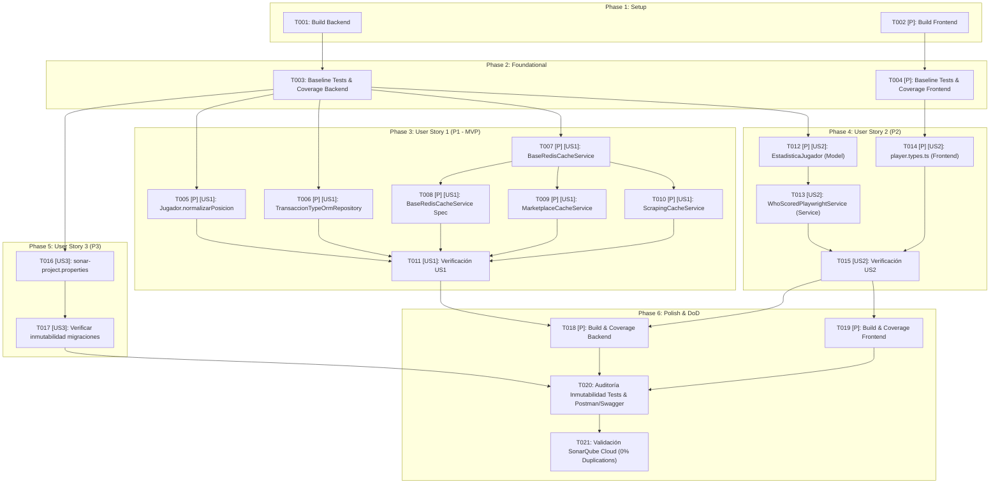

---

description: "Lista de tareas de implementación para la reducción integral de duplicación de código en SonarQube Cloud"
---

# Tasks: Reducción Integral de Duplicación de Código en SonarQube Cloud

**Input**: Documentos de diseño desde `/specs/016-reduce-sonar-duplications/` (`plan.md`, `spec.md`, `research.md`, `quickstart.md`) y `.specify/memory/constitution.md`

**Prerequisites**: `plan.md` (requerido), `spec.md` (requerido para historias de usuario), `research.md`, `quickstart.md`

**Tests**: Se incluye la creación de pruebas unitarias para la nueva clase abstracta `BaseRedisCacheService` (`backend/test/unit/services/base-redis-cache.service.spec.ts`) y la verificación de todas las suites preexistentes cumpliendo la **Política Estricta de Inmutabilidad de Tests (Principio IV)** y el **umbral mínimo de cobertura ≥ 80% en líneas y ramas (Principio VI)** en `backend` y `frontend`.

**Organization**: Las tareas están agrupadas por historia de usuario (P1, P2, P3) para permitir la implementación, prueba y validación independiente de cada incremento.

## Format: `[ID] [P?] [Story] Description`

- **[P]**: Puede ejecutarse en paralelo (archivos distintos, sin dependencias de tareas incompletas)
- **[Story]**: Historia de usuario a la que pertenece la tarea (`[US1]`, `[US2]`, `[US3]`)
- Todas las descripciones incluyen las rutas de archivo exactas del repositorio

## Path Conventions

- **Web app full-stack**: `backend/src/`, `backend/test/`, `frontend/src/`, `frontend/tests/` y `sonar-project.properties` en la raíz del repositorio

---

## Phase 1: Setup (Infraestructura y Verificación de Entorno)

**Purpose**: Verificación inicial de compilación y estado limpio de los módulos `backend` y `frontend` antes de iniciar las refactorizaciones.

- [X] T001 Verificar la compilación limpia (`npm run build`) y configuración de TypeScript del módulo backend en `backend/package.json` y `backend/tsconfig.json`
- [X] T002 [P] Verificar la compilación limpia (`npm run build`) y configuración de TypeScript del módulo frontend en `frontend/package.json` y `frontend/tsconfig.json`

---

## Phase 2: Foundational (Prerrequisitos de Gobernanza e Inmutabilidad de Pruebas)

**Purpose**: Establecer la línea base de pruebas automatizadas y cobertura mínima (≥ 80% líneas y ramas) que ninguna historia de usuario puede degradar ni alterar (Principios III, IV y VI de la Constitución).

**⚠️ CRITICAL**: Ninguna tarea de las Historias de Usuario puede comenzar hasta confirmar esta línea base.

- [X] T003 Ejecutar la línea base de pruebas y cobertura del backend (`npm run test:cov`) verificando el estado limpio de las suites existentes bajo `backend/test/` desde `backend/package.json`
- [X] T004 [P] Ejecutar la línea base de pruebas y cobertura del frontend (`npm run test:coverage`) verificando el estado limpio de las suites existentes bajo `frontend/tests/` desde `frontend/package.json`

**Checkpoint**: Línea base verificada — la implementación de las Historias de Usuario puede comenzar en paralelo o por orden de prioridad.

---

## Phase 3: User Story 1 - Consolidación de Lógica Duplicada en Dominio, Persistencia y Servicios de Caché (Priority: P1) 🎯 MVP

**Goal**: Eliminar 131 de las 199 líneas duplicadas en código productivo (65,8% de la duplicación productiva, 6 bloques en 4 archivos del módulo `backend`) consolidando las reglas de normalización de posición en la entidad `Jugador` (Capa `Model`), el filtrado y ejecución de consultas en `TransaccionTypeOrmRepository` (Capa `Data Access`) y la gestión común de caché L1 Redis en `BaseRedisCacheService` para `MarketplaceCacheService` y `ScrapingCacheService` (Capa `Service`).

**Independent Test**: Verificar que `backend/src/domain/jugador.entity.ts` (43 líneas dup → 0), `backend/src/data-access/transaccion.typeorm-repository.ts` (34 líneas dup → 0), `backend/src/services/marketplace-cache.service.ts` (27 líneas dup → 0) y `backend/src/scraping/services/scraping-cache.service.ts` (27 líneas dup → 0) compilan sin errores, reportan 0 bloques duplicados y pasan el 100% de las pruebas unitarias y de integración (incluyendo la nueva suite `backend/test/unit/services/base-redis-cache.service.spec.ts` con cobertura ≥ 80% en líneas y ramas).

### Implementation & Unit Tests for User Story 1

- [X] T005 [P] [US1] Consolidar declarativamente las reglas de `Jugador.normalizarPosicion` mediante la constante inmutable `REGLAS_NORMALIZACION_POSICION` e iteración con `.find()` y `.some()` (eliminando 43 líneas / 2 bloques duplicados) en `backend/src/domain/jugador.entity.ts`
- [X] T006 [P] [US1] Extraer el tipo interno `FiltroComunTransacciones` y el método privado `aplicarFiltrosYEjecutar` para centralizar filtrado (`jugadorId`, `desde`, `hasta`), ordenamiento, paginación y mapeo entre `listarPorUsuario` y `listarAuditoriaGlobal` (eliminando 34 líneas / 2 bloques duplicados) en `backend/src/data-access/transaccion.typeorm-repository.ts`
- [X] T007 [P] [US1] Crear la clase abstracta `BaseRedisCacheService` implementando `OnModuleDestroy` con inicialización tolerante a fallos del cliente `Redis` y métodos protegidos `guardarJson`, `obtenerJson` y `eliminarPorPatron` en `backend/src/services/base-redis-cache.service.ts`
- [X] T008 [P] [US1] Crear la suite de pruebas unitarias para `BaseRedisCacheService` cubriendo inicialización, lectura/escritura JSON, eliminación por patrón, degradación elegante ante errores de Redis y cierre en `onModuleDestroy` (cobertura ≥ 80% en líneas y ramas, depende de T007) en `backend/test/unit/services/base-redis-cache.service.spec.ts`
- [X] T009 [P] [US1] Refactorizar `MarketplaceCacheService` para extender `BaseRedisCacheService` preservando `constructor(@Optional() injectedRedis?: Redis)` y delegando las operaciones de caché (eliminando 27 líneas / 1 bloque duplicado, depende de T007) en `backend/src/services/marketplace-cache.service.ts`
- [X] T010 [P] [US1] Refactorizar `ScrapingCacheService` para extender `BaseRedisCacheService` preservando `constructor(@Optional() injectedRedis?: Redis)` y delegando las operaciones de caché (eliminando 27 líneas / 1 bloque duplicado, depende de T007) en `backend/src/scraping/services/scraping-cache.service.ts`
- [X] T011 [US1] Verificar la ejecución exitosa de las pruebas de dominio, persistencia y caché de la Historia de Usuario 1 sin modificar tests preexistentes (incluyendo `backend/test/unit/domain/jugador.entity.spec.ts` y `backend/test/unit/services/base-redis-cache.service.spec.ts`)

**Checkpoint**: La Historia de Usuario 1 (MVP) se encuentra completamente funcional, con 131 líneas duplicadas eliminadas y verificable de forma independiente.

---

## Phase 4: User Story 2 - Unificación de Estructuras de Métricas Estadísticas entre Dominio, Ingesta y Vista (Priority: P2)

**Goal**: Eliminar las 68 líneas restantes de duplicación en código productivo (34,2% de la duplicación productiva, 5 bloques en 3 archivos de `backend` y `frontend`) unificando la definición de métricas estadísticas en `EstadisticaJugador` (Capa `Model`), reutilizándola en `RawWhoScoredPlayerStats` (Capa `Service -> Model`) y estructurando `EstadisticasJugador` en la vista (Capa `Frontend`) sin acoplar compilaciones entre módulos.

**Independent Test**: Verificar que `backend/src/scraping/domain/estadistica-jugador.entity.ts` (26 líneas dup → 0), `backend/src/scraping/services/whoscored-playwright.service.ts` (26 líneas dup → 0) y `frontend/src/types/player.types.ts` (16 líneas dup → 0) compilan sin errores de tipos en ambos módulos y mantienen intactas todas las pruebas de dominio estadístico, ingesta y visualización de jugador (`StatsGrid.tsx`).

### Implementation for User Story 2

- [X] T012 [P] [US2] Dividir `CAMPOS_ACTUALIZABLES` en `CAMPOS_CONTADORES_ESTADISTICOS` (6 contadores) y `CAMPOS_METRICAS_OPCIONALES` (19 métricas), exportar `MetricasEstadisticasJugador` y hacer que `EstadisticaJugadorProps` extienda dicho tipo (eliminando 26 líneas / 2 bloques duplicados) en `backend/src/scraping/domain/estadistica-jugador.entity.ts`
- [X] T013 [US2] Importar `MetricasEstadisticasJugador` desde la capa de dominio (`Service -> Model`) y refactorizar `RawWhoScoredPlayerStats` para extender `MetricasEstadisticasJugador` (eliminando 26 líneas / 2 bloques duplicados, depende de T012) en `backend/src/scraping/services/whoscored-playwright.service.ts`
- [X] T014 [P] [US2] Definir el tipo unión `CampoMetricaOpcionalJugador` y refactorizar `EstadisticasJugador` mediante `Partial<Record<CampoMetricaOpcionalJugador, number | null>>` conservando los 8 campos obligatorios de cabecera (eliminando 16 líneas / 1 bloque duplicado) en `frontend/src/types/player.types.ts`
- [X] T015 [US2] Verificar la compilación de tipos y pruebas existentes de estadísticas e ingesta en `backend/src/scraping/domain/estadistica-jugador.entity.ts`, `backend/src/scraping/services/whoscored-playwright.service.ts` y `frontend/src/types/player.types.ts`

**Checkpoint**: El 100% del código productivo (7 archivos, 11 bloques, 199 líneas duplicadas) queda libre de duplicación en `backend` y `frontend`.

---

## Phase 5: User Story 3 - Delimitación del Alcance de Análisis Frente a Migraciones Históricas de Esquemas (Priority: P3)

**Goal**: Excluir de la evaluación de duplicación de código (CPD) en SonarQube Cloud las 3 migraciones históricas e inmutables de esquemas TypeORM (363 líneas duplicadas en 12 bloques), preservando intacto su contenido histórico y manteniendo activo sobre ellas el resto del análisis estático de calidad y seguridad.

**Independent Test**: Comprobar que `sonar-project.properties` incluye `sonar.cpd.exclusions=backend/src/migrations/**`, que los 3 archivos en `backend/src/migrations/` no presentan modificaciones en `git diff` y que el reporte de duplicación global (`Overall Code` y `New Code`) cae a `0` líneas duplicadas (`0.0%`).

### Implementation for User Story 3

- [X] T016 [US3] Agregar la directiva `sonar.cpd.exclusions=backend/src/migrations/**` para excluir del cálculo de duplicación (CPD) las 3 migraciones históricas (363 líneas / 12 bloques) en `sonar-project.properties`
- [X] T017 [US3] Verificar que los 3 archivos históricos de migración permanezcan sin modificaciones en `backend/src/migrations/1710000000000-InitialCatalogSchema.ts`, `backend/src/migrations/1711000000000-ScrapingStatsSchema.ts` y `backend/src/migrations/1712000000000-MarketplaceTradingSchema.ts`

**Checkpoint**: Todas las historias de usuario (P1, P2 y P3) están completas, cubriendo los 10 archivos, 23 bloques y 562 líneas duplicadas del proyecto.

---

## Phase 6: Polish & Cross-Cutting Concerns (Validación Integral y Definition of Done)

**Purpose**: Verificación transversal de compilación, umbrales de cobertura (≥ 80% líneas y ramas en cada stack), inmutabilidad de tests preexistentes, sincronización de contratos OpenAPI/Postman y auditoría final en SonarQube Cloud.

- [X] T018 [P] Ejecutar la compilación final (`npm run build`) y reporte de cobertura completa (`npm run test:cov`, verificando ≥ 80% en `lines` y ≥ 80% en `branches`) del backend desde `backend/package.json`
- [X] T019 [P] Ejecutar la compilación final (`npm run build`) y reporte de cobertura completa (`npm run test:coverage`, verificando ≥ 80% en `lines` y ≥ 80% en `branches`) del frontend desde `frontend/package.json`
- [X] T020 Auditar con `git status` y `git diff` la inmutabilidad de todos los tests preexistentes (Principio IV) y la ausencia de alteraciones en controladores REST, OpenAPI/Swagger y colección Postman (DoD) sobre `backend/test/`, `frontend/tests/`, `backend/src/controllers/` y `postman/`
- [X] T021 Validar la guía de verificación integral y comprobar mediante `.agents/skills/sonarqube-speckit/scripts/sonarcloud_issues.py` que SonarQube Cloud reporte `0` líneas duplicadas, `0` bloques duplicados y `0.0%` de densidad según `specs/016-reduce-sonar-duplications/quickstart.md`

---

## Dependencies & Execution Order

### Grafo de Dependencias por Fase e Historia de Usuario



### Phase Dependencies

- **Setup (Phase 1)**: Sin dependencias previas — puede comenzar de inmediato (`T001` y `T002` en paralelo).
- **Foundational (Phase 2)**: Depende de Setup — **BLOQUEA** el inicio de las historias de usuario hasta confirmar la línea base de pruebas (`T003` y `T004` en paralelo).
- **User Stories (Phases 3, 4 y 5)**: Dependen de la finalización de Foundational (Phase 2).
  - **US1 (P1)**, **US2 (P2)** y **US3 (P3)** afectan conjuntos de archivos disjuntos y pueden ejecutarse en paralelo o secuencialmente en orden de prioridad (P1 → P2 → P3).
- **Polish (Phase 6)**: Depende de que las tres historias de usuario (US1, US2 y US3) hayan finalizado.

### Within Each User Story

- **User Story 1 (P1)**:
  - `T005` (`jugador.entity.ts`), `T006` (`transaccion.typeorm-repository.ts`) y `T007` (`base-redis-cache.service.ts`) afectan archivos independientes y pueden ejecutarse en paralelo.
  - Una vez completada `T007`, las tareas `T008` (`base-redis-cache.service.spec.ts`), `T009` (`marketplace-cache.service.ts`) y `T010` (`scraping-cache.service.ts`) pueden ejecutarse en paralelo.
  - `T011` valida de forma integral la Historia de Usuario 1 al concluir `T005`–`T010`.
- **User Story 2 (P2)**:
  - `T012` (`estadistica-jugador.entity.ts`) y `T014` (`frontend/src/types/player.types.ts`) pueden ejecutarse en paralelo.
  - `T013` (`whoscored-playwright.service.ts`) depende de `T012` porque importa `MetricasEstadisticasJugador` desde la entidad de dominio.
  - `T015` valida la compilación y pruebas de ambos módulos tras completar `T013` y `T014`.
- **User Story 3 (P3)**:
  - `T016` actualiza `sonar-project.properties` y `T017` comprueba la inmutabilidad de las 3 migraciones históricas.

---

## Parallel Opportunities

### Parallel Example: User Story 1 (P1)

```bash
# Paso 1: Ejecutar en paralelo las refactorizaciones de dominio, persistencia y creación de clase base de caché:
Task T005: "Consolidar declarativamente Jugador.normalizarPosicion en backend/src/domain/jugador.entity.ts"
Task T006: "Extraer aplicarFiltrosYEjecutar en backend/src/data-access/transaccion.typeorm-repository.ts"
Task T007: "Crear BaseRedisCacheService en backend/src/services/base-redis-cache.service.ts"

# Paso 2 (tras completar T007): Ejecutar en paralelo los tests unitarios de la clase base y la adopción en ambos servicios de caché:
Task T008: "Crear suite unitaria de BaseRedisCacheService en backend/test/unit/services/base-redis-cache.service.spec.ts"
Task T009: "Refactorizar MarketplaceCacheService en backend/src/services/marketplace-cache.service.ts"
Task T010: "Refactorizar ScrapingCacheService en backend/src/scraping/services/scraping-cache.service.ts"
```

### Parallel Example: User Story 2 (P2)

```bash
# Ejecutar en paralelo la unificación de métricas en el dominio del backend y en los tipos del frontend:
Task T012: "Exportar MetricasEstadisticasJugador en backend/src/scraping/domain/estadistica-jugador.entity.ts"
Task T014: "Refactorizar EstadisticasJugador con CampoMetricaOpcionalJugador en frontend/src/types/player.types.ts"
```

---

## Implementation Strategy

### MVP First (User Story 1 Only)

1. Completar **Phase 1: Setup** (`T001`–`T002`).
2. Completar **Phase 2: Foundational** (`T003`–`T004`).
3. Completar **Phase 3: User Story 1 (P1)** (`T005`–`T011`).
4. **DETENERSE Y VALIDAR**: Ejecutar las pruebas del backend y verificar que el 65,8% de la duplicación en código productivo (131 de 199 líneas en dominio de jugador, repositorio de transacciones y servicios de caché) ha sido eliminado sin alterar ningún test preexistente.

### Incremental Delivery

1. **Setup + Foundational** → Línea base de compilación, tests e inmutabilidad asegurada.
2. **User Story 1 (P1 - MVP)** → Elimina 131 líneas duplicadas (6 bloques en 4 archivos productivos del núcleo de negocio, persistencia y caché).
3. **User Story 2 (P2)** → Elimina las 68 líneas duplicadas restantes en código productivo (5 bloques en 3 archivos de estadísticas en `backend` y `frontend`), alcanzando 0 líneas duplicadas en código de aplicación.
4. **User Story 3 (P3)** → Excluye del detector CPD las 3 migraciones históricas inmutables (363 líneas en 12 bloques), llevando la duplicación total reportada en SonarQube Cloud a `0.0%` (`0` líneas y `0` bloques).
5. **Polish & Cross-Cutting Concerns** → Certifica el cumplimiento de la Definición de Terminado (DoD), cobertura ≥ 80% en ambos stacks, inmutabilidad de tests y sincronización de contratos Postman/Swagger.

---

## Notes

- Las tareas con `[P]` operan sobre archivos distintos y sin bloqueos entre sí.
- Cada etiqueta `[US1]`, `[US2]`, `[US3]` asegura trazabilidad directa con las historias de usuario y la matriz de 10 archivos / 23 bloques / 562 líneas de `spec.md`.
- **Regla Constitucional IV (No Negociable)**: Ningún archivo de prueba existente puede ser modificado ni eliminado; únicamente se añade `backend/test/unit/services/base-redis-cache.service.spec.ts`.
