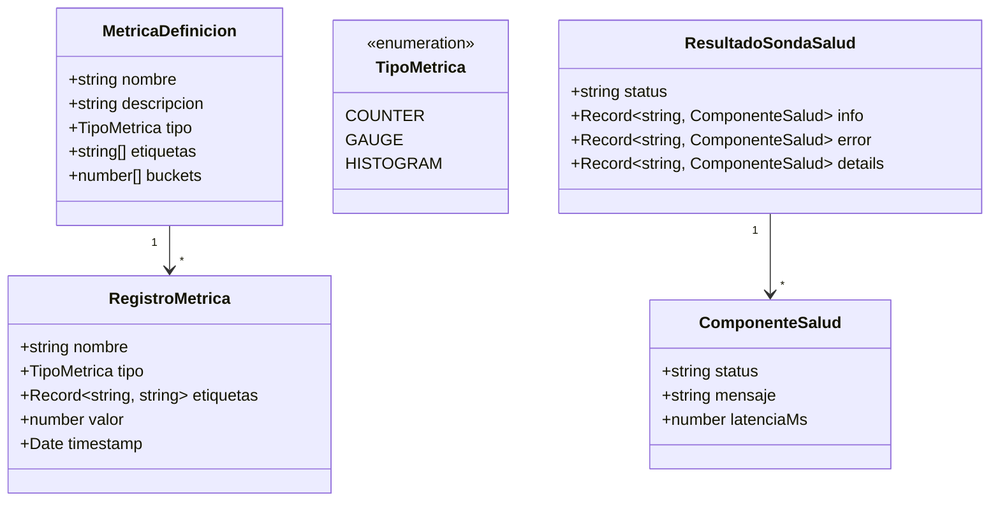
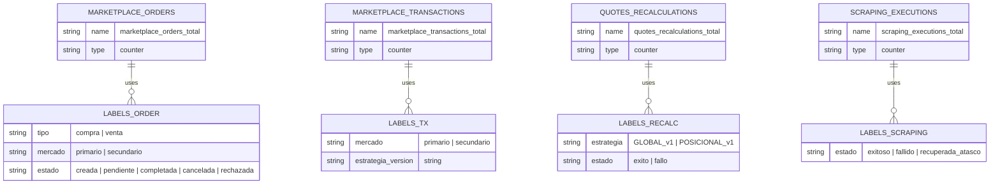

# Data Model: Observabilidad, Métricas de Dominio y Health Checks

**Feature Branch**: `017-backend-observability`  
**Date**: 2026-11-16  
**Status**: Completed  

---

## 1. Entidades y Modelos de Dominio de Observabilidad

Dado que la observabilidad es un componente de soporte transversal y telemetría en tiempo real, no requiere persistencia relacional en PostgreSQL (los datos son efímeros, expuestos vía scraping HTTP por Prometheus y consultados en tiempo real por orquestadores de contenedores). No obstante, los modelos de datos en memoria y los contratos de respuesta deben cumplir estrictas reglas de validación y estructura.

---

## 2. Definición Detallada de Entidades y Value Objects

### 2.1. Definición de Métrica (`MetricaDefinicion`)
Representa la especificación formal de una métrica registrada en el sistema de telemetría de Prometheus.

| Campo | Tipo | Requerido | Descripción y Reglas de Validación |
| :--- | :--- | :---: | :--- |
| `nombre` | `string` | Sí | Identificador canónico en formato `snake_case`. Debe coincidir con la expresión regular `^[a-zA-Z_:][a-zA-Z0-9_:]*$`. Los contadores terminan en `_total` y los histogramas en `_seconds`. |
| `descripcion` | `string` | Sí | Texto explicativo claro en español o inglés del propósito de la métrica (expuesto en la directiva `# HELP`). |
| `tipo` | `TipoMetrica` | Sí | Uno de: `COUNTER`, `GAUGE`, `HISTOGRAM`. |
| `etiquetas` | `string[]` | No | Lista de nombres de dimensiones/labels asociados a la métrica. No deben colisionar con nombres reservados (`job`, `instance`). |
| `buckets` | `number[]` | No | Obligatorio solo para `HISTOGRAM`. Lista ordenada ascendentemente de límites superiores para la agregación de latencias. |

### 2.2. Registro / Evento de Métrica (`RegistroMetrica`)
Representa una muestra o actualización numérica de una métrica en el recolector en memoria.

| Campo | Tipo | Requerido | Descripción y Reglas de Validación |
| :--- | :--- | :---: | :--- |
| `nombre` | `string` | Sí | Nombre de la métrica registrada. |
| `etiquetas` | `Record<string, string>` | Sí | Mapa de clave-valor con las dimensiones del evento (ej: `{ tipo: "compra", mercado: "primario", estado: "completada" }`). |
| `valor` | `number` | Sí | Valor numérico a sumar o fijar. En `COUNTER`, el valor a sumar debe ser $\ge 0$. En `GAUGE`, puede ser cualquier número real. En `HISTOGRAM`, representa la duración en segundos $\ge 0$. |

### 2.3. Sonda de Salud (`ResultadoSondaSalud`)
Payload estandarizado emitido por `@nestjs/terminus` en las rutas `/health/ready` y `/health/live`.

| Campo | Tipo | Requerido | Descripción |
| :--- | :--- | :---: | :--- |
| `status` | `string` | Sí | `'ok'` si todos los indicadores requeridos pasaron; `'error'` si al menos uno falló. |
| `info` | `Record<string, ComponenteSalud>` | No | Diccionario de dependencias o umbrales que reportaron estado exitoso (`status: 'up'`). |
| `error` | `Record<string, ComponenteSalud>` | No | Diccionario de dependencias o umbrales que reportaron fallo (`status: 'down'`), presente en caso de código HTTP 503. |
| `details` | `Record<string, ComponenteSalud>` | Sí | Consolidado total del estado de todos los indicadores evaluados en la verificación. |

### 2.4. Componente de Salud (`ComponenteSalud`)
Detalle de evaluación de una dependencia o recurso de la sonda.

| Campo | Tipo | Requerido | Descripción |
| :--- | :--- | :---: | :--- |
| `status` | `string` | Sí | `'up'` (disponible o dentro de umbral) o `'down'` (no disponible o umbral excedido). |
| `mensaje` | `string` | No | Detalle del error o timeout en caso de caída. |

---

## 3. Catálogo de Métricas y Esquema de Etiquetas

### Detalle de Valores Permitidos en Etiquetas (Enums de Dominio)

1. **`tipo` de orden**:
   - `'compra'`: Operación de adquisición de tokens.
   - `'venta'`: Publicación u orden de venta en el mercado secundario.

2. **`mercado`**:
   - `'primario'`: Compra directa de tokens recién emitidos desde la cartera ADMIN.
   - `'secundario'`: Compra de tokens ofertados por otros usuarios en el libro de órdenes.

3. **`estado` de orden**:
   - `'creada'`: Orden inicializada.
   - `'pendiente'`: Orden de venta en espera de comprador en el libro secundario.
   - `'completada'`: Orden ejecutada y liquidada atómicamente.
   - `'cancelada'`: Orden retirada por el usuario vendedor.
   - `'rechazada'`: Orden no procesada (ej. saldo insuficiente o slippage superado).

4. **`categoria` de jugadores evaluados**:
   - `'procesados'`: Jugadores cuya cotización fue actualizada con éxito.
   - `'sin_estadisticas'`: Jugadores sin estadísticas registradas en la temporada (asignados a valor base $1.00$).
   - `'fallidos'`: Jugadores que experimentaron error individual en el recálculo.

5. **`liga` de scraping**:
   - `'PL'`: Premier League (Inglaterra)
   - `'PD'`: La Liga Primera División (España)
   - `'SA'`: Serie A (Italia)
   - `'BL1'`: Bundesliga (Alemania)
   - `'FL1'`: Ligue 1 (Francia)
   - `'GLOBAL'`: Falla o evento general en todo el pipeline

6. **`dominio` de caché**:
   - `'marketplace'`: Consultas sobre ranking o libros de órdenes.
   - `'scraping'`: Respuestas cacheadas de estadísticas o feeds externos.

---

## 4. Transiciones de Estado e Invariantes

### Invariantes de Métricas
- **Monotonicidad de Contadores**: Para cualquier métrica tipo `Counter` y cualquier vector de etiquetas $L$, $C_L(t_2) \ge C_L(t_1)$ para todo $t_2 > t_1$. Los decrementos están estrictamente prohibidos.
- **Valores Iniciales Garantizados**: Al inicializarse el servicio (`onModuleInit`), todas las series temporales estándar se registran con valor $0$, evitando que consultas iniciales a `/metrics` omitan contadores clave.
- **Tolerancia a Excepciones**: Ninguna excepción originada en la manipulación de métricas se propagará hacia los servicios invocadores.

### Invariantes de Health Checks
- **Readiness Condicional**: La sonda `/health/ready` responderá `200 OK` si y solo si:
  $$\text{PostgreSQL} == \text{UP} \land \text{Redis} == \text{UP} \land \text{FootballDataAPI} == \text{UP}$$
  Si cualquiera de las 3 condiciones es falsa o excede su timeout, el status general es `503 Service Unavailable`.
- **Liveness de Memoria**: La sonda `/health/live` responderá `200 OK` si y solo si:
  $$\text{HeapMemory} < 300\text{ MB} \land \text{RSSMemory} < 1024\text{ MB}$$
  Si el uso de memoria sobrepasa cualquiera de estos dos techos, el status general es `503 Service Unavailable`.
