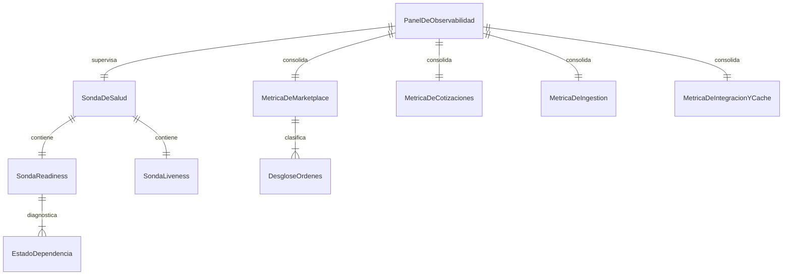
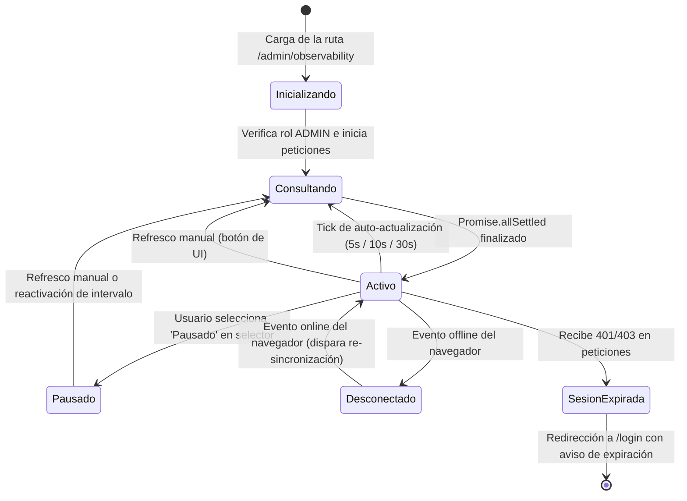

# Data Model: Panel de Observabilidad y Monitoreo en Tiempo Real

**Feature**: `018-frontend-observability-dashboard`  
**Date**: 2026-11-23  
**Status**: Draft

---

## 1. Entidades Principales

### 1.1 PanelDeObservabilidad (Estado del Dashboard)
Representa la sesión operativa del panel de supervisión en el frontend, orquestando el ciclo de vida de los datos, el intervalo de actualización y el estado de conectividad.

| Campo | Tipo | Requerido | Descripción | Reglas de Validación |
|---|---|---|---|---|
| `intervaloRefresco` | `number` | Sí | Milisegundos entre consultas periódicas: `0` (pausado), `5000` (5s), `10000` (10s), `30000` (30s). | Debe ser uno de: `0, 5000, 10000, 30000`. |
| `ultimaSincronizacion` | `Date \| null` | No | Marca de tiempo en que finalizó con éxito el último ciclo de refresco. | Instancia de fecha válida o `null` si no ha sincronizado aún. |
| `estadoConexion` | `'online' \| 'offline'` | Sí | Estado de conectividad de red del navegador del operador. | Detectado vía eventos del navegador. |
| `cargando` | `boolean` | Sí | `true` si alguna de las fuentes está en proceso de consulta inicial. | Booleano. |
| `actualizando` | `boolean` | Sí | `true` durante un refresco manual o automático en segundo plano. | Booleano (no bloquea UI). |
| `error` | `string \| null` | No | Mensaje de error general si fallan todas las fuentes simultáneamente. | Texto descriptivo en español o `null`. |

---

### 1.2 SondaDeSalud (Readiness y Liveness)
Representa los resultados de los health checks provistos por NestJS Terminus en `/health/ready` y `/health/live`.

#### 1.2.1 SondaReadiness (Preparación Operativa)
| Campo | Tipo | Requerido | Descripción | Reglas de Validación |
|---|---|---|---|---|
| `estadoGlobal` | `'ok' \| 'error' \| 'degradado'` | Sí | Estado consolidado de la sonda de preparación. | Derivado de la respuesta HTTP y checks individuales. |
| `baseDatos` | `EstadoDependencia` | Sí | Conectividad y ping a la base de datos relacional PostgreSQL. | Status: `'up' \| 'down'`, tiempo de respuesta en ms opcional. |
| `redis` | `EstadoDependencia` | Sí | Disponibilidad y ping a la capa de caché Redis L1. | Status: `'up' \| 'down'`, mensaje de error si falla. |
| `footballData` | `EstadoDependencia` | Sí | Disponibilidad operativa de la API externa de fútbol. | Status: `'up' \| 'down'`, mensaje de error si falla. |

#### 1.2.2 SondaLiveness (Vitalidad y Memoria)
| Campo | Tipo | Requerido | Descripción | Reglas de Validación |
|---|---|---|---|---|
| `estadoGlobal` | `'ok' \| 'error'` | Sí | Estado consolidado de la vivacidad del proceso. | Derivado de la verificación de memoria de Node.js. |
| `memoriaHeapBytes` | `number` | Sí | Consumo actual de memoria Heap en bytes. | `>= 0`. |
| `umbralHeapBytes` | `number` | Sí | Límite máximo operativo de Heap (300 MB = 314,572,800 bytes). | Fijo a 300 MB. |
| `porcentajeHeap` | `number` | Sí | Porcentaje de uso respecto al umbral (`(memoriaHeap / umbralHeap) * 100`). | `0` a `100+`. Alerta visual si `> 80%`. |
| `memoriaRssBytes` | `number` | Sí | Consumo actual de Resident Set Size (RSS) en bytes. | `>= 0`. |
| `umbralRssBytes` | `number` | Sí | Límite máximo operativo de RSS (1 GB = 1,073,741,824 bytes). | Fijo a 1 GB. |
| `porcentajeRss` | `number` | Sí | Porcentaje de uso de RSS respecto al umbral. | `0` a `100+`. Alerta visual si `> 80%`. |

```typescript
export interface EstadoDependencia {
  estado: 'up' | 'down';
  mensaje?: string;
  tiempoRespuestaMs?: number;
}
```

---

### 1.3 MetricaDeMarketplace (Trading & Liquidez)
Agrupa las métricas extraídas del endpoint `/metrics` referidas al marketplace y al motor de órdenes (OMS).

| Campo | Tipo | Requerido | Descripción | Reglas de Validación |
|---|---|---|---|---|
| `ordenesTotales` | `number` | Sí | Suma total de órdenes registradas en el OMS (`marketplace_orders_total`). | `>= 0`. |
| `ordenesDesglose` | `DesgloseOrdenes[]` | Sí | Detalle por tipo (`compra`/`venta`), mercado (`primario`/`secundario`) y estado. | Matriz estructurada para alimentar gráficos Recharts. |
| `transaccionesTotales` | `number` | Sí | Cantidad total de operaciones de intercambio cerradas (`marketplace_transactions_total`). | `>= 0`. |
| `volumenCentavosTotal` | `number` | Sí | Importe monetario acumulado transaccionado en centavos (`marketplace_volume_cents_total`). | `>= 0`. |
| `volumenMonetarioFormateado` | `string` | Sí | Representación en moneda estándar (ej. `$1,250.00` o `125,000 pts`). | Formateado con separadores de miles y decimales. |
| `ordenesVentaActivas` | `number` | Sí | Conteo actual de órdenes de venta en espera de contraparte (`marketplace_active_sell_orders`). | Gauge actual `>= 0`. |
| `rechazosSlippage` | `number` | Sí | Total de órdenes rechazadas por variación de cotización (`marketplace_slippage_rejections_total`). | Counter `>= 0`. |
| `latenciaLiquidacionPromedioSegundos` | `number` | Sí | Duración promedio de liquidación con locks pesimistas (`_sum / _count`). | Si `_count > 0` es `_sum / _count`, sino `0`. |

```typescript
export interface DesgloseOrdenes {
  tipo: 'compra' | 'venta';
  mercado: 'primario' | 'secundario';
  estado: 'creada' | 'pendiente' | 'completada' | 'cancelada' | 'rechazada';
  cantidad: number;
}
```

---

### 1.4 MetricaDeCotizaciones (Pricing & Valuación)
Agrupa los indicadores sobre la estabilidad, desempeño y reglas del motor de recálculo masivo de cotizaciones.

| Campo | Tipo | Requerido | Descripción | Reglas de Validación |
|---|---|---|---|---|
| `recalculosExitosos` | `number` | Sí | Corridas de recálculo finalizadas con estado `exito`. | `>= 0`. |
| `recalculosFallidos` | `number` | Sí | Corridas de recálculo con error (`fallo`). | `>= 0`. |
| `tasaExitoRecalculos` | `number` | Sí | Porcentaje de éxito (`(exitosos / totales) * 100`). | `0` a `100%`. Si totales es `0`, devuelve `100%`. |
| `duracionPromedioSegundos` | `number` | Sí | Tiempo promedio de ejecución del recálculo masivo (`_sum / _count`). | `>= 0`. |
| `jugadoresProcesados` | `number` | Sí | Futbolistas evaluados con estadísticas deportivas completas. | `>= 0`. |
| `jugadoresSinEstadisticas` | `number` | Sí | Futbolistas evaluados con reglas por defecto. | `>= 0`. |
| `jugadoresFallidos` | `number` | Sí | Futbolistas cuya valuación arrojó error. | `>= 0`. |
| `estrategiaActiva` | `string` | Sí | Denominación y versión de la estrategia activa (`GLOBAL_v1`, `POSICIONAL_v1`). | Identificada mediante gauge `quotes_active_strategy == 1`. |

---

### 1.5 MetricaDeIngestion (Scraping de Datos Deportivos)
Agrupa las métricas sobre el pipeline automatizado de extracción de WhoScored / Playwright.

| Campo | Tipo | Requerido | Descripción | Reglas de Validación |
|---|---|---|---|---|
| `ejecucionesExitosas` | `number` | Sí | Ejecuciones completadas sin incidencias. | `>= 0`. |
| `ejecucionesFallidas` | `number` | Sí | Ejecuciones que concluyeron en fallo. | `>= 0`. |
| `ejecucionesRecuperadas` | `number` | Sí | Ejecuciones que sufrieron atasco pero fueron rescatadas. | `>= 0`. |
| `duracionPorLiga` | `Record<string, number>` | Sí | Duración promedio en segundos de extracción por liga (`PL`, `PD`, `SA`, `BL1`, `FL1`). | Diccionario clave-valor con promedio `>= 0`. |
| `tasaAsociacionPorLiga` | `Record<string, number>` | Sí | Porcentaje de match entre jugadores scrapeados y catálogo oficial (0 a 100). | Valores entre `0` y `100`. |
| `incidentesTotales` | `number` | Sí | Conteo consolidado de incidentes o reintentos anómalos. | `>= 0`. |

---

### 1.6 MetricaDeIntegracionYCache (Infraestructura de Soporte, Caché y Auth)
Agrupa métricas de rate limiting externo, rendimiento de caché L1 y telemetría de autenticación.

| Campo | Tipo | Requerido | Descripción | Reglas de Validación |
|---|---|---|---|---|
| `footballDataRequests` | `number` | Sí | Total de solicitudes HTTP enviadas a Football-Data.org. | `>= 0`. |
| `footballDataRateLimitRemaining` | `number` | Sí | Solicitudes restantes antes de agotar cuota por minuto. | `>= 0`. Alerta si `<= 2`. |
| `cacheHits` | `number` | Sí | Total de consultas servidas exitosamente desde Redis L1 (`cache_requests_total{resultado="hit"}`). | `>= 0`. |
| `cacheMisses` | `number` | Sí | Consultas que no estaban en caché (`resultado="miss"`). | `>= 0`. |
| `cacheHitRatio` | `number` | Sí | Porcentaje de aciertos: `(hits / (hits + misses)) * 100`. | `0` a `100%`. Si total es 0, `100%`. |
| `cacheFallbacks` | `number` | Sí | Activaciones del mecanismo de respaldo a DB por indisponibilidad de Redis. | `>= 0`. Alerta si `> 0`. |
| `totwGeneraciones` | `number` | Sí | Conteo de ejecuciones del scheduler de Equipo de la Semana. | `>= 0`. |
| `totwDuracionSegundos` | `number` | Sí | Duración promedio de cálculo de TOTW. | `>= 0`. |
| `authIntentosExitosos` | `number` | Sí | Intentos de login con credenciales correctas. | `>= 0`. |
| `authIntentosFallidos` | `number` | Sí | Intentos de login rechazados (credenciales inválidas). | `>= 0`. |
| `authLatenciaHashingPromedio` | `number` | Sí | Duración promedio de cómputo de hashing con bcrypt en segundos. | `>= 0`. |

---

## 2. Diagrama de Entidades del Panel



---

## 3. Transiciones de Estado y Manejo de Conectividad



---

## 4. Reglas de Validación e Invariantes de Negocio

1. **Invariante de División Segura**: Ningún cálculo porcentual (ej. ratio de aciertos de caché, tasa de éxito de recálculos, latencias promedio de histogramas) puede resultar en `NaN` o `Infinity`. Cuando los denominadores sean `0`, se deben suministrar valores predeterminados seguros (`0%`, `100%` en hit-ratio nominal sin tráfico, o estados descriptivos como `"Sin datos en el período"`).
2. **Invariante de Moneda y Formateo**: Todos los valores de volumen monetario registrados en centavos (`marketplace_volume_cents_total`) deben dividirse entre 100 para representarse en unidades de crédito/moneda en la interfaz, con formato numérico localizado en español (`1.250,50` o `$1.250,50`).
3. **Invariante de Límites y Alertas Visuales**:
   - Memoria Heap / RSS: Si el consumo supera el 80% del umbral operativo (Heap > 240 MB o RSS > 819 MB), la tarjeta debe adoptar estilo de advertencia (`warning` / amarillo). Si supera el 95%, debe adoptar estilo de peligro (`critical` / rojo).
   - Rate limit de Football-Data: Si las solicitudes restantes son `<= 2`, debe resaltarse con badge de alerta urgente.
   - Fallbacks de caché: Si `cache_fallback_total > 0`, debe exhibirse una advertencia indicando que la base de datos está asumiendo tráfico de contingencia.
