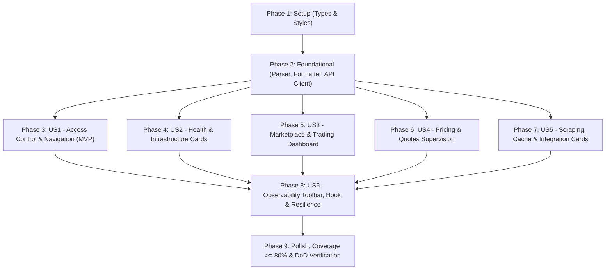

# Tasks: Panel de Observabilidad y Monitoreo en Tiempo Real para Administradores

**Input**: Design documents from `/specs/018-frontend-observability-dashboard/`
- Spec: [spec.md](file:///home/ale/Escritorio/Repositorios/dapps2026GrupoQ/specs/018-frontend-observability-dashboard/spec.md)
- Plan: [plan.md](file:///home/ale/Escritorio/Repositorios/dapps2026GrupoQ/specs/018-frontend-observability-dashboard/plan.md)
- Data Model: [data-model.md](file:///home/ale/Escritorio/Repositorios/dapps2026GrupoQ/specs/018-frontend-observability-dashboard/data-model.md)
- Research: [research.md](file:///home/ale/Escritorio/Repositorios/dapps2026GrupoQ/specs/018-frontend-observability-dashboard/research.md)
- Contracts: [observability-api.contract.md](file:///home/ale/Escritorio/Repositorios/dapps2026GrupoQ/specs/018-frontend-observability-dashboard/contracts/observability-api.contract.md), [observability-client.contract.md](file:///home/ale/Escritorio/Repositorios/dapps2026GrupoQ/specs/018-frontend-observability-dashboard/contracts/observability-client.contract.md)
- Quickstart: [quickstart.md](file:///home/ale/Escritorio/Repositorios/dapps2026GrupoQ/specs/018-frontend-observability-dashboard/quickstart.md)
- Constitution: [.specify/memory/constitution.md](file:///home/ale/Escritorio/Repositorios/dapps2026GrupoQ/.specify/memory/constitution.md)

**Tests**: Included in accordance with Constitution Principles III (Testing Strategy), VI (Coverage >= 80%), and DoD.

**Organization**: Tasks are grouped by user story to enable independent implementation and testing of each story.

## Format: `- [ ] [TaskID] [P?] [Story?] Description with file path`

- **[P]**: Can run in parallel (different files, no dependencies on incomplete tasks)
- **[Story]**: Which user story this task belongs to (e.g., [US1], [US2], [US3], [US4], [US5], [US6])
- Include exact file paths in descriptions

---

## Phase 1: Setup (Shared Infrastructure)

**Purpose**: Definición de tipos, contratos TypeScript y estilos compartidos para el panel de observabilidad.

- [X] T001 [P] Crear tipos e interfaces de observabilidad en frontend/src/types/observability.types.ts con validaciones exactas: intervaloRefresco "Debe ser uno de: 0, 5000, 10000, 30000", estadoConexion "'online' | 'offline'", umbralHeapBytes "Fijo a 300 MB (314,572,800 bytes)", umbralRssBytes "Fijo a 1 GB (1,073,741,824 bytes)", y estructuras para SondaReadinessData, SondaLivenessData, MetricaDeMarketplace, MetricaDeCotizaciones, MetricaDeIngestion y MetricaDeIntegracionYCache
- [X] T002 [P] Crear hoja de estilos CSS para layout responsive, tarjetas de telemetría y badges de estado en frontend/src/styles/observability.css

---

## Phase 2: Foundational (Blocking Prerequisites)

**Purpose**: Componentes y utilidades fundamentales requeridos por todas las historias de usuario (parser puro Prometheus, helpers de cálculo seguro y cliente de telemetría).

**⚠️ CRITICAL**: Ninguna historia de usuario visual puede implementarse hasta completar esta fase.

- [X] T003 [P] Crear suite de pruebas unitarias para el parser de Prometheus en frontend/tests/unit/utils/prometheus-parser.test.ts cubriendo contadores, gauges, histogramas (_bucket, _sum, _count), comentarios HELP/TYPE, labels con comillas y casos borde (texto vacío, sin samples, valores flotantes/científicos)
- [X] T004 Implementar parser determinista de texto Prometheus en frontend/src/utils/prometheus-parser.ts según contrato parsePrometheusText (satisfaciendo T003)
- [X] T005 [P] Crear suite de pruebas unitarias para helpers de cálculo y formateo en frontend/tests/unit/utils/formato-observabilidad.test.ts validando invariantes: división segura contra NaN e Infinity (tasaExitoRecalculos "0 a 100%. Si totales es 0, devuelve 100%", cacheHitRatio "0 a 100%. Si total es 0, 100%", latenciaLiquidacionPromedioSegundos "Si _count > 0 es _sum / _count, sino 0"), conversión de centavos a moneda dividiendo entre 100, y umbrales de alerta de memoria (>80% warning, >95% critical)
- [X] T006 Implementar helpers de cálculo y formateo de telemetría en frontend/src/utils/formato-observabilidad.ts (satisfaciendo T005)
- [X] T007 [P] Crear suite de pruebas unitarias para el cliente de API de observabilidad en frontend/tests/unit/api/observabilityApi.test.ts testeando llamadas a /metrics (text/plain), /health/ready (JSON 200 y 503 Terminus) y /health/live (JSON 200 y 503 Terminus) con dobles de red controlados
- [X] T008 Implementar cliente API de observabilidad en frontend/src/api/observabilityApi.ts implementando la interfaz ObservabilityApi para consumir /metrics, /health/ready y /health/live interpretando 200 y 503 como diagnósticos válidos (satisfaciendo T007)

**Checkpoint**: Base de telemetría y parsing lista - la implementación de historias de usuario puede comenzar.

---

## Phase 3: User Story 1 - Control de Acceso y Navegación Exclusiva para Administradores (Priority: P1) 🎯 MVP

**Goal**: Asegurar que únicamente usuarios con rol 'ADMIN' puedan ver el enlace de navegación y acceder a /admin/observability, redirigiendo a visitantes anónimos a /login y a usuarios estándar a / con advertencia de seguridad.

**Independent Test**: Verificar mediante pruebas aisladas que intentar ingresar a /admin/observability como visitante anónimo redirige a /login, como rol 'USUARIO' redirige a / con advertencia de seguridad, y como rol 'ADMIN' permite el acceso y muestra el enlace 'Observabilidad' en el navbar.

### Tests for User Story 1 ⚠️

- [X] T009 [P] [US1] Crear prueba unitaria para inclusión condicional de Observabilidad en frontend/tests/unit/utils/navegacion.rol.test.ts verificando que construirItemsNavegacion incluye el ítem 'Observabilidad' con ruta '/admin/observability' si y solo si rol === 'ADMIN'
- [X] T010 [P] [US1] Crear pruebas de integración para protección de ruta y redirección en frontend/tests/integration/ObservabilityAccess.test.tsx verificando redirección anónima a /login, bloqueo a rol 'USUARIO' con avisoSeguridad hacia /, y acceso concedido para rol 'ADMIN'

### Implementation for User Story 1

- [X] T011 [P] [US1] Actualizar AdminRoute para soportar mensajeSeguridad opcional con retrocompatibilidad en frontend/src/routes/AdminRoute.tsx
- [X] T012 [P] [US1] Actualizar construirItemsNavegacion en frontend/src/utils/navegacion.ts para incorporar el ítem de Observabilidad para rol 'ADMIN'
- [X] T013 [US1] Crear vista base preliminar de observabilidad en frontend/src/views/ObservabilityView.tsx con estructura de encabezado, título y contenedor principal
- [X] T014 [US1] Registrar la ruta protegida /admin/observability en frontend/src/routes/AppRoutes.tsx utilizando ProtectedRoute y AdminRoute envolviendo ObservabilityView

**Checkpoint**: User Story 1 completa y verificable independientemente como MVP de acceso y navegación.

---

## Phase 4: User Story 2 - Monitoreo Visual de Salud de Servicios e Infraestructura (Readiness y Liveness) (Priority: P1)

**Goal**: Proveer tarjetas visuales en tiempo real de conectividad para PostgreSQL, Redis y Football-Data (/health/ready) y medidores de consumo de memoria Heap y RSS contra sus límites operativos de 300 MB y 1 GB (/health/live).

**Independent Test**: Montar HealthStatusCard con dobles de datos simulando servicios saludables (badges verdes) y degradados (badges rojos con causa), así como consumos de memoria Heap y RSS en rangos nominales, advertencia (>80%) y críticos (>95%).

### Tests for User Story 2 ⚠️

- [X] T015 [P] [US2] Crear prueba de integración para el componente HealthStatusCard en frontend/tests/integration/components/HealthStatusCard.test.tsx verificando tarjetas de preparación (PostgreSQL, Redis, FootballData) en estado nominal y degradado (HTTP 503), y barras de progreso de vivacidad (Heap contra 300 MB y RSS contra 1 GB) con clases de alerta visual

### Implementation for User Story 2

- [X] T016 [US2] Implementar componente visual de tarjetas de salud y memoria en frontend/src/components/admin/observability/HealthStatusCard.tsx con badges de disponibilidad y barras de progreso con alertas (>80% advertencia, >95% crítico)
- [X] T017 [US2] Integrar HealthStatusCard en la vista principal en frontend/src/views/ObservabilityView.tsx

**Checkpoint**: Sondas de salud e infraestructura visualizadas y operativas independientemente.

---

## Phase 5: User Story 3 - Telemetría y Dashboards Visuales de Trading y Marketplace (Priority: P1)

**Goal**: Presentar indicadores de volumen monetario, transacciones cerradas, órdenes de venta activas, latencia de settlement y gráfico de órdenes creadas desglosadas por tipo y mercado utilizando Recharts.

**Independent Test**: Renderizar MarketplaceMetricsCard con muestras de Prometheus simuladas y verificar que las métricas monetarias (volumen dividido entre 100), conteo de órdenes, latencia y gráfico de barras Recharts se presenten con etiquetas claras en español.

### Tests for User Story 3 ⚠️

- [X] T018 [P] [US3] Crear prueba de integración para el componente MarketplaceMetricsCard en frontend/tests/integration/components/MarketplaceMetricsCard.test.tsx verificando tarjetas de volumen monetario formateado, transacciones ejecutadas, órdenes de venta activas, rechazos por slippage, latencia promedio y renderizado del gráfico de barras de órdenes

### Implementation for User Story 3

- [X] T019 [US3] Implementar componente MarketplaceMetricsCard en frontend/src/components/admin/observability/MarketplaceMetricsCard.tsx integrando ChartContainer y BarChart de frontend/src/components/ui/chart.tsx junto con tarjetas de resumen transaccional
- [X] T020 [US3] Integrar MarketplaceMetricsCard en la vista principal en frontend/src/views/ObservabilityView.tsx

**Checkpoint**: Panel de trading y métricas de mercado completamente operativo.

---

## Phase 6: User Story 4 - Supervisión del Motor de Valuación y Cotizaciones (Priority: P2)

**Goal**: Visualizar el estado de la estrategia activa de precios, tasa de recálculos exitosos vs fallidos, duración promedio y clasificación de jugadores evaluados (con estadísticas, sin estadísticas, fallidos).

**Independent Test**: Renderizar PricingMetricsCard comprobando que el badge de la estrategia activa (quotes_active_strategy) se resalta correctamente, la tasa de éxito y duración reflejan los datos calculados, y se despliega la distribución de jugadores.

### Tests for User Story 4 ⚠️

- [X] T021 [P] [US4] Crear prueba de integración para el componente PricingMetricsCard en frontend/tests/integration/components/PricingMetricsCard.test.tsx verificando visualización de estrategia activa, tasa porcentual de recálculos exitosos vs fallidos, duración promedio y desglose de jugadores procesados

### Implementation for User Story 4

- [X] T022 [US4] Implementar componente PricingMetricsCard en frontend/src/components/admin/observability/PricingMetricsCard.tsx destacando estrategia activa (ej. GLOBAL_v1), gráficos/tarjetas de recálculos y clasificación de futbolistas
- [X] T023 [US4] Integrar PricingMetricsCard en la vista principal en frontend/src/views/ObservabilityView.tsx

**Checkpoint**: Módulo de supervisión de cotizaciones operativo y testeable por separado.

---

## Phase 7: User Story 5 - Monitoreo de Extracción de Datos (Scraping), Servicios Auxiliares y Caché (Priority: P2)

**Goal**: Exponer telemetría del pipeline de scraping por liga, margen de cuota restante de Football-Data.org (alerta si <= 2), ratio de aciertos de caché Redis L1 (alerta si fallback > 0), TOTW e intentos de autenticación.

**Independent Test**: Renderizar ScrapingMetricsCard y SystemIntegrationCard comprobando que los tiempos por liga, tasa de asociación, cuota de API externa, hit/miss ratio de caché y métricas de autenticación se muestren con alertas específicas ante umbrales críticos.

### Tests for User Story 5 ⚠️

- [X] T024 [P] [US5] Crear prueba de integración para ScrapingMetricsCard en frontend/tests/integration/components/ScrapingMetricsCard.test.tsx verificando desglose de ejecuciones por estado, duración por liga deportiva, tasa de match con catálogo e incidentes
- [X] T025 [P] [US5] Crear prueba de integración para SystemIntegrationCard en frontend/tests/integration/components/SystemIntegrationCard.test.tsx verificando medidor de rate limit restante con advertencia (<= 2), porcentaje de aciertos de caché Redis L1, alerta de fallback de caché (> 0) y tiempos de hashing de auth

### Implementation for User Story 5

- [X] T026 [P] [US5] Implementar componente ScrapingMetricsCard en frontend/src/components/admin/observability/ScrapingMetricsCard.tsx visualizando ejecuciones, duraciones por liga, tasa de match e incidentes
- [X] T027 [P] [US5] Implementar componente SystemIntegrationCard en frontend/src/components/admin/observability/SystemIntegrationCard.tsx visualizando cuota Football-Data, caché L1 Redis, TOTW y telemetría de autenticación
- [X] T028 [US5] Integrar ScrapingMetricsCard y SystemIntegrationCard en la vista principal en frontend/src/views/ObservabilityView.tsx

**Checkpoint**: Monitoreo de scraping, integraciones externas y caché totalmente integrado.

---

## Phase 8: User Story 6 - Controles de Operabilidad, Frecuencia de Actualización y Resiliencia en UI (Priority: P3)

**Goal**: Incorporar barra de herramientas operativa con selector de frecuencia (Pausado, 5s, 10s, 30s), botón de refresco instantáneo, marca de última sincronización, hook orquestador useObservability con Promise.allSettled y aislamiento de errores por tarjeta.

**Independent Test**: Verificar mediante pruebas que el hook useObservability ejecuta polling según el intervalo elegido, maneja refresco manual, pausa consultas ante eventos offline del navegador, limpia temporizadores al desmontarse, maneja sesión expirada (401/403) y aísla fallos de /metrics sin romper /health/ready.

### Tests for User Story 6 ⚠️

- [X] T029 [P] [US6] Crear prueba de integración para el hook useObservability en frontend/tests/integration/hooks/useObservability.test.ts verificando auto-actualización por intervalos (0, 5000, 10000, 30000 ms), refresco manual, Promise.allSettled para aislamiento de fallos, eventos online/offline y limpieza de temporizadores
- [X] T030 [P] [US6] Crear prueba de integración de vista completa y barra de herramientas en frontend/tests/integration/ObservabilityView.test.tsx verificando toolbar, botón de refresco, selector de frecuencia, marca de última sincronización, visualización de errores parciales con botón de reintento y preservación de datos nominales

### Implementation for User Story 6

- [X] T031 [P] [US6] Implementar barra de control en frontend/src/components/admin/observability/ObservabilityToolbar.tsx con selector de intervalo (Pausado [0], 5s, 10s, 30s), botón de refresco manual, estado de conexión (online/offline) y timestamp de última sincronización
- [X] T032 [US6] Implementar hook orquestador useObservability en frontend/src/hooks/useObservability.ts con temporizador configurable, Promise.allSettled hacia /metrics, /health/ready y /health/live, soporte de AbortController, escucha de eventos online/offline y manejo de expiración de sesión (401/403)
- [X] T033 [US6] Conectar useObservability y ObservabilityToolbar en frontend/src/views/ObservabilityView.tsx con manejo de estados de carga (skeletons/spinners), alertas de error aisladas por bloque y botón de reintento

**Checkpoint**: Panel de observabilidad completamente interactivo, auto-actualizable y resiliente ante fallas de red.

---

## Phase 9: Polish & Cross-Cutting Concerns

**Purpose**: Verificación integral de calidad, cobertura de código (>= 80%), compilación y sincronización de contratos/Postman según la Constitución.

- [X] T034 [P] Ejecutar y validar suites de pruebas unitarias y de integración de frontend con reporte de cobertura garantizando umbral >= 80% en líneas y branches vía npm --prefix frontend run test:coverage
- [X] T035 [P] Ejecutar compilación de producción de frontend para asegurar cero errores de TypeScript y empaquetado vía npm --prefix frontend run build
- [X] T036 Verificar y documentar evidencia de sincronización de contratos y colección de Postman en postman/collection.json (carpeta Observabilidad, endpoints /metrics, /health/ready, /health/live) contra los contratos de API y OpenAPI/Swagger

---

## Dependencies & Execution Order

### Phase Dependencies

- **Setup (Phase 1)**: No dependencies - can start immediately.
- **Foundational (Phase 2)**: Depends on Setup (Phase 1) types - BLOCKS all visual user stories.
- **User Story 1 (Phase 3)**: Depends on Phase 1 & 2. Delivers access control, navigation, and base view (MVP).
- **User Story 2 (Phase 4)**: Depends on Phase 1 & 2. Delivers health probe cards (Readiness/Liveness).
- **User Story 3 (Phase 5)**: Depends on Phase 1 & 2. Delivers trading and marketplace charts.
- **User Story 4 (Phase 6)**: Depends on Phase 1 & 2. Delivers pricing and quotes supervision.
- **User Story 5 (Phase 7)**: Depends on Phase 1 & 2. Delivers scraping, quota, cache, and auth metrics.
- **User Story 6 (Phase 8)**: Depends on US1-US5 cards being created. Orchestrates live polling, toolbar, and error recovery.
- **Polish (Phase 9)**: Depends on all user stories being complete.

### User Story Dependencies



### Parallel Opportunities

- **Phase 1**: T001 (types) and T002 (styles) can run in parallel.
- **Phase 2**: T003 (parser test), T005 (formatter test) and T007 (api test) can run in parallel.
- **User Stories (Phase 3 to Phase 7)**: Once Phase 2 completes, test tasks and component implementation across US2, US3, US4, and US5 can be developed in parallel as they operate in isolated component files (`HealthStatusCard.tsx`, `MarketplaceMetricsCard.tsx`, `PricingMetricsCard.tsx`, `ScrapingMetricsCard.tsx`, `SystemIntegrationCard.tsx`).
- **Phase 9**: T034, T035, and T036 can run in parallel.

---

## Parallel Example: User Story 1 & Foundational

```bash
# Launch test tasks for Foundational in parallel:
Task: "frontend/tests/unit/utils/prometheus-parser.test.ts"
Task: "frontend/tests/unit/utils/formato-observabilidad.test.ts"
Task: "frontend/tests/unit/api/observabilityApi.test.ts"

# Launch test tasks for User Story 1 in parallel:
Task: "frontend/tests/unit/utils/navegacion.rol.test.ts"
Task: "frontend/tests/integration/ObservabilityAccess.test.tsx"
```

---

## Implementation Strategy

### MVP First (User Story 1 Only)

1. Complete Phase 1: Setup (types and styles)
2. Complete Phase 2: Foundational (Prometheus parser, formatter helpers, API client)
3. Complete Phase 3: User Story 1 (AdminRoute, navegacion, base ObservabilityView, AppRoutes)
4. **STOP and VALIDATE**: Verify that anonymous and 'USUARIO' roles cannot access `/admin/observability`, while 'ADMIN' accesses the view smoothly. Deploy/commit MVP increment!

### Incremental Delivery

1. **Increment 1 (MVP)**: US1 - Access Control & Navigation (Protected route and navbar link)
2. **Increment 2**: US2 - Health Probes & Memory Gauges (Readiness & Liveness visibility)
3. **Increment 3**: US3 - Marketplace & Trading Dashboard (Transactional volumes & Recharts order breakdown)
4. **Increment 4**: US4 - Pricing & Quotes Engine (Active strategy, calculation timings & player stats)
5. **Increment 5**: US5 - Scraping, Quota, Cache & Auth (External rate limits, Redis hit ratio, scraping health)
6. **Increment 6**: US6 - Real-time Controls & Resilience (Toolbar, polling intervals 0/5s/10s/30s, offline recovery, error isolation)
7. **Increment 7**: Polish, Constitution test coverage >= 80%, TypeScript build validation, and Postman DoD verification.

---

## Notes

- All tasks follow strict format: `- [ ] [TaskID] [P?] [Story?] Description with file path`.
- [P] tasks indicate different files and no blocking dependencies.
- [Story] labels ([US1] through [US6]) provide exact traceability to user stories in `spec.md`.
- Invariants and constraints from `data-model.md` are quoted verbatim to eliminate ambiguity during implementation.
- All code and tests adhere to the 80% line and branch test coverage requirement defined in the Constitution.
